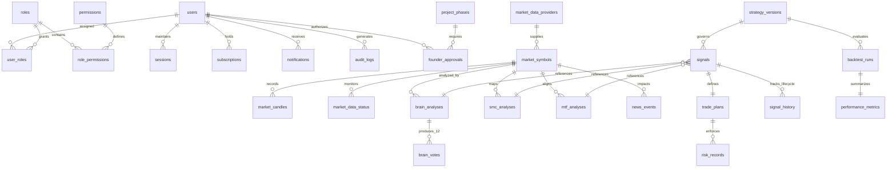

# QUANTUM Trading Intelligence System — Master Project Blueprint

**Document:** Master Blueprint  
**Blueprint Version:** 1.0  
**Project Owner:** Founder  
**Approval Authority:** Founder  
**Development Method:** Step-by-Step, Phase-by-Phase  
**Current Project Status:** `DESIGNED` (Blueprint Only — `NOT IMPLEMENTED`)  

---

## Table of Contents

1. [Project Overview](#1-project-overview)
2. [Project Vision](#2-project-vision)
3. [Objectives](#3-objectives)
4. [Locked Configuration](#4-locked-configuration)
5. [Supported Markets](#5-supported-markets)
6. [Nine Timeframes Architecture](#6-nine-timeframes-architecture)
7. [Execution Timeframe Selection](#7-execution-timeframe-selection)
8. [Independent Timeframe Signals (Mode A)](#8-independent-timeframe-signals-mode-a)
9. [Multi-Timeframe Confirmation (Mode B)](#9-multi-timeframe-confirmation-mode-b)
10. [Trading Methodology](#10-trading-methodology)
11. [Twelve Brains Intelligence Core](#11-twelve-brains-intelligence-core)
12. [Institutional & Smart Money Concepts (SMC) Architecture](#12-institutional--smart-money-concepts-smc-architecture)
13. [Multi-Timeframe (MTF) Intelligence Architecture](#13-multi-timeframe-mtf-intelligence-architecture)
14. [Master Decision Engine](#14-master-decision-engine)
15. [Entry, Execution, and Risk Management](#15-entry-execution-and-risk-management)
16. [News Intelligence](#16-news-intelligence)
17. [Market Protection System](#17-market-protection-system)
18. [Website Architecture & UI/UX Design System](#18-website-architecture--uiux-design-system)
19. [TradingView & Pine Script v6 Integration](#19-tradingview--pine-script-v6-integration)
20. [Frontend Architecture](#20-frontend-architecture)
21. [Backend Architecture](#21-backend-architecture)
22. [Database Architecture & Entity-Relationship Design](#22-database-architecture--entity-relationship-design)
23. [API Architecture](#23-api-architecture)
24. [Security Architecture & Threat Model](#24-security-architecture--threat-model)
25. [Market Data Architecture & Provider Evaluation](#25-market-data-architecture--provider-evaluation)
26. [User Roles & Extensible Permission System](#26-user-roles--extensible-permission-system)
27. [Phase 0–9 Complete Development Roadmap](#27-phase-09-complete-development-roadmap)
28. [Phase Dependencies & Execution Graph](#28-phase-dependencies--execution-graph)
29. [Testing Architecture](#29-testing-architecture)
30. [Backtesting, Walk-Forward, and Optimization Framework](#30-backtesting-walk-forward-and-optimization-framework)
31. [Deployment, Hosting, and Infrastructure](#31-deployment-hosting-and-infrastructure)
32. [Logging, Monitoring, and Observability](#32-logging-monitoring-and-observability)
33. [Backup, Disaster Recovery, and Business Continuity](#33-backup-disaster-recovery-and-business-continuity)
34. [Founder Approval System & Governance](#34-founder-approval-system--governance)
35. [Known Limitations & Technical Risks](#35-known-limitations--technical-risks)
36. [Pending Founder Decisions](#36-pending-founder-decisions)
37. [Future Expansion & Modular Broker Adapters](#37-future-expansion--modular-broker-adapters)
38. [Current Project Status &Intended Repository Structure](#38-current-project-status--intended-repository-structure)
39. [Development Workflow & Change Control](#39-development-workflow--change-control)

---

## 1. Project Overview

**QUANTUM Trading Intelligence** is an institutional-grade, multi-market analytical and decision-support platform designed to evaluate financial markets—specifically **XAUUSD (Spot Gold vs. US Dollar)** and **BTCUSD (Bitcoin vs. US Dollar)**—across nine distinct timeframes (`1M`, `5M`, `15M`, `30M`, `1H`, `4H`, `1D`, `1W`, `1MO`).

Rather than relying on single-indicator triggers or black-box predictions, QUANTUM employs a deterministic, auditable **12-Brain Intelligence Core** combined with **Smart Money Concepts (SMC)**, **Multi-Timeframe (MTF) Alignment**, **Macroeconomic & Crypto News Protection**, and a **Strict Risk Management Engine**. The system evaluates market state on confirmed candle closes to emit explainable, non-repainting decisions: **`BUY`**, **`SELL`**, or **`WAIT`**.

### Core System Pillars
- **Explainable Intelligence:** Every decision (`BUY`, `SELL`, or `WAIT`) includes a structured audit trail detailing the exact vote of all 12 analytical brains, confidence metrics, SMC confirmations, MTF alignment state, and invalidation levels.
- **Confirmed-Only Execution:** All calculations run strictly on closed, validated candles (`barstate.isconfirmed` in Pine Script v6 and verified close timestamps in the backend) to eliminate repainting and lookahead bias.
- **Strict Separation of Voting and Confidence:** Each of the 12 brains casts an equal directional vote (`BUY`, `SELL`, or `NEUTRAL`) alongside a separate quantitative confidence score (`0.00` to `100.00`). Missing or corrupted data yields `DATA UNAVAILABLE` and abstains from voting rather than fabricating a synthetic vote.
- **Dual-Platform Parity:** Synchronized rulesets operating across a full-stack web platform (dashboards, historical backtester, strategy lab, risk calculators) and TradingView **Pine Script v6** indicators/alerts connected via authenticated webhooks.

---

## 2. Project Vision

Financial retail and semi-institutional trading tools frequently fail due to three structural flaws: signal repainting, lack of multi-timeframe context, and absence of automated risk/news protection. QUANTUM's vision is to engineer a transparent, institutional-style trading intelligence architecture that prioritizes capital preservation and analytical rigor above signal frequency.

### Guiding Principles
1. **Reliable Analysis Over Hype:** QUANTUM makes **no promises of guaranteed profits, guaranteed accuracy, or fixed win rates**. Financial markets are probabilistic; QUANTUM is engineered to enforce disciplined execution, quantifiable risk-to-reward profiles, and objective structural validation.
2. **Confirmed Signals Only:** Zero tolerance for intrabar flickering signals or retroactive chart repainting.
3. **Risk Control First:** Every `BUY` or `SELL` output is paired with mathematically defined Entry Zones, Stop Loss (`SL`), Take Profit levels (`TP1`, `TP2`, `TP3`), Position Sizing, Invalidation criteria, and automated vetoes during high-impact news or abnormal spread/volatility regimes.
4. **Data Validation & Integrity:** Strict verification of incoming OHLCV candles, timestamps, gaps, and provider latency. When feeds fail or disconnect, the system explicitly reports `DATA UNAVAILABLE` or `NOT CONNECTED` and defaults to `WAIT`.
5. **Founder-Controlled Governance:** Every architectural milestone, parameter baseline, UI theme selection, and phase transition is gated by explicit Founder review and approval.

---

## 3. Objectives

| Objective Category | Specific Engineering & Product Target | Verification Metric / Acceptance Criteria |
| :--- | :--- | :--- |
| **Analytical Precision** | Implement 12 independent analytical brains with zero overlapping double-counting of evidence. | 100% unit test coverage per brain; deterministic output for identical historical OHLCV inputs. |
| **Multi-Market Isolation** | Independent parameter profiles, pip/tick math, session definitions, and news filters for `XAUUSD` and `BTCUSD`. | Separate configuration schemas and database records per symbol; zero cross-contamination. |
| **Nine-Timeframe Native Support** | Full ingestion, analysis, storage, and UI selection across `1M`, `5M`, `15M`, `30M`, `1H`, `4H`, `1D`, `1W`, `1MO`. | Distinct database composite keys `(symbol, timeframe, timestamp)` and isolated timeframe execution pipelines. |
| **Zero Repainting / Zero Lookahead** | Prevent future candle leakage in MTF alignments and historical backtests. | Automated lookahead-bias test suite comparing bar-by-bar sequential replay against batch historical runs. |
| **Explainability** | Every `BUY`, `SELL`, and `WAIT` decision logs full JSON breakdown and human-readable reasoning. | Every signal record contains all 12 brain outputs, MTF matrix, SMC tags, risk plan, and veto reasons. |
| **Capital & News Protection** | Automatically block or invalidate trade setups during Tier-1 macro events, spread spikes, or daily drawdown breaches. | Simulated high-impact news and drawdown unit tests verify forced `WAIT` state. |
| **Modular Extensibility** | Decouple core intelligence from data ingestion and future broker execution adapters. | Clean interface contracts allowing future broker adapters without altering Phase 1–5 engine code. |

---

## 4. Locked Configuration

The following configuration parameters are **locked** by the Founder. They cannot be silently modified by any future development phase. Any ambiguity or unapproved sub-parameter is marked `PENDING FOUNDER DECISION`.

| Setting | Locked Requirement | Governance / Notes |
| :--- | :--- | :--- |
| **Project** | QUANTUM Trading Intelligence | Master system identifier |
| **Primary Market 1** | `XAUUSD` | Spot Gold / US Dollar |
| **Primary Market 2** | `BTCUSD` | Bitcoin / US Dollar |
| **Trading Style** | Hybrid Sniper + Fast Scalper | Supports precision zone limit/confirmation entries and momentum displacement scalps |
| **Signal Mode** | Confirmed Only | Evaluations execute strictly on confirmed candle close |
| **Decision Mode** | `STRICT` | Requires mandatory minimum brain voting threshold + MTF/SMC/Risk non-veto |
| **Brain Voting** | Equal Voting | All 12 brains carry an equal weight of `1` vote initially (`1/12` each) |
| **Signal Directions** | `BUY`, `SELL`, `WAIT` | Every evaluation cycle must resolve to one of these three deterministic states |
| **Website** | Required | Full web platform with role-based dashboards |
| **Backend** | Required | Core intelligence engine, data ingestion, risk & decision service |
| **Database** | Required | Persistent relational + time-series storage |
| **TradingView** | Pine Script v6 | Custom indicator/strategy script + alert webhook integration |
| **Initial Access** | Private | Invite-only / Founder & Private Tester access initially |
| **Future Access** | Public after Founder approval | Gated by feature flags and explicit Phase 9 sign-off |
| **Initial Auto Trading** | Disabled | Decision-support, paper validation, and alert generation only at launch |
| **Future Broker Integration** | Modular architecture required | Abstract adapter interfaces designed in Phase 0/5 for future live execution |
| **Development Approval** | Founder controlled | Strict step-by-step phase gate approval required |
| **Default Execution Timeframe** | `PENDING FOUNDER DECISION` | System supports all 9 timeframes; default landing timeframe awaits Founder selection |
| **Minimum Brain Vote Threshold** | `PENDING FOUNDER DECISION` | Proposed baseline documented in Section 14; final threshold requires Founder sign-off |
| **UI Color Theme Concept** | `PENDING FOUNDER DECISION` | Concept A, B, or C documented in Section 18 awaits Founder selection |

---

## 5. Supported Markets

QUANTUM natively supports two primary instruments with radically different microstructure, liquidity schedules, volatility profiles, and macroeconomic drivers. Therefore, `XAUUSD` and `BTCUSD` must never share static thresholds.

### 5.1 Market Comparison & Microstructure Specification

| Attribute | Primary Market 1: `XAUUSD` (Gold) | Primary Market 2: `BTCUSD` (Bitcoin) |
| :--- | :--- | :--- |
| **Asset Class** | Spot Commodity / Precious Metal CFD / Bullion | Spot Cryptocurrency |
| **Trading Schedule** | 23 hours/day, 5 days/week (Sunday 22:00 UTC to Friday 21:00 UTC; daily 1-hour rollover break 21:00–22:00 UTC) | 24 hours/day, 7 days/week, 365 days/year (Continuous trading; no weekend close) |
| **Price Quotation & Tick Size** | Quoted in USD per Troy Ounce (typically 2 decimal places, e.g., `2650.45`, tick size `0.01`; broker-dependent `0.001`) | Quoted in USD per BTC (typically 2 decimal places, e.g., `89450.00`, tick size `0.01` or `0.10` depending on feed) |
| **Primary Liquidity Sessions** | Asian (`00:00–08:00 UTC`), London (`07:00–16:00 UTC`), New York (`12:00–21:00 UTC`), London/NY Overlap (`12:00–16:00 UTC` — Peak Volatility) | Global 24/7, but institutional volume clusters around US Equities Open (`13:30–20:00 UTC`), Asian Open (`00:00–04:00 UTC`), and CME BTC Futures hours |
| **Daily Candle (`1D`) Close Reference** | `21:00 UTC` (or `17:00 EST` New York close) to align with institutional FX/Bullion settlement | `00:00 UTC` standard crypto daily close |
| **Typical Volatility Driver** | US Dollar Index (DXY), US Treasury Real Yields (US10Y), Fed Rates, CPI/NFP, Geopolitical risk | Spot ETF inflows/outflows, Exchange perp funding rates, Open Interest liquidations, Regulatory news, Macro liquidity |
| **Weekend Gap Behavior** | Prone to Friday-to-Sunday opening price gaps requiring gap-handling logic | Trades continuously through weekends; CME futures gap proxies tracked separately if enabled |
| **Contract / Lot Specification** | Standard Lot = 100 oz (`0.01` move = `$1.00` per standard lot; broker verification required) | 1 Standard Unit = 1 BTC (`1.00` move = `$1.00` per 1 BTC; broker/exchange verification required) |

---

## 6. Nine Timeframes Architecture

QUANTUM enforces first-class architectural support for all **nine execution and analysis timeframes**.

### 6.1 Mandatory Timeframe Registry

| Internal Identifier | Full Name | Duration in Seconds | Candle Boundary Alignment (UTC) | Primary Analytical Role |
| :--- | :--- | :--- | :--- | :--- |
| **`1M`** | 1 Minute | `60` | Every minute at `:00` seconds | Micro-structure, Fast Scalper execution, precision sweep timing |
| **`5M`** | 5 Minutes | `300` | Minutes `:00, :05, :10, ..., :55` | Intraday Scalper / Sniper execution, LTF CHoCH/BOS confirmation |
| **`15M`** | 15 Minutes | `900` | Minutes `:00, :15, :30, :45` | Intraday structure, session liquidity pools, standard Sniper execution |
| **`30M`** | 30 Minutes | `1,800` | Minutes `:00, :30` | Session equilibrium, intraday order blocks, medium intraday execution |
| **`1H`** | 1 Hour | `3,600` | Top of every hour `HH:00:00` | Intraday-to-swing bridge, structural dealing ranges, HTF confirmation |
| **`4H`** | 4 Hours | `14,400` | `00:00, 04:00, 08:00, 12:00, 16:00, 20:00 UTC` (or NY-aligned for XAUUSD) | Swing structure, high-probability institutional Order Blocks & FVGs |
| **`1D`** | 1 Day | `86,400` | `00:00 UTC` (BTCUSD) / `21:00 UTC` NY Close (XAUUSD configurable) | Daily bias, PDH/PDL (Previous Day High/Low), daily dealing range |
| **`1W`** | 1 Week | `604,800` | Monday `00:00 UTC` (or Sunday `22:00 UTC` market open for XAUUSD) | Weekly bias, PWH/PWL (Previous Week High/Low), macro structural trend |
| **`1MO`** | 1 Month | Calendar Month | 1st day of calendar month `00:00 UTC` | Macro institutional bias, multi-month liquidity pools and dealing ranges |

### 6.2 Strict Identifier Disambiguation Rule
- **`1M` strictly and exclusively denotes 1 Minute.**
- **`1MO` strictly and exclusively denotes 1 Month.**
- Every database column constraint, TypeScript enum, Python Pydantic enum, API query validator, and Pine Script mapping table must validate against `['1M', '5M', '15M', '30M', '1H', '4H', '1D', '1W', '1MO']`. Any ambiguous string (such as lowercase `1m` or `1M` used for month) must be rejected at the API/schema boundary.

### 6.3 Timeframe-Specific Configuration Isolation
A parameter configuration suitable for `1M` (where noise is high and ATR is small) is invalid for `1D` or `1MO`. Therefore, every timeframe maintains an isolated configuration profile in the database per market symbol (`9 timeframes × 2 markets = 18 distinct baseline configuration profiles`):
1. **Indicator Parameters:** Lookback periods for ATR, EMA, RSI/Momentum, Volume moving averages.
2. **Structure Sensitivity:** Minimum swing pivot depth (`leftBars`, `rightBars`) and minimum ATR displacement required to validate a Break of Structure (`BOS`).
3. **Liquidity Sensitivity:** Tolerance in ATR multiples or ticks for Equal Highs (`EQH`) and Equal Lows (`EQL`), plus minimum sweep wick penetration and rejection ratio.
4. **Volatility Thresholds:** Minimum ATR floor (dead market filter) and maximum ATR ceiling (shock expansion veto).
5. **Confirmation Rules:** Required candle body-to-range ratio and displacement velocity.
6. **Entry, Stop Loss, and Take Profit Rules:** Buffer distances in ATR/ticks, maximum acceptable entry zone width, and R-multiple targets (`TP1`, `TP2`, `TP3`).
7. **Signal Expiry:** Maximum number of bars a pending Entry Zone remains valid before automatic expiration (`e.g., 6 bars on 1M vs. 3 bars on 1D`).
8. **Risk Parameters:** Maximum allowed spread-to-SL ratio (e.g., spread cannot exceed X% of SL distance on `1M`).

---

## 7. Execution Timeframe Selection

### 7.1 Functional Specification
- **Purpose:** Allow authorized users (and automated evaluation workers) to select any of the nine timeframes (`1M`, `5M`, `15M`, `30M`, `1H`, `4H`, `1D`, `1W`, `1MO`) as the active **Execution Timeframe**.
- **Function:** Switching the Execution Timeframe dynamically re-scopes the live chart, the 12-Brain analysis matrix, SMC zone overlays, MTF confirmation hierarchy, entry/SL/TP calculations, signal history feed, and performance analytics strictly to the selected timeframe.
- **Default Execution Timeframe:** `PENDING FOUNDER DECISION`.
- **Inputs:** `symbol` (`XAUUSD` | `BTCUSD`), `execution_timeframe` (`1M` | `5M` | `15M` | `30M` | `1H` | `4H` | `1D` | `1W` | `1MO`), `signal_mode` (`MODE_A_INDEPENDENT` | `MODE_B_MTF_CONFIRMED`).
- **Processing:**
  1. Validates that the user has permission to view/select the requested market and timeframe.
  2. Queries the latest confirmed analysis state and candle stream for `(symbol, execution_timeframe)`.
  3. If `MODE_B_MTF_CONFIRMED` is active, loads the configured higher/lower confirmation timeframes mapped to that `execution_timeframe`.
  4. Renders timeframe-stamped signal cards and trade plans.
- **Outputs:** Scoped state payload explicitly tagged with `execution_timeframe`, `candle_close_timestamp`, and `signal_mode`.
- **Validation:** Rejects any API response or UI render where `payload.execution_timeframe !== selected_execution_timeframe`.
- **Error Handling:** If the selected timeframe lacks sufficient historical warm-up bars (e.g., minimum 200 confirmed candles), the system displays `DATA UNAVAILABLE — INSUFFICIENT HISTORICAL BARS FOR [TIMEFRAME]` and forces decision state to `WAIT`.
- **Testing & Acceptance Criteria:** Switching from `5M` to `4H` must immediately display `4H`-specific structure, `4H` brain votes, `4H` entry/SL/TP distances, and `4H` historical metrics with zero cross-timeframe contamination.

---

## 8. Independent Timeframe Signals (Mode A)

### 8.1 Mode A Specification
- **Purpose:** Evaluate a single selected timeframe completely on its own merits without external higher-timeframe or lower-timeframe dependencies (other than internal Brain 2 telemetry, which is marked informational or neutralized in pure Mode A as defined below).
- **Function:** Produces an independent `BUY`, `SELL`, or `WAIT` signal strictly from the OHLCV, structure, liquidity, SMC, momentum, volatility, and news protection state of the selected timeframe `T`.
- **Signal Type Label:** Every Mode A output is explicitly badged and stored in the database as `SIGNAL_TYPE: INDEPENDENT_TIMEFRAME`.
- **Isolation Guarantee:**
  - `1M` Independent Analysis evaluates only `1M` candles and `1M` parameters.
  - `1H` Independent Analysis evaluates only `1H` candles and `1H` parameters.
  - `1MO` Independent Analysis evaluates only `1MO` candles and `1MO` parameters.
- **Separate Persistence & Statistics:** Mode A signals, trade plans, win rates, drawdowns, and backtest runs are stored and queried separately from Mode B signals so performance statistics are never conflated.

---

## 9. Multi-Timeframe Confirmation (Mode B)

### 9.1 Mode B Specification
- **Purpose:** Filter and confirm potential execution setups on the selected Execution Timeframe (`T_exec`) against the structural bias, liquidity draw, and order flow of mapped Higher Timeframes (`HTF`) and/or precision trigger alignment on Lower Timeframes (`LTF`).
- **Function:** When `T_exec` generates a candidate `BUY` or `SELL` setup, the MTF Confirmation Engine evaluates the mapped confirmation timeframes (`T_htf_1`, `T_htf_2`, and optional `T_ltf`). If a conflicting condition is detected (e.g., `T_exec` signals `BUY` directly into an unmitigated `T_htf_1` Bearish Order Block or against `T_htf_1` confirmed bearish BOS), Mode B vetoes the trade and outputs `WAIT` with an explicit conflict explanation.
- **Signal Type Label:** Every Mode B output is explicitly badged and stored as `SIGNAL_TYPE: MTF_CONFIRMED`.

### 9.2 Configurable Timeframe Relationship Matrix
Because all 9 timeframes can serve as the Execution Timeframe, the MTF mapping hierarchy is dynamically determined by the active `execution_timeframe` (and remains configurable per strategy version):

| Selected Execution Timeframe (`T_exec`) | Primary Higher Timeframe (`HTF 1` — Tactical Structure) | Secondary Higher Timeframe (`HTF 2` — Macro Bias / Dealing Range) | Lower Timeframe (`LTF` — Optional Micro Refinement / Intrabar Close) |
| :--- | :--- | :--- | :--- |
| **`1M`** | `5M` | `15M` | None (`1M` is lowest supported timeframe) |
| **`5M`** | `15M` | `1H` | `1M` |
| **`15M`** | `1H` | `4H` | `5M` |
| **`30M`** | `1H` | `4H` | `5M` or `15M` |
| **`1H`** | `4H` | `1D` | `15M` |
| **`4H`** | `1D` | `1W` | `1H` |
| **`1D`** | `1W` | `1MO` | `4H` |
| **`1W`** | `1MO` | `1MO` (Macro structural context) | `1D` |
| **`1MO`** | `1MO` (Self-contained macro structure; HTF cap warning) | None (Top of hierarchy) | `1W` |

*(Note: When `1MO` is selected in Mode B, the system alerts the user that no higher timeframe exists above `1MO` and relies on `1MO` macro structure + `1W` confirmation, or operates in Mode A.)*

---

## 10. Trading Methodology

QUANTUM implements a **Hybrid Sniper + Fast Scalper** methodology operating under **Confirmed-Only (`STRICT`)** rules.

### 10.1 Sniper Sub-Methodology (Precision Structural Reversal & Continuation)
- **Objective:** Enter at high-probability institutional Points of Interest (POIs) where risk distance (`|Entry - SL|`) is tightly bounded by structural invalidation, yielding asymmetric Risk-to-Reward (`R:R >= 1:2.0` to `1:5.0+`).
- **Setup Sequence:**
  1. **HTF / Dealing Range Context:** Price reaches an institutional POI (unmitigated Order Block, Fair Value Gap, Breaker Block, or Premium/Discount extreme) or sweeps an external/internal liquidity pool (`BSL`/`SSL`, `PDH`/`PDL`, `EQH`/`EQL`).
  2. **Structural Shift & Displacement:** Market prints a confirmed Liquidity Sweep rejection or Change of Character (`CHoCH`) / Market Structure Shift (`MSS`) backed by strong displacement (large candle body + FVG creation).
  3. **Confirmed Trigger:** On the confirmed close of the trigger/retest candle inside or rejecting the Entry Zone, the signal transitions to confirmed `BUY` or `SELL`.
  4. **Invalidation:** Strictly placed beyond the structural swing extreme or sweep wick that anchored the POI plus a market/timeframe-specific volatility/spread buffer.

### 10.2 Fast Scalper Sub-Methodology (Momentum & Displacement Continuation)
- **Objective:** Capture high-velocity directional expansions following confirmed Break of Structure (`BOS`), Fair Value Gap continuation, or session liquidity breakouts.
- **Setup Sequence:**
  1. **Directional Momentum & Session Volume:** Active liquid session (e.g., London or NY open for `XAUUSD`, high-volume expansion for `BTCUSD`) with aligned trend and momentum brains.
  2. **Displacement Breakout / Pullback:** Price confirms a `BOS` with displacement volume and immediately respects a shallow micro-FVG or mitigation block without violating internal structure.
  3. **Confirmed Trigger:** Immediate execution on the confirmed close of the continuation candle with tight structural Stop Loss and rapid partial scale-out (`TP1` at `1.0R–1.5R` with automatic Break-Even rule).

---

## 11. Twelve Brains Intelligence Core

The Phase 1 Intelligence Core comprises **12 modular, deterministic analytical brains**.

### 11.1 Mandatory Rules Governing All 12 Brains
1. **Equal Voting Weight:** Every brain holds a voting weight of `1`.
2. **Separation of Vote and Confidence:**
   - `vote`: Enum strictly in `{'BUY', 'SELL', 'NEUTRAL', 'ABSTAIN_DATA_UNAVAILABLE'}`.
   - `confidence`: Float strictly in `[0.00, 100.00]`, measuring signal clarity and strength within that brain's domain. Confidence never multiplies the integer vote count in Equal Voting mode.
3. **Zero Fake Votes on Missing Data:** If required candle history, volume data, or dependent features are missing/corrupted, the brain must output `vote = 'ABSTAIN_DATA_UNAVAILABLE'`, `confidence = 0.0`, and log the exact missing input. It must **never** default to `NEUTRAL` (which implies the market was analyzed and found flat) or fabricate a directional vote.
4. **Orthogonality & Anti-Duplication Rule:** Each brain evaluates a distinct analytical dimension. Two brains must not compute the exact same indicator formula to artificially inflate the vote count for the same underlying evidence.
5. **Market & Timeframe Specific Profiles:** Every brain loads its threshold configuration from a `(symbol, timeframe, strategy_version)` parameter profile.

---

### 11.2 Detailed Specification of Each of the 12 Brains

#### Brain 1: Trend Intelligence (`BRAIN_01_TREND`)
- **Purpose:** Determine the prevailing directional trend regime (Bullish, Bearish, or Ranging/Transitioning) on the active timeframe.
- **Responsibilities:** Evaluate multi-horizon moving average geometry, slope velocity, and directional movement persistence without overlapping with raw oscillator momentum (Brain 9) or swing pivot BOS (Brain 3).
- **Required Inputs:** Confirmed OHLC series (minimum 250 bars), configured Fast/Medium/Slow EMA lengths (e.g., 21, 50, 200), ADX/DMI period, and ATR(14) for slope normalization.
- **Indicators & Calculations:**
  - EMA Stack Alignment: $\text{EMA}_{\text{fast}} > \text{EMA}_{\text{med}} > \text{EMA}_{\text{slow}}$ (Bullish) vs. inverse (Bearish).
  - Normalized EMA Slope: $\frac{\text{EMA}_{\text{med}}[0] - \text{EMA}_{\text{med}}[k]}{k \cdot \text{ATR}(14)}$.
  - Trend Strength Index: ADX(14) paired with $+DI$ and $-DI$ separation.
- **Analysis Methodology:** Confirms a directional trend only when the EMA stack is aligned, normalized slope exceeds the timeframe's minimum slope threshold, and ADX confirms trend regime rather than low-energy chop.
- **Validation Rules:** Close price and all EMA values must be finite numbers (`> 0`).
- **BUY / SELL / NEUTRAL Output:**
  - `BUY`: Bullish EMA alignment + positive normalized slope above threshold + $+DI > -DI$ with ADX above trend floor.
  - `SELL`: Bearish EMA alignment + negative normalized slope below threshold + $-DI > +DI$ with ADX above trend floor.
  - `NEUTRAL`: Mixed EMA stack, flat slope, or ADX below trend floor (choppy/sideways market).
- **Confidence Calculation:** Weighted composite (0–100) of EMA stack separation (35%), normalized slope magnitude capped at 2.5 ATR (35%), and ADX directional strength (30%).
- **Explanation:** Generates deterministic text, e.g., `"Bullish trend confirmed: EMA(21)>EMA(50)>EMA(200), slope +0.42 ATR/bar, ADX 31.4 (+DI 28.1 > -DI 14.2)."`
- **Timestamp:** ISO-8601 UTC timestamp of the confirmed candle close.
- **Error Handling & Missing-Data Behaviour:** If `< 250` confirmed bars exist, returns `ABSTAIN_DATA_UNAVAILABLE` with error code `ERR_BRAIN01_INSUFFICIENT_BARS`.
- **Dependencies:** Confirmed OHLCV Ingestion Service.
- **Unit Tests:** Test bullish synthetic trend, bearish synthetic trend, sideways sine-wave chop (`NEUTRAL`), and `< 200` bar array (`ABSTAIN_DATA_UNAVAILABLE`).
- **Limitations:** Lagging during sharp V-shaped reversals (compensated by Brains 3, 5, and 6).

---

#### Brain 2: Multi-Timeframe Intelligence (`BRAIN_02_MTF`)
- **Purpose:** Evaluate directional alignment between the selected Execution Timeframe and its mapped Higher Timeframes (`HTF 1`, `HTF 2`) using strictly closed HTF candles.
- **Responsibilities:** Synthesize HTF trend bias, HTF structural direction, and HTF dealing-range location into a single directional vote for the active execution timeframe.
- **Required Inputs:** Confirmed execution timeframe timestamp $t_{\text{exec}}$, plus the most recently **closed** OHLCV and structural summaries of mapped `HTF 1` and `HTF 2` where $t_{\text{htf\_close}} \le t_{\text{exec}}$.
- **Indicators & Calculations:**
  - HTF 1 and HTF 2 confirmed structure state (`BULLISH`, `BEARISH`, `RANGING`).
  - HTF 1 and HTF 2 candle body direction and EMA(50) bias on last closed HTF candle.
  - Alignment Concordance Score across `[T_exec, HTF_1, HTF_2]`.
- **Analysis Methodology:** Strictly enforces the **Non-Repainting HTF Cutoff Rule**: an in-progress HTF candle is ignored for structural confirmation until its close timestamp is $\le$ the execution candle close timestamp.
- **Validation Rules:** Assert `htf_candle.close_time <= exec_candle.close_time`. Any violation raises `LookaheadBiasException`.
- **BUY / SELL / NEUTRAL Output:**
  - `BUY`: Both `HTF 1` and `HTF 2` hold confirmed bullish bias/structure (or `HTF 1` bullish with `HTF 2` in bullish discount pullback).
  - `SELL`: Both `HTF 1` and `HTF 2` hold confirmed bearish bias/structure (or `HTF 1` bearish with `HTF 2` in bearish premium pullback).
  - `NEUTRAL`: `HTF 1` and `HTF 2` are in direct conflict (`HTF 1` Bullish vs. `HTF 2` Bearish).
- **Confidence Calculation:** 100% base when `HTF 1` and `HTF 2` trend + structure fully align; scaled by HTF displacement strength (0–100).
- **Explanation:** E.g., `"15M execution aligned with confirmed 1H Bullish BOS (closed 14:00 UTC) and 4H Bullish trend (closed 12:00 UTC)."`
- **Timestamp:** Execution candle close UTC + referenced HTF close UTC timestamps.
- **Error Handling & Missing-Data Behaviour:** If mapped HTF data is stale or unavailable, returns `ABSTAIN_DATA_UNAVAILABLE` (`ERR_BRAIN02_HTF_MISSING`).
- **Dependencies:** Phase 3 MTF Synchronization Service.
- **Unit Tests:** Verify timestamp boundary enforcement (e.g., at `14:15 UTC`, `1H` data must use the `13:00–14:00 UTC` closed candle, never the `14:00–15:00 UTC` forming candle).
- **Limitations:** At `1MO` execution timeframe, no higher timeframe exists; Brain 2 logs top-of-hierarchy status and evaluates `1MO` macro structure vs. `1W` alignment.

---

#### Brain 3: Market Structure (`BRAIN_03_STRUCTURE`)
- **Purpose:** Track institutional market structure via confirmed Swing Highs/Lows, Higher Highs (`HH`), Higher Lows (`HL`), Lower Highs (`LH`), Lower Lows (`LL`), Break of Structure (`BOS`), Change of Character (`CHoCH`), and Market Structure Shift (`MSS`).
- **Responsibilities:** Maintain dual-layer structural state (Internal Structure for tactical shifts; External Structure for major dealing-range trend).
- **Required Inputs:** Confirmed OHLC series, timeframe-specific pivot lookback lengths (`internal_pivot_len`, `external_pivot_len`), and minimum body-close breakout threshold.
- **Indicators & Calculations:**
  - Confirmed Fractal Pivot Highs/Lows (verified after `rightBars` confirmed closes).
  - Body Close Verification: A valid `BOS` or `CHoCH` requires a confirmed candle **body close** (`close > swing_high` or `close < swing_low`), not merely a wick penetration (which is classified as a sweep by Brain 5).
- **Analysis Methodology:** Tracks sequence of external and internal swings. Distinguishes trend continuation (`BOS`) from trend reversal (`CHoCH` / `MSS`).
- **Validation Rules:** Pivot timestamps must be strictly chronological; swing high must be `> swing low`.
- **BUY / SELL / NEUTRAL Output:**
  - `BUY`: Confirmed Bullish External `BOS` with intact Higher Low, or confirmed Bullish `MSS`/`CHoCH` following protected low.
  - `SELL`: Confirmed Bearish External `BOS` with intact Lower High, or confirmed Bearish `MSS`/`CHoCH` following protected high.
  - `NEUTRAL`: Price compressed inside internal range with contradicting internal/external breaks or unconfirmed wick-only violation.
- **Confidence Calculation:** Derived from external + internal structural agreement (50%), distance from protected structural invalidation level (25%), and breakout candle body displacement above the broken pivot (25%).
- **Explanation:** E.g., `"External & Internal Structure Bullish: Confirmed 15M Bullish BOS via body close at 2654.20 above prior Swing High 2651.80; Protected HL at 2644.10."`
- **Timestamp:** Confirmed candle close UTC.
- **Error Handling & Missing-Data Behaviour:** Returns `ABSTAIN_DATA_UNAVAILABLE` if insufficient bars exist to establish at least 4 confirmed external swing pivots.
- **Dependencies:** Phase 2 SMC Structure Module.
- **Unit Tests:** Test wick-only break (must NOT trigger BOS), body-close break (triggers BOS), and CHoCH transition from LH/LL to HH/HL.
- **Limitations:** Requires `rightBars` confirmation for new swing pivots, deliberately trading earliest possible pivot guesswork for non-repainting certainty.

---

#### Brain 4: Liquidity Mapping (`BRAIN_04_LIQUIDITY_MAP`)
- **Purpose:** Map resting Buy-Side Liquidity (`BSL`) and Sell-Side Liquidity (`SSL`) pools acting as price magnets (draw on liquidity).
- **Responsibilities:** Identify where resting stop orders and institutional liquidity pools reside—including Equal Highs (`EQH`), Equal Lows (`EQL`), Old Swing Highs/Lows, Previous Day High/Low (`PDH`/`PDL`), Previous Week High/Low (`PWH`/`PWL`), and Asian/London/NY Session Highs/Lows—and determine the active **Draw on Liquidity**.
- **Required Inputs:** Confirmed OHLCV series, session boundary timestamps, daily/weekly highs and lows, and ATR-based clustering tolerance.
- **Indicators & Calculations:**
  - Liquidity Pool Clustering: Groups untouched swing highs/lows within $\pm \alpha \cdot \text{ATR}$ into `EQH`/`EQL` pools.
  - Liquidity Density & Proximity Score: Ranks pools by age, number of touches without violation, and structural significance (`PWH/PWL > PDH/PDL > Session High/Low > Internal EQH/EQL`).
  - Draw Direction Vector: Evaluates whether price is expanding away from a mitigated zone toward an opposing unmitigated liquidity pool.
- **Analysis Methodology:** Determines whether the dominant draw on liquidity is upward toward resting `BSL` or downward toward resting `SSL`, provided sufficient clear space (R:R room) exists before hitting opposing hurdle liquidity.
- **Validation Rules:** A liquidity level is marked `MITIGATED/SWEPT` the moment any subsequent candle high exceeds `BSL` or low breaches `SSL`.
- **BUY / SELL / NEUTRAL Output:**
  - `BUY`: Clear, unmitigated `BSL` target pool above current price with asymmetric distance relative to nearest downside `SSL` threat.
  - `SELL`: Clear, unmitigated `SSL` target pool below current price with asymmetric distance relative to nearest upside `BSL` threat.
  - `NEUTRAL`: Equidistant between major `BSL` and `SSL` pools (equilibrium chop) or immediately capped by an adjacent unmitigated liquidity pool blocking expansion.
- **Confidence Calculation:** Function of target liquidity significance weight (40%), number of clustered equal highs/lows (30%), and clear spatial path-to-target ratio (30%).
- **Explanation:** E.g., `"Draw on Liquidity is Bullish toward clustered EQH + PDH BSL pool at 2668.50 (+14.20 pts clear range)."`
- **Timestamp:** Confirmed candle close UTC.
- **Error Handling & Missing-Data Behaviour:** If session/daily reference candles are missing, flags degraded mode or returns `ABSTAIN_DATA_UNAVAILABLE`.
- **Dependencies:** Phase 2 Liquidity Registry.
- **Unit Tests:** Test EQH detection within tolerance, automatic removal of swept pools, and PDH/PDL roll-over at daily close boundary.
- **Limitations:** Infers resting liquidity from price geometry and session highs/lows rather than proprietary central-bank Level-3 order books.

---

#### Brain 5: Liquidity Sweep (`BRAIN_05_LIQUIDITY_SWEEP`)
- **Purpose:** Detect completed stop-runs / liquidity raids (Turtle Soups / SFP — Swing Failure Patterns) where price pierces a resting `BSL` or `SSL` pool and closes back inside the prior structural range.
- **Responsibilities:** Differentiate between a genuine structural breakout (`BOS`, handled by Brain 3) and a liquidity sweep / stop-hunt rejection.
- **Required Inputs:** Active unmitigated `BSL` and `SSL` levels from Brain 4, confirmed candle OHLC, volume, and ATR(14).
- **Indicators & Calculations:**
  - Sweep Penetration Depth: $d_{\text{sweep}} = \text{High} - \text{BSL}$ (for bearish sweep) or $\text{SSL} - \text{Low}$ (for bullish sweep).
  - Wick-to-Range Rejection Ratio: $\frac{\text{Rejection Wick Length}}{\text{Total Candle Range}}$.
  - Reclaim Verification: Candle `close < BSL` (after `high > BSL`) or `close > SSL` (after `low < SSL`) within $N \in [1, 2]$ confirmed candles.
- **Analysis Methodology:** Validates that a resting liquidity pool was raided by at least the minimum tick/ATR penetration threshold, did not exceed the maximum structural breakout distance, and closed firmly back inside the range with rejection velocity.
- **Validation Rules:** Penetration depth must satisfy $d_{\text{min}} \le d_{\text{sweep}} \le d_{\text{max\_atr}}$.
- **BUY / SELL / NEUTRAL Output:**
  - `BUY`: Confirmed raid of resting `SSL` (`EQL`, `PDL`, Session Low, or Swing Low) followed by a confirmed candle close back above the swept `SSL` level.
  - `SELL`: Confirmed raid of resting `BSL` (`EQH`, `PDH`, Session High, or Swing High) followed by a confirmed candle close back below the swept `BSL` level.
  - `NEUTRAL`: No active liquidity sweep within the recency window (`sweep_expiry_bars`), or price closed beyond the level as a continuation breakout.
- **Confidence Calculation:** Weighted by significance of the swept liquidity pool (40%), rejection wick ratio (35%), and reclaim close strength (25%).
- **Explanation:** E.g., `"Bullish SSL Sweep confirmed: London Low (2638.00) raided to 2636.85 and reclaimed with confirmed close at 2641.20 (wick rejection ratio 0.72)."`
- **Timestamp:** Confirmed candle close UTC.
- **Error Handling & Missing-Data Behaviour:** Returns `ABSTAIN_DATA_UNAVAILABLE` if Brain 4 liquidity map is empty or unavailable.
- **Dependencies:** Brain 4 (`BRAIN_04_LIQUIDITY_MAP`).
- **Unit Tests:** Test 1-bar SFP sweep, 2-bar sweep-and-reclaim, and failed sweep (continuation close beyond level).
- **Limitations:** Deep news-driven spikes can exceed $d_{\text{max\_atr}}$; handled in tandem with Phase 6 News Protection.

---

#### Brain 6: Reversal and Trap Detection (`BRAIN_06_REVERSAL_TRAP`)
- **Purpose:** Identify institutional inducement traps, retail breakout traps (bull traps / bear traps), and momentum exhaustion divergences at structural extremes.
- **Responsibilities:** Detect when retail traders are induced into taking the wrong side of the market prior to an institutional reversal, or warn against entering a late chasing signal into exhaustion.
- **Required Inputs:** Confirmed OHLCV series, Internal Inducement (`IDM`) pivots, RSI/Momentum series, and Volume/Range compression metrics.
- **Indicators & Calculations:**
  - Inducement (`IDM`) Trap Detection: Raid of the first minor internal pullback pivot after a `BOS` that traps early counter-trend or late breakout participants before tapping the true POI.
  - Multi-Bar False Breakout Trap: Candle $t-1$ closes marginally beyond a minor range high/low with declining volume/follow-through, and candle $t$ engulfs and closes back inside in the opposite direction.
  - Structural Exhaustion Divergence: Price prints a marginal new extreme inside an HTF POI while momentum/displacement velocity contracts sharply across consecutive swings.
- **Analysis Methodology:** Evaluates trap signatures both positively (confirming an institutional reversal after a bear/bull trap has sprung) and defensively (casting a counter-vote when the current move is a low-displacement trap).
- **Validation Rules:** All divergence and engulfing patterns require confirmed candle close.
- **BUY / SELL / NEUTRAL Output:**
  - `BUY`: Confirmed Bear Trap / Bullish Inducement sweep & engulfing reversal at discount support.
  - `SELL`: Confirmed Bull Trap / Bearish Inducement sweep & engulfing reversal at premium resistance.
  - `NEUTRAL`: No active trap or reversal signature present.
- **Confidence Calculation:** Composite of engulfing body ratio (40%), inducement structural location (35%), and exhaustion divergence slope (25%).
- **Explanation:** E.g., `"Bearish Bull-Trap confirmed: Minor breakout above 89,800 failed on contracting displacement and was immediately engulfed by confirmed bearish close at 89,320."`
- **Timestamp:** Confirmed candle close UTC.
- **Error Handling & Missing-Data Behaviour:** Returns `ABSTAIN_DATA_UNAVAILABLE` if OHLCV history is shorter than required divergence lookback.
- **Dependencies:** Phase 2 Inducement & Structure Module.
- **Unit Tests:** Test bull trap engulfing pattern, bear trap engulfing pattern, and clean breakout (must not falsely flag as trap when displacement is expanding).
- **Limitations:** Early counter-trend divergence in a parabolic runaway market can fail if used alone; mitigated by requiring Equal Voting consensus across all 12 brains in `STRICT` mode.

---

#### Brain 7: Order Block Analysis (`BRAIN_07_ORDER_BLOCK`)
- **Purpose:** Detect, validate, track mitigation of, and score institutional **Order Blocks (`OB`)**, **Breaker Blocks (`BB`)**, and **Mitigation Blocks (`MB`)**.
- **Responsibilities:** Maintain a lifecycle registry of valid bullish and bearish institutional blocks and evaluate price interaction (retest/rejection vs. invalidation) at those zones.
- **Required Inputs:** Confirmed OHLCV series, confirmed `BOS`/`MSS` events (from Brain 3), displacement metrics (Brain 10), and FVG registry (Brain 8).
- **Indicators & Calculations:**
  - **Bullish Order Block:** The last down-close candle (or contiguous down-candle sequence) immediately preceding a strong upward displacement impulse that creates an imbalance (`FVG`) and breaks structure (`BOS`/`MSS`).
  - **Bearish Order Block:** The last up-close candle immediately preceding a strong downward displacement impulse that creates an imbalance (`FVG`) and breaks structure (`BOS`/`MSS`).
  - **Mean Threshold (`MT`):** The 50% midpoint of the Order Block body/range. High-probability OBs respect the 50% Mean Threshold without full body closure beyond the distal edge.
  - **Breaker Block (`BB`):** A previously valid Order Block after a liquidity sweep that gets impulsively broken through by a structural shift (`MSS`), flipping its polarity into a high-probability support/resistance zone on retest.
- **Analysis Methodology:** An OB is strictly invalid unless it is backed by confirmed structural breakage (`BOS`/`MSS`) and displacement. Tracks states: `UNMITIGATED` $\rightarrow$ `TAPPED_ACTIVE` $\rightarrow$ `MITIGATED` or `INVALIDATED_CONVERTED_TO_BREAKER`.
- **Validation Rules:** Once a confirmed candle closes beyond the distal invalidation boundary of an OB, that OB is permanently marked `INVALIDATED` (and evaluated for Breaker conversion) and can never generate same-direction OB signals again.
- **BUY / SELL / NEUTRAL Output:**
  - `BUY`: Price taps an `UNMITIGATED` Bullish Order Block or Bullish Breaker Block (in Discount/Equilibrium) and prints a confirmed bullish rejection/respect close (holding above the distal low and ideally respecting the 50% Mean Threshold).
  - `SELL`: Price taps an `UNMITIGATED` Bearish Order Block or Bearish Breaker Block (in Premium/Equilibrium) and prints a confirmed bearish rejection/respect close.
  - `NEUTRAL`: Price is not interacting with an active OB/BB, or price sliced through an opposing OB without rejection.
- **Confidence Calculation:** Based on OB freshness (`UNMITIGATED` first touch = highest score, 35%), presence of coupled FVG + liquidity sweep at origin (35%), and respect of the 50% Mean Threshold on retest (30%).
- **Explanation:** E.g., `"Bullish Order Block [2640.50 - 2643.00, MT: 2641.75] tapped and respected on first mitigation; origin backed by BOS and displacement."`
- **Timestamp:** Confirmed candle close UTC + OB origin candle timestamp.
- **Error Handling & Missing-Data Behaviour:** Returns `ABSTAIN_DATA_UNAVAILABLE` if structural/displacement prerequisites cannot be computed due to missing bars.
- **Dependencies:** Phase 2 SMC Engine (Structure + Displacement verification).
- **Unit Tests:** Verify OB creation only on valid BOS+displacement, verify invalidation on distal close, and verify polarity flip to Breaker Block.
- **Limitations:** Unfiltered candle coloring creates too many fake OBs; QUANTUM strictly restricts OBs to those that caused a structural break and displacement imbalance.

---

#### Brain 8: Fair Value Gap (`BRAIN_08_FVG`)
- **Purpose:** Identify 3-candle price delivery imbalances—**Bullish Fair Value Gaps (`BISI`)**, **Bearish Fair Value Gaps (`SIBI`)**, and **Inverse Fair Value Gaps (`IFVG`)**—and evaluate rebalance/retest behavior.
- **Responsibilities:** Track open, partially filled, consequent-encroachment (`CE` 50% midpoint) respected, and inverted Fair Value Gaps.
- **Required Inputs:** Confirmed 3-candle sequences $(C_{t-2}, C_{t-1}, C_t)$ and ATR(14).
- **Indicators & Calculations:**
  - **Bullish FVG (`BISI`):** Exists when $\text{Low}_t > \text{High}_{t-2}$ with an impulsive bullish middle candle $C_{t-1}$. Gap zone: $[\text{High}_{t-2}, \text{Low}_t]$.
  - **Bearish FVG (`SIBI`):** Exists when $\text{High}_t < \text{Low}_{t-2}$ with an impulsive bearish middle candle $C_{t-1}$. Gap zone: $[\text{High}_t, \text{Low}_{t-2}]$.
  - **Consequent Encroachment (`CE`):** Exact 50% midpoint of the FVG: $\text{CE} = \frac{\text{Upper} + \text{Lower}}{2}$.
  - **Inverse FVG (`IFVG`):** When an FVG is impulsively disrespected via a confirmed candle body close completely through its opposite boundary, its polarity inverts (a disrespected Bearish FVG becomes a Bullish IFVG support zone; a disrespected Bullish FVG becomes a Bearish IFVG resistance zone).
- **Analysis Methodology:** Filters out micro noise gaps smaller than `min_fvg_atr_ratio * ATR(14)`. Tracks price rebalancing into active FVGs or retesting newly inverted IFVGs.
- **Validation Rules:** FVG creation is finalized only on the confirmed close of candle $C_t$.
- **BUY / SELL / NEUTRAL Output:**
  - `BUY`: Price rebalances into an active Bullish FVG (or retests a confirmed Bullish IFVG) and closes above the lower boundary (ideally holding above Consequent Encroachment `CE`), OR creates a fresh breakaway Bullish FVG during a Fast Scalper continuation.
  - `SELL`: Price rebalances into an active Bearish FVG (or retests a confirmed Bearish IFVG) and closes below the upper boundary (ideally holding below `CE`), OR creates a fresh breakaway Bearish FVG during a Fast Scalper continuation.
  - `NEUTRAL`: No active FVG interaction or FVG invalidated without clean IFVG retest.
- **Confidence Calculation:** Function of FVG size relative to ATR (30%), respect of the 50% Consequent Encroachment level (40%), and overlap with Premium/Discount or OB confluence (30%).
- **Explanation:** E.g., `"Bullish FVG [2645.10 - 2648.30, CE: 2646.70] rebalanced and respected with confirmed candle close at 2647.85 above CE."`
- **Timestamp:** Confirmed candle close UTC + FVG 3rd-candle close timestamp.
- **Error Handling & Missing-Data Behaviour:** If time gap / missing candle exists inside $(C_{t-2}, C_{t-1}, C_t)$, suppresses false gap detection and logs `GAP_BOUNDARY_SKIPPED`.
- **Dependencies:** Phase 2 SMC Imbalance Module.
- **Unit Tests:** Test Bullish FVG, Bearish FVG, CE 50% calculation, complete fill invalidation, and IFVG polarity inversion.
- **Limitations:** Weekend or daily rollover gaps must be distinguished from 3-candle intraday liquidity voids.

---

#### Brain 9: Momentum Intelligence (`BRAIN_09_MOMENTUM`)
- **Purpose:** Measure directional velocity, acceleration, and momentum regime alignment without duplicating the moving-average stack of Brain 1.
- **Responsibilities:** Evaluate whether internal price momentum supports directional continuation or confirms a structural turn out of an oversold/overbought POI.
- **Required Inputs:** Confirmed OHLC series, timeframe-specific RSI period, MACD/Momentum Oscillator parameters, and Rate of Change (`ROC`) normalized by volatility.
- **Indicators & Calculations:**
  - Regime-Shifted RSI(14): Bullish momentum regime ($50 \le \text{RSI} \le 75$ or sharp hook upward crossing above 40/50 from a POI) vs. Bearish momentum regime ($25 \le \text{RSI} \le 50$ or sharp hook downward crossing below 60/50).
  - Volatility-Normalized ROC: $\text{NROC} = \frac{\text{Close}_t - \text{Close}_{t-n}}{\text{ATR}(14) \cdot \sqrt{n}}$.
  - Impulse Histogram Acceleration: $\Delta H_t = H_t - H_{t-1}$ where $H_t$ is the momentum oscillator histogram.
- **Analysis Methodology:** Avoids naive retail "overbought = sell / oversold = buy" traps during strong trends. Instead, evaluates momentum thrust alignment with structural direction and flags exhaustion when $\text{RSI} > 80$ (blocks late `BUY` chasing) or $\text{RSI} < 20$ (blocks late `SELL` chasing).
- **Validation Rules:** All oscillator inputs must have completed warm-up periods.
- **BUY / SELL / NEUTRAL Output:**
  - `BUY`: Positive NROC above threshold + expanding bullish histogram impulse + RSI in constructive bullish zone (not extreme exhausted $>80$).
  - `SELL`: Negative NROC below threshold + expanding bearish histogram impulse + RSI in constructive bearish zone (not extreme exhausted $<20$).
  - `NEUTRAL`: Flat oscillator momentum near zero-line, conflicting ROC/Histogram direction, or extreme overextended exhaustion warning against late entry.
- **Confidence Calculation:** Derived from NROC magnitude (40%), histogram acceleration consistency over last 3 bars (35%), and RSI regime positioning (25%).
- **Explanation:** E.g., `"Bullish momentum expansion: Normalized ROC +1.35, RSI(14) at 61.8 rising above 50 midline, positive histogram acceleration."`
- **Timestamp:** Confirmed candle close UTC.
- **Error Handling & Missing-Data Behaviour:** Returns `ABSTAIN_DATA_UNAVAILABLE` if fewer than 100 confirmed candles are available.
- **Dependencies:** Confirmed OHLCV Ingestion Service.
- **Unit Tests:** Test momentum expansion, flat equilibrium (`NEUTRAL`), and extreme exhaustion guard ($\text{RSI} > 82$ preventing late `BUY`).
- **Limitations:** Oscillators compress during tight consolidations prior to expansion.

---

#### Brain 10: Volume and Displacement (`BRAIN_10_VOLUME_DISPLACEMENT`)
- **Purpose:** Verify institutional participation through candle displacement kinematics and relative volume (`RVOL`) expansion.
- **Responsibilities:** Distinguish high-conviction institutional order-flow sponsorship from low-volume retail drift.
- **Required Inputs:** Confirmed OHLCV series, Volume (tick volume or exchange spot/perp volume), and ATR(14).
- **Indicators & Calculations:**
  - **Displacement Ratio (`DR`):** $\text{DR}_t = \frac{|\text{Close}_t - \text{Open}_t|}{\text{ATR}(14)}$. A true displacement candle typically satisfies $\text{DR}_t \ge 1.25$ (configurable per market/timeframe).
  - **Body-to-Range Efficiency (`BRE`):** $\text{BRE}_t = \frac{|\text{Close}_t - \text{Open}_t|}{\text{High}_t - \text{Low}_t}$ (requires $\text{BRE}_t \ge 0.65$ to confirm decisive directional close rather than indecisive doji).
  - **Relative Volume (`RVOL`):** $\text{RVOL}_t = \frac{\text{Volume}_t}{\text{SMA}(\text{Volume}, 20)}$ (or session-time-of-day normalized volume where available).
  - **Volume-Weighted Directional Pressure:** Evaluates net bullish vs. bearish displacement volume over a rolling $k$-bar impulse window.
- **Analysis Methodology:** Combines price displacement ($\text{DR}$ and $\text{BRE}$) with volume expansion ($\text{RVOL}$). If a feed provides zero or missing volume on a specific CFD feed, the brain explicitly marks volume sub-component as unavailable and relies only on verified price displacement kinematics or abstains if configured to require volume.
- **Validation Rules:** Volume must be non-negative; $\text{High}_t - \text{Low}_t > 0$.
- **BUY / SELL / NEUTRAL Output:**
  - `BUY`: Confirmed bullish displacement ($\text{Close} > \text{Open}$, $\text{DR} \ge \theta_{\text{DR}}$, $\text{BRE} \ge \theta_{\text{BRE}}$) supported by $\text{RVOL} \ge \theta_{\text{RVOL}}$ (or sustained bullish displacement dominance during minor low-volume pullback).
  - `SELL`: Confirmed bearish displacement ($\text{Close} < \text{Open}$, $\text{DR} \ge \theta_{\text{DR}}$, $\text{BRE} \ge \theta_{\text{BRE}}$) supported by $\text{RVOL} \ge \theta_{\text{RVOL}}$.
  - `NEUTRAL`: Low-displacement indecisive candles (dojis, overlapping small bodies) or declining volume on directional attempts.
- **Confidence Calculation:** Weighted across Displacement Ratio (40%), Body-to-Range Efficiency (30%), and Relative Volume expansion (30%).
- **Explanation:** E.g., `"Institutional Bullish Displacement confirmed: Candle body 1.62x ATR, body-to-range efficiency 81%, RVOL 1.85x 20-bar average."`
- **Timestamp:** Confirmed candle close UTC.
- **Error Handling & Missing-Data Behaviour:** If `ATR == 0` or corrupted OHLC (`High < Low`), returns `ABSTAIN_DATA_UNAVAILABLE`.
- **Dependencies:** Confirmed OHLCV Ingestion Service.
- **Unit Tests:** Test marubozu high-RVOL expansion, small-body doji (`NEUTRAL`), and missing volume fallback handling.
- **Limitations:** In spot FX/Gold (`XAUUSD`), volume is decentralized tick volume from the liquidity provider rather than centralized exchange volume; tick-volume vs. spot-exchange volume normalization is handled separately for `XAUUSD` and `BTCUSD`.

---

#### Brain 11: Volatility and Session (`BRAIN_11_VOLATILITY_SESSION`)
- **Purpose:** Evaluate whether current market volatility regime and active trading session timing provide favorable liquidity conditions for a trade in the specific direction.
- **Responsibilities:** Filter out dead/illiquid rollover hours, low-volatility compression traps, and extreme erratic volatility spikes, while evaluating session directional bias (e.g., Asian range manipulation into London/NY directional expansion).
- **Required Inputs:** Confirmed OHLCV series, UTC timestamp, market symbol (`XAUUSD` vs. `BTCUSD`), ATR(14), Historical ATR percentile rank (100-bar lookback), and Session High/Low levels.
- **Indicators & Calculations:**
  - **ATR Percentile Rank (`ATR_PR`):** Percentile of current `ATR(14)` over rolling 100 bars ($0\text{ to }100$).
  - **Volatility Regime Classification:**
    - `DEAD_COMPRESSED`: $\text{ATR\_PR} < \theta_{\text{min}}$ (e.g., $< 10\text{th}$ percentile).
    - `OPTIMAL_EXPANSION`: $\theta_{\text{min}} \le \text{ATR\_PR} \le \theta_{\text{max}}$ (e.g., $15\text{th to }88\text{th}$ percentile).
    - `EXTREME_SHOCK`: $\text{ATR\_PR} > \theta_{\text{max}}$ (e.g., $> 95\text{th}$ percentile erratic spike).
  - **Session Context (`XAUUSD`):**
    - Rollover Dead Zone (`20:45–22:15 UTC`): Non-tradable spread/illiquidity window.
    - Asian Session (`00:00–07:00 UTC`): Range formation / accumulation.
    - London Open / Killzone (`07:00–10:30 UTC`) & NY Open / Overlap (`12:00–16:30 UTC`): High-probability directional displacement windows.
  - **Session Context (`BTCUSD`):** 24/7 operation with liquidity weighting across Asian, European, and US Equity overlap hours plus weekend low-liquidity threshold adjustment.
- **Analysis Methodology:** On intraday timeframes (`1M` through `1H`), evaluates whether the current UTC timestamp sits in an active liquidity window with `OPTIMAL_EXPANSION` volatility and directional session breakout/Judas-swing completion. On higher timeframes (`1D`, `1W`, `1MO`), session time-of-day filter is bypassed in favor of multi-bar volatility regime and true-range expansion analysis.
- **Validation Rules:** UTC clock synchronization required (`NTP` drift check).
- **BUY / SELL / NEUTRAL Output:**
  - `BUY`: Active tradable session + `OPTIMAL_EXPANSION` volatility regime + price expanding bullishly above session equilibrium / post-session low sweep.
  - `SELL`: Active tradable session + `OPTIMAL_EXPANSION` volatility regime + price expanding bearishly below session equilibrium / post-session high sweep.
  - `NEUTRAL`: Rollover dead window, `DEAD_COMPRESSED` or `EXTREME_SHOCK` volatility regime, or mid-session equilibrium chop.
- **Confidence Calculation:** Session liquidity quality weight (40%), ATR percentile optimality curve peaking around 50th–75th percentile (40%), and session range expansion alignment (20%).
- **Explanation:** E.g., `"NY/London Overlap Active (13:30 UTC): Volatility in Optimal Expansion regime (ATR Percentile: 68%), bullish expansion above London equilibrium."`
- **Timestamp:** Confirmed candle close UTC.
- **Error Handling & Missing-Data Behaviour:** If timestamp timezone is missing or unverified, returns `ABSTAIN_DATA_UNAVAILABLE`.
- **Dependencies:** Market Session Clock & Volatility Service.
- **Unit Tests:** Test XAUUSD daily rollover window (`21:30 UTC` must output `NEUTRAL` + rollover warning on intraday TFs), test optimal London Open window, and test `1D`/`1W` timeframe bypass of intraday hour filter.
- **Limitations:** Holiday schedules (e.g., US Bank Holidays) reduce NY session liquidity and require calendar awareness from Phase 6.

---

#### Brain 12: Precision Entry (`BRAIN_12_PRECISION_ENTRY`)
- **Purpose:** Validate the exact tactical execution trigger candle, Premium/Discount dealing-range location, and immediate structural Risk-to-Reward (`R:R`) feasibility before casting the final execution vote.
- **Responsibilities:** Act as the tactical gatekeeper ensuring we never buy at the top of a Premium dealing range (in Sniper mode) or enter a setup where the nearest structural Stop Loss produces an unacceptable `R:R` ratio.
- **Required Inputs:** Confirmed OHLCV series, active Dealing Range `[Swing_Low, Swing_High]`, active POI (`OB`/`FVG`/`Sweep` zone), candidate Stop Loss and Take Profit levels, and trading style mode (`SNIPER` vs. `FAST_SCALPER`).
- **Indicators & Calculations:**
  - **Dealing Range Position (`DRP`):** $\text{DRP} = \frac{\text{Close}_t - \text{Range\_Low}}{\text{Range\_High} - \text{Range\_Low}} \in [0.0, 1.0]$.
    - `DISCOUNT`: $\text{DRP} < 0.50$ (Optimal for Sniper `BUY`; Deep Discount / OTE Zone: $0.214 \le \text{DRP} \le 0.382$).
    - `EQUILIBRIUM`: $\text{DRP} = 0.50$.
    - `PREMIUM`: $\text{DRP} > 0.50$ (Optimal for Sniper `SELL`; Deep Premium / OTE Zone: $0.618 \le \text{DRP} \le 0.786$).
  - **Trigger Candle Anatomy:** Confirmation close rejecting POI (e.g., bullish rejection pinbar, bullish engulfing, or displacement close out of entry zone).
  - **Instantaneous Structural `R:R` Check:** $\text{RR}_1 = \frac{|\text{TP}_1 - \text{Entry}|}{|\text{Entry - SL}|}$ and $\text{RR}_2 = \frac{|\text{TP}_2 - \text{Entry}|}{|\text{Entry - SL}|}$.
- **Analysis Methodology:**
  - For **Sniper Entry:** Requires price to be in `DISCOUNT` (for `BUY`) or `PREMIUM` (for `SELL`), interacting with an institutional POI, printing a confirmed rejection/displacement trigger candle, and achieving $\text{RR}_2 \ge \theta_{\text{min\_rr\_sniper}}$.
  - For **Fast Scalper Entry:** Allows continuation entries past Equilibrium provided a fresh breakaway FVG/BOS displacement occurred, stop distance is bounded by the micro-impulse low/high, and net $\text{RR} \ge \theta_{\text{min\_rr\_scalp}}$ before the next opposing liquidity obstacle.
- **Validation Rules:** `Entry != SL`, `Range_High > Range_Low`.
- **BUY / SELL / NEUTRAL Output:**
  - `BUY`: Confirmed bullish trigger candle at valid Long Entry Zone + valid Discount/Continuation location + structural `R:R` passes minimum threshold.
  - `SELL`: Confirmed bearish trigger candle at valid Short Entry Zone + valid Premium/Continuation location + structural `R:R` passes minimum threshold.
  - `NEUTRAL`: Price overextended away from entry zone (chasing), poor `R:R` due to wide SL or nearby opposing resistance/support, or no confirmed trigger candle close.
- **Confidence Calculation:** Dealing range location / OTE precision (35%), trigger candle close quality (35%), and clear structural R:R headroom (30%).
- **Explanation:** E.g., `"Sniper Long Entry Trigger confirmed: Price in Discount (31.2% of Dealing Range), bullish engulfing close off POI, structural R:R to TP2 is 1:3.4."`
- **Timestamp:** Confirmed candle close UTC.
- **Error Handling & Missing-Data Behaviour:** Returns `ABSTAIN_DATA_UNAVAILABLE` if dealing range or SL/TP boundaries cannot be calculated.
- **Dependencies:** Phase 2 Dealing Range & Phase 5 Risk/Entry Calculator.
- **Unit Tests:** Test Sniper Buy in Premium (must reject / output `NEUTRAL`), Sniper Buy in Discount OTE with valid trigger and R:R (outputs `BUY`), and overextended candle with poor R:R (outputs `NEUTRAL`).
- **Limitations:** Dependent on accurate Dealing Range anchor selection from Phase 2.

---

## 12. Institutional & Smart Money Concepts (SMC) Architecture

Phase 2 formalizes **26 institutional and Smart Money Concepts (SMC)** features. Every concept is computed algorithmically from verified OHLCV data without claiming access to non-public commercial bank order books.

### 12.1 Complete SMC Feature Specification Matrix

| # | SMC Feature | Meaning | Detection Method | Confirmation Rule | Invalidation Rule | Timeframe & Data Requirements | Testing Requirements |
| :--- | :--- | :--- | :--- | :--- | :--- | :--- | :--- |
| **1** | **BOS (Break of Structure)** | Trend-continuation structural break in the direction of the existing trend. | Price breaks above prior confirmed Swing High in an uptrend (or below prior Swing Low in a downtrend). | Confirmed candle **body close** beyond the swing level + minimum ATR displacement check. | Wick-only pierce without body close is classified as a sweep, not BOS. | All 9 timeframes (`1M`–`1MO`); confirmed OHLC series. | Unit test verifying body close vs. wick rejection on synthetic HH/HL and LH/LL series. |
| **2** | **CHoCH (Change of Character)** | First early structural sign of potential trend reversal (breaking the most recent internal swing pivot against the prevailing trend). | In an uptrend, price breaks below the last internal Higher Low; in a downtrend, price breaks above the last internal Lower High. | Confirmed candle **body close** beyond the internal swing pivot. | Reclaimed by continuation BOS in the original trend direction before external structure breaks. | All 9 timeframes; uses `internal_pivot_len` lookback. | Test internal pivot break following a liquidity sweep vs. minor noise inside a large candle. |
| **3** | **MSS (Market Structure Shift)** | High-conviction structural trend reversal backed by a liquidity sweep and strong displacement. | Price sweeps an HTF/external liquidity pool (`BSL`/`SSL`) and breaks the structural swing pivot with an aggressive displacement impulse creating an FVG. | Confirmed candle body close beyond structural pivot + FVG creation + displacement ratio $\ge \theta_{\text{DR}}$. | Confirmed close back beyond the sweep extreme that initiated the MSS. | All 9 timeframes; OHLC + ATR(14). | Test MSS requiring all 3 criteria: (1) sweep, (2) structural break close, (3) FVG displacement. |
| **4** | **Internal & External Structure** | Dual-horizon structural hierarchy: External defines the primary dealing range; Internal defines pullbacks and tactical continuation/CHoCH inside that range. | Dual fractal detectors operating simultaneously with `L_int < L_ext` (e.g., Internal pivot length 3 vs. External pivot length 10). | Confirmed after `L_int` and `L_ext` right-hand candle closes respectively. | External structure updates only when external swing high/low is broken by body close. | All 9 timeframes; minimum 200 bars history. | Test nesting of multiple internal swings inside a single external dealing range leg. |
| **5** | **Swing Highs & Swing Lows** | Confirmed local price maxima (`SH`) and minima (`SL`) anchoring market structure and liquidity pools. | $H_i > \max(H_{i-k \dots i-1})$ and $H_i \ge \max(H_{i+1 \dots i+k})$ for Swing High (analogous for Swing Low). | Strictly confirmed only after $k$ subsequent candles have closed (`t >= i + k`). | Never retroactively deleted; marked `BROKEN` or `SWEPT` when violated by future price action. | All 9 timeframes; zero future lookahead (`t >= i + k` enforced). | Repainting test verifying pivot $i$ never appears at bar $i$ or $i+1$, only at bar $i+k$. |
| **6** | **Buy-Side Liquidity (`BSL`)** | Resting buy-stop orders (short sellers' protective stops and breakout buyers' pending orders) positioned above Swing Highs, EQH, PDH, PWH, or Session Highs. | Any confirmed, untouched Swing High, EQH cluster, Session High, PDH, or PWH above current price. | Confirmed once the underlying swing pivot or session/day boundary closes. | Marked `SWEPT` or `BROKEN` the moment any candle `High > BSL_Level`. | All 9 timeframes; OHLC + UTC session/day clocks. | Test BSL registration and immediate status transition upon `High > BSL`. |
| **7** | **Sell-Side Liquidity (`SSL`)** | Resting sell-stop orders (long traders' protective stops and breakdown sellers' pending orders) positioned below Swing Lows, EQL, PDL, PWL, or Session Lows. | Any confirmed, untouched Swing Low, EQL cluster, Session Low, PDL, or PWL below current price. | Confirmed once the underlying swing pivot or session/day boundary closes. | Marked `SWEPT` or `BROKEN` the moment any candle `Low < SSL_Level`. | All 9 timeframes; OHLC + UTC session/day clocks. | Test SSL registration and immediate status transition upon `Low < SSL`. |
| **8** | **Equal Highs (`EQH`) & Equal Lows (`EQL`)** | Two or more swing highs or swing lows terminating at approximately the same price level, creating an engineered magnet of concentrated stop liquidity. | Two or more untouched confirmed Swing Highs (or Lows) where $\|P_1 - P_2\| \le \tau_{\text{eq}} \cdot \text{ATR}(14)$ without any intermediate bar violating the outer extreme. | Confirmed when the second (or $n$-th) swing pivot completes its $k$-bar confirmation. | Invalidated/Swept when price trades above $\max(P_{\text{EQH}})$ or below $\min(P_{\text{EQL}})$. | All 9 timeframes; timeframe-specific $\tau_{\text{eq}}$ tolerance. | Test 2-touch and 3-touch EQH/EQL clusters within ATR tolerance and rejection of levels separated by an intermediate sweep. |
| **9** | **Liquidity Sweeps** | Intentional raid of a `BSL` or `SSL` pool to trigger resting stops and fill institutional counter-orders, followed by price rejection back inside the range. | Candle `High > BSL` while `Close < BSL` (Bearish Sweep) or `Low < SSL` while `Close > SSL` (Bullish Sweep), within 1–2 confirmed bars. | Confirmed candle close back inside the swept level with wick rejection ratio $\ge \theta_{\text{wick}}$. | Subsequent candle closes beyond the sweep extreme (converting the event into a structural breakout). | All 9 timeframes; OHLC + active BSL/SSL registry. | Test 1-bar sweep, 2-bar sweep reclaim, and breakout invalidation. |
| **10** | **Stop-Hunt Proxies** | Algorithmic proxy detecting rapid wick expansion into a known liquidity pool accompanied by elevated tick/exchange volume and immediate intrabar mean reversion. | Combination of Liquidity Sweep + wick length $\ge 1.2 \times \text{ATR}(14)$ + $\text{RVOL} \ge 1.3$ + close in opposite third of candle range. | Confirmed on candle close meeting all four proxy criteria. | Confirmed close beyond the stop-hunt wick extreme. | All 9 timeframes; OHLCV data ( explicitly labeled as an OHLCV/Volume proxy, not bank level-3 data). | Test synthetic stop-hunt spike vs. normal low-volume wick. |
| **11** | **Liquidity Pools** | Aggregated price zones containing overlapping liquidity sources (e.g., `PDH` + `London High` + `15M EQH` within a tight ATR band). | Spatial interval clustering of all active `BSL` or `SSL` levels within $\Delta P \le 0.5 \cdot \text{ATR}(14)$, weighted by source hierarchy. | Confirmed when $\ge 2$ distinct liquidity objects cluster in the same price band. | Marked `DEPLETED` once price sweeps through the outer bound of the pooled band. | All 9 timeframes; multi-source liquidity registry. | Test overlapping PDH + EQH score boost vs. isolated minor swing high. |
| **12** | **Order Blocks (`OB`)** | Institutional footprint zone: the final opposing candle(s) prior to an impulsive displacement move that breaks structure and creates an FVG. | Last bearish candle before bullish displacement + BOS + FVG (Bullish OB); last bullish candle before bearish displacement + BOS + FVG (Bearish OB). | Confirmed only after the subsequent impulse completes a confirmed `BOS`/`MSS` and leaves an `FVG`. | Confirmed candle **body close** beyond the distal boundary of the OB (or violation of the 50% Mean Threshold if strict MT rule is active). | All 9 timeframes; OHLCV + Structure + FVG modules. | Test OB lifecycle: creation, first mitigation tap, respect of 50% MT, and distal close invalidation. |
| **13** | **Breaker Blocks (`BB`)** | A failed Order Block that formed after a liquidity sweep and was impulsively broken through by an opposing `MSS`, flipping its role from support to resistance (or vice versa). | Identify an OB between a swept swing and the sweep extreme; when price breaks through that OB via an opposing `MSS` with displacement, re-classify the broken OB zone as a Breaker Block. | Confirmed on the `MSS` candle body close through the old OB. | Confirmed candle body close back through the distal side of the Breaker Block. | All 9 timeframes; requires OB + Liquidity Sweep + MSS modules. | Test Bullish OB failure converting into Bearish Breaker Block and subsequent bearish retest. |
| **14** | **Mitigation Blocks (`MB`)** | A structural failure swing zone (similar to a Breaker Block, but where the preceding swing failed to sweep the prior high/low before structure broke). | Identify the last opposing candle in a failure swing (Lower High in uptrend failure, Higher Low in downtrend failure) once the structural base is broken by body close. | Confirmed on the candle body close breaking the failure swing base. | Confirmed candle body close back through the distal boundary of the Mitigation Block. | All 9 timeframes; OHLC + Structure module. | Differentiate Breaker Block (preceded by sweep) vs. Mitigation Block (preceded by failure swing without sweep). |
| **15** | **Fair Value Gaps (`FVG`)** | 3-candle price delivery inefficiency where buying or selling pressure was so one-sided that candle 1's range and candle 3's range do not overlap. | Bullish (`BISI`): $\text{Low}_t > \text{High}_{t-2}$. Bearish (`SIBI`): $\text{High}_t < \text{Low}_{t-2}$, filtered by minimum ATR gap height. | Confirmed on the close of candle $t$ (the 3rd candle of the pattern). | Invalidated when a confirmed candle closes completely beyond the distal boundary of the gap. | All 9 timeframes; contiguous 3-candle OHLC sequence. | Test BISI, SIBI, 50% Consequent Encroachment (`CE`), and gap-size ATR filter. |
| **16** | **Inverse Fair Value Gaps (`IFVG`)** | A previously valid FVG that was impulsively disrespected by an opposing candle body close, inverting the gap into an opposing support/resistance zone. | Track an existing Bullish or Bearish FVG; when an opposing candle closes completely through the distal edge of the gap, register an IFVG of opposite polarity with the same price bounds. | Confirmed on the close of the candle that breaks through the original FVG's distal edge. | Confirmed candle body close back through the opposite side of the IFVG. | All 9 timeframes; depends on FVG lifecycle registry. | Test Bearish FVG broken upward converting to Bullish IFVG and acting as support on pullback. |
| **17** | **Displacement** | High-velocity, large-bodied institutional price expansion indicating aggressive market-order execution. | Candle body size $\ge \theta_{\text{DR}} \cdot \text{ATR}(14)$ and body-to-range efficiency $\ge 0.65$, optionally spanning a 1-to-3 bar contiguous directional leg that creates an FVG. | Confirmed on candle close meeting displacement thresholds. | Loss of displacement when subsequent counter-candle immediately retraces $> 100\%$ of the impulse candle. | All 9 timeframes; OHLC + ATR(14). | Test single-bar and 2-bar displacement legs vs. long-wick indecisive high-range candles. |
| **18** | **Imbalances (Volume / Wick / Opening Gaps)** | Price inefficiencies beyond standard 3-candle FVGs, including Volume Imbalances (body-to-body gap with overlapping wicks) and Opening Liquidity Voids. | Volume Imbalance: $\text{Open}_t > \text{Close}_{t-1}$ (bullish) or $\text{Open}_t < \text{Close}_{t-1}$ (bearish) where wicks overlap; Opening Gap: $\text{Low}_t > \text{High}_{t-1}$ or $\text{High}_t < \text{Low}_{t-1}$. | Confirmed on candle close of bar $t$. | Filled and closed through by subsequent confirmed candle body. | All 9 timeframes (especially `XAUUSD` session/weekend opens and high-velocity `1M`–`15M` bars). | Test body-to-body Volume Imbalance detection and fill tracking. |
| **19** | **Premium & Discount** | Valuation zones within the active Dealing Range: upper 50% (`0.50 to 1.00`) is **Premium** (expensive — favorable for shorts); lower 50% (`0.00 to 0.50`) is **Discount** (cheap — favorable for longs). | Compute normalized position $\text{DRP} = (\text{Price} - \text{DL}_{\text{low}}) / (\text{DL}_{\text{high}} - \text{DL}_{\text{low}})$ along with Optimal Trade Entry (`OTE`: `0.618–0.786` retracement). | Confirmed as soon as the anchoring Dealing Range (`DL_low`, `DL_high`) is confirmed. | Recalculated dynamically when a new external `BOS` or `MSS` establishes a new Dealing Range. | All 9 timeframes; depends on Dealing Range module. | Test DRP math: `0.25` = Discount, `0.50` = Equilibrium, `0.75` = Premium. |
| **20** | **Equilibrium (`EQ`)** | The exact 50% midpoint ($0.50$) of an active Dealing Range, Order Block (Mean Threshold), or Fair Value Gap (Consequent Encroachment). | $\text{EQ} = \frac{\text{Upper\_Bound} + \text{Lower\_Bound}}{2}$. | Confirmed simultaneously with the parent Dealing Range, OB, or FVG. | Updates or retires whenever the parent range/zone is updated or invalidated. | All 9 timeframes. | Verify exact midpoint calculation and classification boundary at `0.50`. |
| **21** | **Dealing Range** | The active structural trading boundary anchored by a confirmed External Swing Low and External Swing High after a liquidity sweep and/or structural break (`BOS`/`MSS`). | Anchored from the origin swing pivot that initiated the `BOS` to the newly confirmed external swing extreme once a pullback begins. | Confirmed once the terminating swing extreme completes its $k$-bar pivot confirmation. | Replaced only when a confirmed candle body closes outside `[Dealing_Low, Dealing_High]`. | All 9 timeframes; External Structure module. | Test dealing range persistence during internal pullbacks and update upon external BOS. |
| **22** | **Inducement (`IDM`)** | Minor internal structural pullback pivot or liquidity pool engineered near an institutional POI to entice early entries before the true sweep into the POI occurs. | First internal swing pullback low (in a bullish leg after BOS) or internal swing pullback high (in a bearish leg after BOS) located above/below the unmitigated origin OB/FVG. | Confirmed when the internal pivot forms between current price and the origin OB/FVG. | Marked `SWEPT/COMPLETE` once price raids the IDM level, unlocking high-probability entry at the underlying OB/FVG. | All 9 timeframes; Internal Structure + OB/FVG modules. | Verify that an OB entry receives higher SMC quality score after internal IDM has been swept vs. before IDM is swept. |
| **23** | **Supply and Demand Zones** | Broader accumulation/distribution base zones (Rally-Base-Drop / Drop-Base-Rally) preceding an impulsive imbalance departure. | Identify 1-to-5 candle consolidation base ($\text{Range} < 0.8 \cdot \text{ATR}$) followed by an impulsive departure leg $> 2.0 \cdot \text{ATR}$ breaking structure. | Confirmed on the close of the departure impulse leg. | Confirmed candle body close beyond the distal edge of the base zone. | All 9 timeframes; complements single-candle OB analysis. | Test Drop-Base-Rally (Demand) and Rally-Base-Drop (Supply) detection and distal invalidation. |
| **24** | **Session Liquidity** | High and Low price extremes formed during distinct global institutional trading sessions (Asian, London, New York). | Track running High and Low between configured UTC session start and end timestamps (e.g., Asian `00:00–07:00 UTC`, London `07:00–16:00 UTC`, NY `12:00–21:00 UTC`). | Session High/Low locks as a static liquidity pool once the session end timestamp closes; active current-session high/low tracked separately. | Marked `SWEPT` when a subsequent session trades above the prior Session High or below the prior Session Low. | Intraday timeframes (`1M`, `5M`, `15M`, `30M`, `1H`, `4H`); UTC session clock. | Test Asian High/Low locking at `07:00 UTC` and detection of London Open sweep of Asian High/Low. |
| **25** | **Previous Day High / Low (`PDH` / `PDL`)** | The exact highest high (`PDH`) and lowest low (`PDL`) of the most recently completed `1D` daily trading session—major daily institutional liquidity benchmarks. | Extracted from the last confirmed `1D` candle (using `21:00 UTC` NY rollover for `XAUUSD` and `00:00 UTC` for `BTCUSD`). | Confirmed immediately upon the daily session close timestamp. | Marked `SWEPT_INTRADAY` or `BROKEN_DAILY` when current day's price breaches `PDH` or `PDL`; rolls over to new values at the next daily close. | All intraday and daily timeframes (`1M` through `1D`). | Test PDH/PDL computation across weekend rollover for XAUUSD (Friday's High/Low must serve as PDH/PDL on Monday, not empty Sunday hours). |
| **26** | **Previous Week High / Low (`PWH` / `PWL`)** | The exact highest high (`PWH`) and lowest low (`PWL`) of the most recently completed `1W` weekly candle—major macro liquidity benchmarks. | Extracted from the last confirmed `1W` candle. | Confirmed upon the weekly close boundary. | Marked `SWEPT` or `BROKEN` upon breach during the current week; updates at the start of each new trading week. | All timeframes (`1M` through `1W`). | Test PWH/PWL locking at weekly close and persistence across all intraday bars of the following week. |

---

## 13. Multi-Timeframe (MTF) Intelligence Architecture

Phase 3 governs how all **nine timeframes (`1M`, `5M`, `15M`, `30M`, `1H`, `4H`, `1D`, `1W`, `1MO`)** synchronize and cross-validate without lookahead bias or repainting.

### 13.1 Core MTF Architectural Components

1. **Higher Timeframe Bias (`HTF_BIAS`):**
   - Evaluates the mapped `HTF 1` and `HTF 2` (from the configurable table in Section 9.2) to classify the macro environment as `BULLISH_EXPANSION`, `BULLISH_PULLBACK`, `BEARISH_EXPANSION`, `BEARISH_PULLBACK`, or `NEUTRAL_CONFLICT`.
2. **Lower Timeframe Confirmation (`LTF_CONFIRM`):**
   - When an execution timeframe (`T_exec`, e.g., `1H`) taps an institutional POI, the optional `LTF` (e.g., `15M`) can be inspected for an internal `CHoCH`/`MSS` + displacement close occurring inside the `T_exec` POI before the `T_exec` candle closes, **provided and only provided** that final `T_exec` signal emission respects the user's selected confirmation mode (`T_exec` confirmed candle close).
3. **Six-Dimensional MTF Alignment Matrix:**
   Every Mode B evaluation computes an explicit alignment state (`ALIGNED_BULLISH`, `ALIGNED_BEARISH`, `NEUTRAL`, or `CONFLICT`) across six dimensions:
   - **Trend Alignment:** Concordance of Brain 1 across `T_exec`, `HTF 1`, and `HTF 2`.
   - **Structure Alignment:** External `BOS`/`MSS` concordance across `T_exec` and `HTF 1` (or `T_exec` internal structure aligning with `HTF 1` external continuation after a discount/premium pullback).
   - **Liquidity Alignment:** Verifies that `T_exec`'s target (`TP1`/`TP2`) flows in the direction of `HTF 1`'s active Draw on Liquidity (`BSL`/`SSL`).
   - **SMC Alignment:** Ensures `T_exec` is not firing a `BUY` signal directly beneath an unmitigated `HTF 1` Bearish Order Block/FVG (or a `SELL` signal directly into an unmitigated `HTF 1` Bullish Order Block/FVG).
   - **Momentum Alignment:** Checks that `HTF 1` momentum is not violently opposing `T_exec` entry direction.
   - **Volatility Alignment:** Verifies that neither `T_exec` nor `HTF 1` is locked in `DEAD_COMPRESSED` or `EXTREME_SHOCK` state.
4. **Conflicting Timeframe Detection & Veto Rules:**
   - **Hard Conflict (`MTF_VETO`):** If `T_exec` signals `BUY`, while `HTF 1` has just printed a confirmed Bearish `MSS`/Displacement or price is capped inside an active `HTF 1` Bearish OB, the MTF Engine triggers `MTF_CONFLICT_DETECTED = TRUE` and forces the Mode B Master Decision to `WAIT`.
   - **Counter-Trend Pullback Recognition (Allowed Only When Explicitly Configured):** Distinguishes between a blind conflict and a valid structural retrace (e.g., `HTF 1` is Bullish External Structure currently pulling back into a `HTF 1` Discount Bullish OB; `T_exec` flips from bearish pullback to Bullish `MSS` inside that `HTF 1` OB $\rightarrow$ classified as `ALIGNED_BULLISH_REENTRY`).

### 13.2 Non-Repainting, Timestamp Validation, and Lookahead-Bias Prevention

```
Timeline (UTC) for 15M Execution Timeframe with 1H HTF Confirmation:
13:00          13:15          13:30          13:45          14:00
  |---- 15M #1 --|---- 15M #2 --|---- 15M #3 --|---- 15M #4 --|
  |----------------------- 1H Candle (Forming) ---------------| (Closes at 14:00 UTC)
  ^
  Last Confirmed 1H Candle closed at 13:00 UTC (Covers 12:00 - 13:00 UTC)
```

- **Strict Cutoff Invariant:** When evaluating the `15M` candle closing at `13:15 UTC`, `13:30 UTC`, or `13:45 UTC`, the MTF Engine is **mathematically prohibited** from reading the `13:00–14:00 UTC` `1H` candle because that `1H` candle has not closed yet. It must strictly reference the `1H` candle that closed at `13:00 UTC`. Only when the `14:00 UTC` `15M` candle closes at `14:00 UTC` does the `13:00–14:00 UTC` `1H` candle become eligible for use.
- **Pine Script v6 Implementation Rule:** Any `request.security()` call in Pine Script v6 must use `lookahead = barmerge.lookahead_off` and index the prior confirmed HTF bar (`expression[1]` wrapped in `barstate.isconfirmed` logic) so historical bars and live real-time bars behave identically.
- **Missing Data Handling in MTF:** If any required confirmation timeframe has a missing candle or timestamp lag exceeding `1 bar duration` of that timeframe, Mode B outputs `WAIT` with status `MTF_DATA_STALE_OR_MISSING`.

---

## 14. Master Decision Engine

Phase 4 integrates the outputs of Phase 1 (12 Brains), Phase 2 (SMC), Phase 3 (MTF), Phase 5 (Risk Gate), and Phase 6 (News/Market Protection) into a single deterministic decision: **`BUY`**, **`SELL`**, or **`WAIT`**.

### 14.1 Decision Engine Pipeline & Strict Mode Logic

```
[Confirmed Candle Close on (Symbol, Execution_Timeframe)]
                        │
                        ▼
      ┌───────────────────────────────────┐
      │ Gate 1: Data & Feed Integrity     │──── Fail ───► WAIT (Reason: DATA UNAVAILABLE / STALE FEED)
      └─────────────────┬─────────────────┘
                        │ Pass
                        ▼
      ┌───────────────────────────────────┐
      │ Gate 2: Phase 6 Market & News     │──── Veto ───► WAIT (Reason: HIGH-IMPACT NEWS / SPREAD / VOLATILITY SHOCK)
      │         Protection Check          │
      └─────────────────┬─────────────────┘
                        │ Pass
                        ▼
      ┌───────────────────────────────────┐
      │ Gate 3: Phase 1 Twelve-Brain      │──── Data ───► If Available Brains < Min Quorum ───► WAIT
      │         Equal Voting Evaluation   │     Check
      └─────────────────┬─────────────────┘
                        │
                        ▼
      ┌───────────────────────────────────┐
      │ Gate 4: Minimum Vote Threshold    │──── Fail ───► WAIT (Reason: INSUFFICIENT BRAIN CONSENSUS)
      │         & Conflict Check          │
      └─────────────────┬─────────────────┘
                        │ Pass
                        ▼
      ┌───────────────────────────────────┐
      │ Gate 5: Mandatory Core Brain,     │──── Fail ───► WAIT (Reason: SMC / MTF / PRECISION TRIGGER UNCONFIRMED)
      │         SMC & MTF Confirmation    │
      └─────────────────┬─────────────────┘
                        │ Pass
                        ▼
      ┌───────────────────────────────────┐
      │ Gate 6: Phase 5 Risk, R:R,        │──── Fail ───► WAIT (Reason: RISK LIMIT / INVALID R:R / DUPLICATE SIGNAL)
      │         & Duplicate Signal Gate   │
      └─────────────────┬─────────────────┘
                        │ Pass
                        ▼
           [EMIT CONFIRMED BUY OR SELL]
```

### 14.2 Equal Voting & Strict Mode Rules
1. **Equal Voting Tally:**
   - $V_{\text{BUY}} = \sum_{i=1}^{12} \mathbb{I}(\text{Brain}_i.\text{vote} == \text{'BUY'})$
   - $V_{\text{SELL}} = \sum_{i=1}^{12} \mathbb{I}(\text{Brain}_i.\text{vote} == \text{'SELL'})$
   - $V_{\text{NEUTRAL}} = \sum_{i=1}^{12} \mathbb{I}(\text{Brain}_i.\text{vote} == \text{'NEUTRAL'})$
   - $V_{\text{ABSTAIN}} = \sum_{i=1}^{12} \mathbb{I}(\text{Brain}_i.\text{vote} == \text{'ABSTAIN\_DATA\_UNAVAILABLE'})$
2. **Data Quorum Rule:** If $V_{\text{ABSTAIN}} > 0$ on any mandatory structural/entry brain (Brains 3, 7/8, 12, or Brain 2 in Mode B), the decision immediately resolves to `WAIT` (`DATA UNAVAILABLE`).
3. **Minimum Voting Threshold (`STRICT` Mode):**
   - Proposed Baseline (subject to `PENDING FOUNDER DECISION` lock):
     - Minimum directional votes required for `BUY`: $V_{\text{BUY}} \ge 8$ out of $12$ (and $V_{\text{SELL}} \le 1$).
     - Minimum directional votes required for `SELL`: $V_{\text{SELL}} \ge 8$ out of $12$ (and $V_{\text{BUY}} \le 1$).
   - **Brain Conflict Detection:** If opposing votes exceed the conflict ceiling (e.g., $V_{\text{BUY}} = 8$ while $V_{\text{SELL}} \ge 2$), the engine flags `BRAIN_CONFLICT_DETECTED` and defaults to `WAIT`.
4. **Mandatory Confirmation Requirements:**
   Even if 8 brains vote `BUY`, `STRICT` mode requires:
   - **Brain 12 (`Precision Entry`)** must vote in the signal direction (`BUY` for Long, `SELL` for Short)—ensuring valid trigger candle, valid dealing-range location, and valid R:R.
   - **SMC Structural Confirmation:** At least one structural brain (**Brain 3 `Market Structure`** or **Brain 5 `Liquidity Sweep`**) AND at least one POI brain (**Brain 7 `Order Block`** or **Brain 8 `Fair Value Gap`**) must vote in the signal direction.
   - **MTF Confirmation (when in Mode B):** **Brain 2 (`Multi-Timeframe Intelligence`)** and Phase 3 MTF check must pass with zero hard HTF conflicts.
5. **Aggregate Confidence & Signal Quality Grade:**
   - **Aggregate Confidence ($C_{\text{agg}}$):** Average confidence of the brains voting in the winning direction, weighted by the proportion of concordant brains:
     $$C_{\text{agg}} = \left(\frac{1}{V_{\text{dir}}} \sum_{i \in \text{dir}} C_i\right) \times \left(\frac{V_{\text{dir}} - V_{\text{opp}}}{12}\right)$$
   - **Signal Quality Tier:**
     - `A+` (Institutional Sniper Confluence): $V_{\text{dir}} \ge 10$, $V_{\text{opp}} = 0$, $C_{\text{agg}} \ge 80\%$, Mode B MTF Aligned, SMC Sweep + OB/FVG confluence.
     - `A` (High Conviction): $V_{\text{dir}} \ge 9$, $V_{\text{opp}} \le 1$, $C_{\text{agg}} \ge 70\%$.
     - `B` (Standard Approved Strict Setup): Meets minimum `STRICT` vote threshold ($V_{\text{dir}} \ge 8$) and all mandatory gates.
     - `WAIT`: Any setup failing the minimum threshold or any mandatory gate.
6. **Duplicate Signal Prevention & Invalidation:**
   - Once a confirmed `BUY` or `SELL` signal is emitted for a specific `(symbol, execution_timeframe, poi_id / structural_leg_id)`, the engine suppresses duplicate identical signals on subsequent adjacent bars within the same Entry Zone while the existing signal remains `ACTIVE`.
   - A new same-direction signal on that timeframe can only fire after the previous signal reaches `TP1`/`INVALIDATED`/`EXPIRED` OR a fresh `BOS` forms a new distinct POI.

### 14.3 Mandatory Signal Output Schema
Every emitted decision record (`BUY`, `SELL`, or `WAIT`) must populate the following 18 mandatory attributes:

| Field | Data Type | Description |
| :--- | :--- | :--- |
| `signal_id` | `UUIDv7` | Time-ordered globally unique identifier |
| `symbol` | `ENUM('XAUUSD', 'BTCUSD')` | Target market instrument |
| `direction` | `ENUM('BUY', 'SELL', 'WAIT')` | Deterministic master decision |
| `execution_timeframe` | `ENUM('1M','5M','15M','30M','1H','4H','1D','1W','1MO')` | Timeframe that generated and owns this decision |
| `signal_type` | `ENUM('INDEPENDENT_TIMEFRAME', 'MTF_CONFIRMED')` | Mode A vs. Mode B identifier |
| `timestamp` | `TIMESTAMPTZ` (ISO-8601 UTC) | Confirmed candle close timestamp + evaluation timestamp |
| `brain_votes` | `JSONB` | Array of all 12 brain objects `{brain_id, vote, confidence, explanation, timestamp}` plus summary counts `{buy_count, sell_count, neutral_count, abstain_count}` |
| `confidence` | `NUMERIC(5,2)` | Aggregate confidence score (`0.00` to `100.00`) |
| `mtf_status` | `JSONB` | Mode, referenced HTF/LTF closed timestamps, 6-dimension alignment matrix, conflict flags |
| `smc_status` | `JSONB` | Active Dealing Range, Premium/Discount %, active POI (`OB`/`BB`/`FVG`), Sweep status, Structure (`BOS`/`CHoCH`/`MSS`) |
| `entry` | `JSONB` | `{entry_price, entry_zone_low, entry_zone_high, entry_style: 'SNIPER' \| 'FAST_SCALPER'}` (`NULL` if `WAIT`) |
| `sl` | `NUMERIC(18,6)` | Exact structural Stop Loss price (`NULL` if `WAIT`) |
| `tp_levels` | `JSONB` | `{tp1_price, tp1_rr, tp2_price, tp2_rr, tp3_price, tp3_rr}` (`NULL` if `WAIT`) |
| `invalidation` | `JSONB` | `{invalidation_price, invalidation_condition, expiry_timestamp, expiry_bars}` |
| `explanation` | `TEXT` | Complete human-readable narrative explaining why `BUY`, `SELL`, or `WAIT` was decided |
| `strategy_version` | `VARCHAR(64)` | Immutable semantic version hash of the active ruleset and parameter profile (e.g., `v1.0.0-strict`) |
| `signal_status` | `ENUM` | `WAIT_NO_TRADE`, `ACTIVE`, `TP1_HIT`, `TP2_HIT`, `TP3_HIT`, `STOPPED_OUT`, `BREAKEVEN_CLOSED`, `INVALIDATED`, `EXPIRED`, `VETOED_BY_PROTECTION` |

---

## 15. Entry, Execution, and Risk Management

Phase 5 translates an approved `BUY` or `SELL` signal into a precision trade plan and enforces portfolio-level risk constraints.

### 15.1 Entry, Stop Loss, and Take Profit Engineering

| Component | Technical Calculation & Rules |
| :--- | :--- |
| **Entry Price & Entry Zone** | **Entry Price:** Confirmed close price of the trigger candle (or optimal limit anchor inside the POI). **Entry Zone:** Bounded interval `[entry_zone_low, entry_zone_high]` representing the proximal-to-50% Mean Threshold/Consequent Encroachment of the active Order Block or FVG. |
| **Sniper Entry** | Triggered at Discount/Premium POI (`OB`, `BB`, `FVG`, or `Sweep Reclaim`). Narrow stop distance anchored tightly to the POI's structural invalidation wick; targets external liquidity pools (`1:2.5R` to `1:5.0R+`). |
| **Fast Scalper Entry** | Triggered on confirmed displacement breakout / micro-FVG continuation during peak session liquidity. Tighter partial profit schedule (`TP1` at `1.0R–1.5R`) with rapid Break-Even protection. |
| **Stop Loss (`SL`)** | Placed strictly at structural invalidation:<ul><li>**Long (`BUY`):** $\text{SL} = \min(\text{POI\_Distal\_Low}, \text{Sweep\_Wick\_Low}) - (\text{Buffer}_{\text{ATR}} \cdot \text{ATR}(14) + \text{Current\_Spread})$.</li><li>**Short (`SELL`):** $\text{SL} = \max(\text{POI\_Distal\_High}, \text{Sweep\_Wick\_High}) + (\text{Buffer}_{\text{ATR}} \cdot \text{ATR}(14) + \text{Current\_Spread})$.</li></ul>Arbitrary fixed-pip stops divorced from market structure are prohibited. |
| **Take Profit 1 (`TP1`)** | Conservative first structural/liquidity hurdle (e.g., internal swing high/low, Dealing Range Equilibrium `50%`, or minimum `1.0R–1.5R`). Triggers Partial Profit scale-out and Break-Even rule. |
| **Take Profit 2 (`TP2`)** | Primary target aligned with external Dealing Range extreme or major `BSL`/`SSL` pool (`EQH`/`EQL`, `PDH`/`PDL`, Session High/Low), typically `2.0R–3.5R`. |
| **Take Profit 3 (`TP3`)** | Runner target aligned with HTF Draw on Liquidity (`PWH`/`PWL`, HTF FVG/OB, or measured range extension), typically `3.5R–5.0R+`. |
| **Partial Profit & Break-Even (`BE`)** | Configurable rule per profile (e.g., at `TP1` hit: close `50%` of position and move `SL` to `Entry_Price + Commission/Spread_Offset`; at `TP2` hit: close `25%` and trail remaining `25%` behind confirmed internal swing pivots). |
| **Trailing Stop** | Structure-based trailing stop: trails behind newly confirmed internal Higher Lows (for `BUY`) or Lower Highs (for `SELL`) only after `TP1` is achieved. |
| **Risk-to-Reward (`R:R`) Gate** | Any candidate signal whose structural distance to the nearest opposing HTF barrier yields $\text{RR}(\text{TP}_1) < \theta_{\text{min\_rr1}}$ or $\text{RR}(\text{TP}_2) < \theta_{\text{min\_rr2}}$ is automatically rejected and downgraded to `WAIT`. |

### 15.2 Capital & Portfolio Risk Protection Rules

1. **Position Sizing & Risk Per Trade:**
   - Default risk per trade is configurable (e.g., `0.25%` to `1.00%` of account equity; hard cap enforced by risk profile).
   - Exact Position Size formula:
     $$\text{Position\_Units} = \frac{\text{Account\_Equity} \times \text{Risk\_Fraction}}{|\text{Entry\_Price} - \text{SL\_Price}| \times \text{Point\_Value\_Per\_Unit}}$$
   - Contract specifications (`Point_Value_Per_Unit`, minimum lot size, lot step) are parameterized per broker/exchange profile and require explicit verification before use.
2. **Daily Loss Limit:** If cumulative realized + floating daily drawdown reaches the configured Daily Loss Limit (e.g., `2.0%` or `3.0%` in a UTC day), the Risk Engine triggers a `DAILY_LOCKOUT` and blocks new `BUY`/`SELL` trade plans until the next daily reset.
3. **Maximum Drawdown Circuit Breaker:** If total equity drawdown from high-water mark reaches the Maximum Drawdown ceiling (e.g., `6.0%` or `8.0%`), the system triggers `MAX_DRAWDOWN_HALT`, requiring manual Founder/user review and reset.
4. **Consecutive Loss Protection:** After $N$ consecutive full-stop losses (e.g., $N = 3$) on a market/timeframe, the engine either enters a mandatory cool-down period or halves the risk per trade by `50%` until a winning trade recovers structure.
5. **Maximum Open Positions & Correlated Risk:**
   - Limits maximum concurrent active trade plans per symbol and across the portfolio.
   - **Correlated Risk Filter:** Because `XAUUSD` and `BTCUSD` can exhibit episodic positive correlation during USD liquidity shocks (e.g., DXY/Fed events), simultaneous same-USD-direction exposure across both markets is capped by a `Max_Combined_USD_Exposure` limit.
6. **Spread & Slippage Protection:**
   - If live bid-ask spread exceeds `max_spread_points` or `max_spread_to_sl_ratio` (e.g., spread $> 15\%$ of total SL distance on `1M`/`5M`), the signal is vetoed (`WAIT — SPREAD_PROTECTION_ACTIVE`).
   - Slippage tolerance parameter recorded on every trade plan so delayed alerts beyond `max_slippage_points` from the confirmed entry zone are marked invalid for execution.
7. **Emergency Stop (Kill Switch):** Instant manual and automated switch in the Founder/Admin Panel and Risk Dashboard that halts all signal emission, webhook dispatches, and active trade plans immediately.
8. **No Initial Live Auto-Trading:** Live order routing to brokers is **disabled** in the initial release. Phase 5 computes complete trade plans, paper-trading simulations, and user notifications while exposing a clean adapter interface for future Founder-approved broker integration.

---

## 16. News Intelligence

Phase 6 monitors macroeconomic and crypto-specific catalysts to provide context and shield the system from erratic news-driven price dislocations. **QUANTUM never fabricates news events, forecast figures, or actual prints.** If the economic calendar feed is disconnected or missing data, the system displays `NOT CONNECTED` or `DATA UNAVAILABLE`.

### 16.1 Macroeconomic & Event Intelligence Matrix

| Event / Indicator | Target Impact | Data Tracked | Protection Window Behaviour |
| :--- | :--- | :--- | :--- |
| **CPI (Consumer Price Index — US)** | Tier-1 High Impact (`XAUUSD` & `BTCUSD`) | Scheduled UTC timestamp, Previous, Consensus Forecast, Actual Print, Surprise Delta ($\text{Actual} - \text{Forecast}$), Source Reliability Score | Pre-event freeze (e.g., `-30 min`) + post-event stabilization quarantine (`+15 to +30 min` + volatility normalization check) |
| **NFP (Non-Farm Payrolls) & Unemployment Rate** | Tier-1 High Impact (`XAUUSD` & `BTCUSD`) | Payrolls change, Unemployment %, Average Hourly Earnings, UTC timestamp | Pre-event freeze + post-event quarantine until spread & ATR stabilize |
| **FOMC Rate Decisions, Statement, & Press Conference** | Tier-1 Critical Impact (`XAUUSD` & `BTCUSD`) | Fed Funds Rate decision, Dot Plot / Statement release (`18:00/19:00 UTC`), Powell Press Conference (`+30 min`) | Extended freeze across both the rate release and the duration of the FOMC Press Conference |
| **PCE (Personal Consumption Expenditures — Core PCE)** | Tier-1 High Impact (`XAUUSD` & `BTCUSD`) | MoM / YoY Core PCE actual vs. forecast | Pre-event and post-event protection window |
| **GDP (US Gross Domestic Product — Advance/Prelim/Final)** | Tier-1 / Tier-2 High Impact | QoQ Annualized GDP print vs. forecast | Pre-event and post-event protection window |
| **Initial Jobless Claims / ISM PMI / Retail Sales** | Tier-2 Medium-High Impact | Actual vs. forecast + timestamp | Configurable intraday scalper protection window (`1M`–`15M`) |

### 16.2 Market-Specific Fundamental & Sentiment Intelligence

#### Gold-Specific (`XAUUSD`) Intelligence
- **USD Strength Proxy (DXY):** Monitors inverse directional pressure when a verified DXY feed is connected (shows `NOT CONNECTED` if unconfigured).
- **Federal Reserve Policy & Treasury Yields:** Tracks scheduled Fed speaker calendars, FOMC minutes, and US 10-Year / 2-Year Treasury Yield movements where feed data is available.
- **Inflation & Employment Surprise Tracking:** Classifies macro prints as `HAWKISH_USD_BEARISH_GOLD`, `DOVISH_USD_BULLISH_GOLD`, or `INLINE_NEUTRAL` strictly based on verified `Actual vs. Forecast` delta after the post-news volatility quarantine clears.

#### Bitcoin-Specific (`BTCUSD`) Intelligence
- **Regulatory & SEC / Government Announcements:** High-impact alert tagging for verified regulatory headlines.
- **Spot BTC ETF Developments & Flow Windows:** Awareness of US equity market open/close ETF rebalancing windows.
- **Exchange Events & Outages:** Exchange maintenance, halt warnings, or major exchange security incidents.
- **Perpetual Funding Rates & Open Interest / Liquidation Data (Where Available):** When connected to a verified crypto derivatives data endpoint (e.g., Binance/Bybit/Coinalyze API), tracks extreme positive/negative funding rates and liquidation spikes as sweep confluence. If not connected, explicitly displays `NOT CONNECTED`.

---

## 17. Market Protection System

The Market Protection System acts as an unconditional circuit breaker (`Gate 2` of the Master Decision Engine) that overrides all 12 brains and forces the platform output to **`WAIT`** whenever market microstructure degrades.

| Protection Trigger | Detection Condition | Automated System Action | Recovery Validation Rule |
| :--- | :--- | :--- | :--- |
| **High-Impact News Window** | Current UTC time falls within `[T_event - pre_window, T_event + post_window]` for any active Tier-1 event. | Force `WAIT`; badge dashboard with `NEWS_PROTECTION_ACTIVE` + live event countdown timer. | Time must pass `T_event + post_window` AND last 3 confirmed `1M`/`5M` bars must return within normal spread and ATR limits. |
| **Abnormal Volatility Shock** | Single candle range $> 3.5 \times \text{ATR}(14)$ or `ATR_PR > 97th` percentile shock. | Force `WAIT`; suspend new entries on affected timeframe. | Volatility ratio must cool below recovery hysteresis threshold for $M$ consecutive confirmed bars. |
| **Spread Spike** | Live `Ask - Bid > max_allowed_spread` (or $> \theta\%$ of candidate SL distance). | Force `WAIT`; flag `SPREAD_SPIKE_DETECTED`. | Rolling 60-second average spread must drop back below normal threshold. |
| **Low Liquidity / Rollover Dead Zone** | `XAUUSD` daily rollover break (`20:45–22:15 UTC`), major holiday closure, or volume below minimum floor. | Force `WAIT` on intraday timeframes (`1M`–`1H`). | Active trading session resumes with confirmed candle volume above floor. |
| **Stale Data** | Latest candle timestamp in database/stream lags current UTC clock by more than `1 candle period + grace_seconds`. | Force `WAIT`; display `DATA UNAVAILABLE — STALE FEED`. | Fresh confirmed candles must be ingested, validated, and gap-checked. |
| **Feed Failure / Disconnection** | WebSocket/REST market data provider returns HTTP 5xx, timeout, or socket disconnect. | Force `WAIT`; display `NOT CONNECTED`; trigger admin alert. | Provider health check passes, backfill completes any missing historical candles, and continuity check verifies zero gaps. |

---

## 18. Website Architecture & UI/UX Design System

### 18.1 Three UI Design Concepts for Founder Selection

**Theme status:** `PENDING FOUNDER DECISION`. No theme will be finalized in code until the Founder selects Concept A, Concept B, or Concept C.

#### Concept A: Black + Gold — Premium Institutional
- **Visual Persona:** Private Swiss bullion bank meets institutional multi-asset execution desk. Authoritative, restrained, high-contrast luxury precision.
- **Color Tokens:**
  - Background Primary: `#08080A` (Obsidian Carbon)
  - Background Elevated / Card: `#111216` (Institutional Slate)
  - Border / Hairline: `#23242C` (Muted Titanium) / `#3D321C` (Subtle Gold Edge)
  - Accent Primary: `#D4AF37` (Metallic Sovereign Gold) & `#F3E5AB` (Champagne Highlight)
  - Semantic Buy / Bullish: `#10B981` (Emerald Institutional Green)
  - Semantic Sell / Bearish: `#EF4444` (Crimson Risk Red)
  - Semantic Wait / Neutral: `#D97706` (Amber Caution) / `#9CA3AF` (Neutral Silver)
  - Text Primary / Secondary: `#F9FAFB` / `#9CA3AF`

#### Concept B: Black + Electric Blue — Futuristic AI
- **Visual Persona:** High-frequency quantitative research lab and autonomous neural telemetry command center. Crisp, analytical, high-density optical clarity.
- **Color Tokens:**
  - Background Primary: `#050811` (Deep Abyss Navy-Black)
  - Background Elevated / Card: `#0B1120` (Quantum Midnight Panel)
  - Border / Hairline: `#1E293B` (Slate Grid) / `#1D4ED8` (Active Electric Focus)
  - Accent Primary: `#00E5FF` (Electric Cyan) & `#3B82F6` (Cobalt Intelligence Blue)
  - Semantic Buy / Bullish: `#00F5A0` (Bio-Teal Green)
  - Semantic Sell / Bearish: `#FF3366` (Laser Rose Red)
  - Semantic Wait / Neutral: `#F59E0B` (Signal Amber) / `#94A3B8` (Cool Slate)
  - Text Primary / Secondary: `#F8FAFC` / `#94A3B8`

#### Concept C: Black + Neon Green — Trading Terminal
- **Visual Persona:** Classic institutional Bloomberg/proprietary floor terminal re-engineered for modern low-latency SMC price action. Zero distraction, maximum tabular scan speed.
- **Color Tokens:**
  - Background Primary: `#050605` (Terminal Pitch Black)
  - Background Elevated / Card: `#0C0F0D` (Matrix Charcoal)
  - Border / Hairline: `#1A241E` (Phosphor Grid Line)
  - Accent Primary: `#00FF66` (Terminal Neon Green) & `#A3E635` (Lime Vector)
  - Semantic Buy / Bullish: `#00FF66` (High-Luminance Green)
  - Semantic Sell / Bearish: `#FF3B30` (Terminal Alert Red)
  - Semantic Wait / Neutral: `#FFCC00` (Terminal Warning Yellow) / `#71717A` (Zinc Gray)
  - Text Primary / Secondary: `#ECFDF5` / `#86EFAC` (Monospace data labels) & `#A1A1AA`

### 18.2 Shared Design System & Component Standards
- **Typography:**
  - UI & Analytical Headers: Geometric Sans-Serif (`Inter` or `Plus Jakarta Sans`), weights `500, 600, 700`.
  - Prices, Timestamps, Votes, R:R Ratios, P&L Tables: Strict Tabular Monospace (`JetBrains Mono` or `IBM Plex Mono` with `font-variant-numeric: tabular-nums`) so digits never jitter during live tick updates.
- **Core Component Library Specifications:**
  - **Buttons:** Primary Action, Secondary Outline, Danger/Emergency Stop (requires 2-step confirmation modal), Timeframe Selector Group (`1M`, `5M`, `15M`, `30M`, `1H`, `4H`, `1D`, `1W`, `1MO`), and Mode Toggle (`Mode A: Independent` vs. `Mode B: MTF Confirmed`).
  - **Inputs & Controls:** Validated numeric inputs for Account Equity, Risk %, and Strategy Lab parameters with inline min/max/step guardrails.
  - **Tables:** High-density virtualized data tables for Signal History, 12-Brain Audit Matrix, and Backtest Ledger with column sorting, market/timeframe filtering, and CSV/JSON export.
  - **Cards & Panels:** 1px crisp borders, zero decorative clutter; every card displays its active `Symbol`, `Timeframe`, `Last Confirmed Close UTC`, and `Data Status Badge`.
  - **Modals & Drawers:** Signal Deep-Dive Drawer (shows full 12-brain reasoning JSON + chart snapshot levels) and Founder Approval / Emergency Stop Confirmation Modals.
  - **Tooltips:** Explain exact technical definitions (e.g., hovering `Consequent Encroachment` or `Brain 5 Confidence` shows the exact formula and current values).
  - **Charts:** TradingView Lightweight Charts canvas with custom multi-pane overlays for `BOS`/`CHoCH`/`MSS` lines, `OB`/`BB`/`FVG` shaded rectangles, `BSL`/`SSL`/`PDH`/`PDL` horizontal rays, and `Entry`/`SL`/`TP1`/`TP2`/`TP3` risk-reward projection boxes.
- **Mandatory UI States:**
  - **Loading State:** Structured skeleton loaders matching exact card geometry.
  - **Empty State:** Clear explanatory notice (e.g., `"No confirmed BUY/SELL signals matched the current filter criteria"`).
  - **Error / Disconnected State:** High-visibility banner displaying `DATA UNAVAILABLE` or `NOT CONNECTED` with last known healthy timestamp and retry status.
- **Responsive Layout & Accessibility:**
  - **Desktop Layout (`>= 1280px`):** Multi-panel command workstation (Top Market/Timeframe/Protection Bar, Center Chart + Trade Plan, Right 12-Brain & Decision Matrix, Bottom MTF/SMC/History Tabs).
  - **Mobile/Tablet Layout (`< 1024px`):** Collapsible navigation drawer, sticky Market + 9-Timeframe selector bar, stacked priority cards (Master Decision & Protection Status first, followed by Chart, 12-Brain Accordion, and Risk Plan).
  - **Accessibility:** WCAG 2.1 AA contrast ratios (`>= 4.5:1`), full keyboard navigation, `aria-live` announcements for confirmed signal emissions, and colorblind-safe directional icons (`▲ BUY`, `▼ SELL`, `■ WAIT`) alongside color coding.

### 18.3 Complete Website Sitemap (18 Core Modules)

| # | Module / Route | Primary Purpose & Functional Scope | Role Access |
| :--- | :--- | :--- | :--- |
| **1** | **Main Dashboard** (`/dashboard`) | Executive command center showing active Master Decisions for `XAUUSD` and `BTCUSD`, active timeframe selector, protection status, and latest confirmed signals. | All Authenticated Roles |
| **2** | **Market Overview** (`/markets`) | Side-by-side comparison of `XAUUSD` and `BTCUSD` across all 9 timeframes (`9x2` heat grid showing trend, structure, volatility regime, and active decision). | All Authenticated Roles |
| **3** | **XAUUSD Dedicated Dashboard** (`/markets/xauusd`) | Gold-focused workspace with NY/London/Asian session liquidity tracker, PDH/PDL/PWH/PWL levels, macro calendar countdown, and Gold 9-timeframe selector. | All Authenticated Roles |
| **4** | **BTCUSD Dedicated Dashboard** (`/markets/btcusd`) | Bitcoin-focused workspace with 24/7 UTC structure, crypto news/ETF/funding telemetry (where connected), and Bitcoin 9-timeframe selector. | All Authenticated Roles |
| **5** | **Live Interactive Chart** (`/chart`) | Full-screen TradingView Lightweight Charts workspace with selectable SMC overlays (`OB`, `FVG`, `BOS/MSS`, `EQH/EQL`, `Dealing Range`) and active trade plan overlay. | All Authenticated Roles |
| **6** | **12-Brain Intelligence Dashboard** (`/brains`) | Real-time & historical inspection of all 12 brains: individual vote (`BUY`/`SELL`/`NEUTRAL`/`ABSTAIN`), confidence bar (`0–100%`), raw calculated metrics, and text explanation. | All Authenticated Roles |
| **7** | **SMC Intelligence Dashboard** (`/smc`) | Complete registry of active & mitigated Order Blocks, Breaker Blocks, FVGs, IFVGs, Liquidity Pools (`BSL`/`SSL`), Sweeps, and Dealing Range Premium/Discount gauges. | All Authenticated Roles |
| **8** | **Multi-Timeframe (MTF) Dashboard** (`/mtf`) | Synchronized 9-timeframe matrix (`1M` to `1MO`) displaying Trend, Structure, Liquidity Draw, POI location, and Mode B conflict diagnostics. | All Authenticated Roles |
| **9** | **Master Decision Dashboard** (`/decisions`) | Deep-dive inspector into the Phase 4 Decision Engine showing Gate 1–6 pass/fail telemetry, vote tally, signal quality grade (`A+`, `A`, `B`, `WAIT`), and full explanation log. | All Authenticated Roles |
| **10** | **News & Market Protection Dashboard** (`/news-protection`) | Economic calendar (CPI, NFP, FOMC, PCE, GDP), actual vs. forecast tracker, Gold/BTC catalyst monitor, spread/volatility circuit-breaker status, and protection quarantine timer. | All Authenticated Roles |
| **11** | **Signal History & Audit Ledger** (`/signals/history`) | Immutable historical log of every emitted signal filtered by Symbol, Timeframe (`1M`–`1MO`), Mode (`A` vs. `B`), Direction, and Outcome (`TP1/2/3`, `SL`, `Expired`). | All Authenticated Roles |
| **12** | **Risk Management & Position Calculator** (`/risk`) | Interactive trade planner computing exact lot/unit size from user equity & risk %, plus tracking Daily Loss Limit, Max Drawdown, Consecutive Losses, and Emergency Stop state. | All Authenticated Roles |
| **13** | **Performance Analytics** (`/analytics`) | Verified performance metrics segmented strictly by Market, Timeframe (`1M`–`1MO`), and Signal Mode: Win Rate, Profit Factor, Expectancy, Avg R, Max Drawdown, Recovery Factor. | All Authenticated Roles (Scoped by Tier) |
| **14** | **Strategy Lab** (`/strategy-lab`) | Sandbox for testing timeframe-specific parameter profiles, running historical backtests, walk-forward analyses, and comparing strategy versions prior to Founder approval. | Founder, Admin, Private Tester |
| **15** | **Account Settings** (`/settings`) | User profile, password/MFA security, default timeframe preference, timezone display preference, and paper-account risk baseline. | All Authenticated Roles |
| **16** | **Notifications Center** (`/notifications`) | In-app notification feed and webhook/alert subscription preferences per symbol and timeframe (`1M`–`1MO`). | All Authenticated Roles |
| **17** | **Admin Panel** (`/admin`) | User management, tester invitation codes, data provider health monitoring, system/API logs, and audit log viewer (cannot override Founder locks). | Admin, Founder |
| **18** | **Founder Control Panel** (`/founder`) | Exclusive governance console: Phase approval gates, locked configuration overrides, strategy version promotion, public launch toggle, and system-wide Emergency Stop control. | **Founder Only** |

---

## 19. TradingView & Pine Script v6 Integration

Phase 7 includes a synchronized **TradingView Pine Script v6** integration (`//@version=6`).

### 19.1 Pine Script v6 Architectural Specification
- **Purpose:** Allow traders to visualize QUANTUM's non-repainting structure, SMC zones, 12-Brain summary dashboard, and confirmed `BUY`/`SELL`/`WAIT` signals directly on TradingView charts across `XAUUSD` and `BTCUSD` on all 9 timeframes, and dispatch authenticated webhook alerts to the QUANTUM backend.
- **Strict Non-Repainting Engineering Rules in Pine Script v6:**
  1. All signal state mutations and alert triggers execute strictly inside `if barstate.isconfirmed`.
  2. Any multi-timeframe call via `request.security(syminfo.tickerid, htf_tf, expression, lookahead = barmerge.lookahead_off)` must reference only confirmed closed HTF bars so historical backtest bars and live forward bars are 100% identical.
  3. Zero use of future-peeking functions or unconfirmed intrabar high/low signals.
- **Visual On-Chart Components:**
  - Confirmed `BUY` and `SELL` signal labels with Entry, `SL`, `TP1`, `TP2`, and `TP3` price lines and shaded R:R projection boxes.
  - SMC Overlays: Active Bullish/Bearish Order Blocks (with 50% Mean Threshold line), Breaker Blocks, Fair Value Gaps (with 50% Consequent Encroachment line), `BOS`/`CHoCH`/`MSS` structural break lines, `EQH`/`EQL` liquidity tags, and `PDH`/`PDL`/`PWH`/`PWL` rays.
  - On-Chart Heads-Up Table (`table.new`): Displays active Market, Execution Timeframe (`1M`–`1MO`), Signal Mode (`Mode A` vs. `Mode B`), Master Decision (`BUY` / `SELL` / `WAIT`), Brain Vote Tally (`e.g., 9 BUY / 0 SELL / 3 NEUTRAL`), Aggregate Confidence %, Active Session, Spread/Volatility Warning, and Strategy Version.
- **Platform Capabilities & Known TradingView Limitations:**
  - **No Arbitrary Outbound HTTP Calls:** Pine Script cannot execute arbitrary `fetch()` or pull external REST APIs (such as live macroeconomic news feeds) directly inside the script.
  - **Outbound Alerts Only:** Pine Script communicates outward exclusively via TradingView's native `alert()` / `alertcondition()` mechanism sending a structured JSON payload to an authenticated HTTPS webhook endpoint on the QUANTUM backend (`POST /api/v1/webhooks/tradingview`).
  - **Execution Limits:** Pine Script v6 enforces compilation limits on drawing objects (`max_boxes_count = 500`, `max_lines_count = 500`, `max_labels_count = 500`), execution time, and `request.security()` call count (max 40 calls). Therefore, the Pine Script indicator mirrors the core deterministic rules for the active timeframe and its mapped HTFs, while the Python backend performs full 9-timeframe concurrent cross-computations and Phase 6 News Protection filtering on incoming webhooks.

---

## 20. Frontend Architecture

### 20.1 Technology Evaluation & Architectural Design

| Technology | Purpose in QUANTUM | Suitability & Strengths | Alternatives Considered | Limitations & Cost Verification |
| :--- | :--- | :--- | :--- | :--- |
| **Next.js (App Router) / React 19** | Core web application framework, SSR/CSR hybrid rendering, role-protected routing. | Industry-standard React framework with strong layout composition, middleware auth guards, and streaming UI performance. | Vite + React SPA (currently scaffolded in root workspace; migration or full-stack pairing decided in Phase 0). | Open-source (MIT, $0 license cost). Self-hosted via Docker incurs zero framework fee. |
| **TypeScript** | Strict static type checking across all frontend models, API contracts, and 9-timeframe enums. | Eliminates runtime type errors; guarantees `1M` vs. `1MO` and `SignalPayload` contract safety. | JavaScript (Rejected: lacks compile-time safety for financial calculations). | Open-source (Apache 2.0, $0). |
| **Tailwind CSS** | Utility-first styling engine implementing the selected Founder UI Theme (Concept A, B, or C) via CSS design tokens. | Zero runtime CSS-in-JS overhead; ideal for high-density dark-mode trading terminals. | Vanilla CSS Modules / Styled Components. | Open-source (MIT, $0). |
| **TradingView Lightweight Charts** | High-performance HTML5 Canvas financial charting library for OHLCV candles and custom SMC primitives. | Free, open-source (Apache 2.0) canvas engine rendering tens of thousands of candles at 60 FPS with custom plugin primitives for OB/FVG boxes. | TradingView Advanced Charting Library (Requires commercial brokerage/public website license verification — not assumed available). | Lightweight Charts is free & open-source ($0, requires attribution link per Apache 2.0 license). Does not include built-in indicators; QUANTUM renders all overlays directly from backend calculations. |
| **WebSockets (Native / Reconnecting Client)** | Real-time push stream for confirmed candle closes, 12-brain telemetry updates, and protection alerts. | Eliminates polling lag on `1M` and `5M` timeframes; supports automatic heartbeat and state reconciliation on reconnect. | Server-Sent Events (SSE) or HTTP Polling (Fallback only). | Native browser standard ($0). |

---

## 21. Backend Architecture

### 21.1 Technology Evaluation & Service Design

| Technology | Purpose in QUANTUM | Suitability & Strengths | Alternatives Considered | Limitations & Cost Verification |
| :--- | :--- | :--- | :--- | :--- |
| **Python FastAPI** | High-performance asynchronous REST and WebSocket API server + core quantitative intelligence execution host. | Native async/await support, automatic OpenAPI schema generation, seamless integration with Python's numerical ecosystem (`numpy`, `pandas`, `polars`). | Node.js / Express (TypeScript) or Go. (Python is superior for multi-brain quantitative vector math and walk-forward backtesting). | Open-source (MIT, $0). CPU-bound backtests must run in worker processes to avoid blocking the async event loop. |
| **Pydantic v2** | Strict runtime data validation and serialization for market candles, brain outputs, and signal schemas. | Rust-backed validation speed; enforces strict invariants (`high >= low`, `confidence in [0,100]`, timeframe enum validation). | Marshmallow / dataclasses. | Open-source (MIT, $0). |
| **SQLAlchemy 2.0 + Alembic** | Async ORM / SQL query builder (`SQLAlchemy`) and version-controlled database schema migration engine (`Alembic`). | Supports strongly typed async PostgreSQL/TimescaleDB queries and auditable, reversible schema migrations across Phases 0–9. | Prisma / Raw `asyncpg`. | Open-source (MIT, $0). |
| **Redis** | In-memory sub-millisecond cache for latest confirmed candle states across `2 markets × 9 timeframes`, pub/sub message broker for WebSockets, rate limiting, and Celery task queue broker. | Essential for low-latency state broadcasting and deduplicating signal evaluation locks. | Memcached / RabbitMQ. | Open-source / Redis Stack ($0 self-hosted in Docker). |
| **Celery** | Distributed task queue and scheduled beat worker for multi-timeframe candle ingestion, 12-brain evaluation pipelines, news polling, and asynchronous historical backtest runs. | Decouples heavy computation and periodic data synchronization from user-facing API latency. | Dramatiq / ARQ / Temporal. | Open-source (BSD, $0). Requires worker monitoring (Flower / Prometheus). |

### 21.2 Backend Modular Service Decomposition
The backend is structured into strictly isolated domain modules:
1. **`ingestion_service`**: Connects to configured market data providers, normalizes `XAUUSD` and `BTCUSD` ticks/candles, validates chronological continuity, constructs or verifies all 9 timeframes (`1M`–`1MO`), and persists confirmed bars.
2. **`smc_service` (Phase 2)**: Computes and updates the 26 institutional SMC features per `(symbol, timeframe)` on every confirmed candle close.
3. **`brains_service` (Phase 1)**: Executes all 12 independent brains in parallel/topological order and collects structured votes and confidence scores.
4. **`mtf_service` (Phase 3)**: Enforces non-repainting timestamp cutoff alignment across the 9 timeframes.
5. **`protection_service` (Phase 6)**: Evaluates economic calendar events, spread spikes, volatility shocks, and feed health.
6. **`decision_engine` (Phase 4)**: Runs the 6-gate `STRICT` mode evaluation to produce the immutable `BUY`, `SELL`, or `WAIT` signal record.
7. **`risk_service` (Phase 5)**: Computes `Entry`, `SL`, `TP1/TP2/TP3`, Position Size, R:R validation, and checks portfolio circuit breakers.
8. **`backtest_service` (Phase 8)**: Event-driven bar-by-bar historical replay engine calling the exact same Phase 1–6 modules used in live production.

---

## 22. Database Architecture & Entity-Relationship Design

### 22.1 Storage Engine Evaluation: PostgreSQL + TimescaleDB
- **PostgreSQL 16+:** Primary ACID-compliant relational database for users, RBAC permissions, system configurations, audit logs, strategy versions, and signal records. (Open-source, PostgreSQL License, $0).
- **TimescaleDB Extension:** PostgreSQL time-series extension transforming `market_candles`, `brain_analyses`, and `api_logs` into automatically partitioned **hypertables** indexed by `(symbol_id, timeframe, timestamp DESC)`. Provides fast range queries across millions of `1M` historical candles, native columnar compression (`>90%` storage reduction on historical OHLCV), and continuous aggregates. (Apache 2 / Timescale Community License, $0 self-hosted via official Docker image).

### 22.2 Entity-Relationship Diagram (Mermaid)



### 22.3 Complete Database Entity Specification (31 Core & Intelligence Tables)

#### A. Foundation, Governance, and Access Control Entities (Phase 0)

| # | Table Name | Primary Key & Key Columns | Relationships & Constraints | Indexes & Retention Policy |
| :--- | :--- | :--- | :--- | :--- |
| **1** | `users` | `id (UUID PK)`, `email (UNIQUE)`, `password_hash`, `full_name`, `mfa_enabled`, `mfa_secret_enc`, `is_active`, `is_verified`, `created_at`, `updated_at` | Referenced by `user_roles`, `sessions`, `audit_logs`. `CHECK (email = lower(email))` | Unique B-Tree on `email`. Retained indefinitely while account exists (soft-delete audit compliant). |
| **2** | `roles` | `id (UUID PK)`, `code (UNIQUE: 'FOUNDER', 'ADMIN', 'PRIVATE_TESTER', 'FREE_USER', 'PREMIUM_USER')`, `name`, `description`, `is_system_locked` | Referenced by `user_roles`, `role_permissions`. `FOUNDER` role has `is_system_locked = TRUE`. | Unique index on `code`. Permanent retention. |
| **3** | `permissions` | `id (UUID PK)`, `code (UNIQUE)`, `module`, `description` | Referenced by `role_permissions`. Granular codes (e.g., `phase:approve`, `signals:read:all_tf`, `killswitch:trigger`). | Unique index on `code`, index on `module`. Permanent retention. |
| **4** | `user_roles` | `user_id (UUID FK)`, `role_id (UUID FK)`, `assigned_by (UUID FK)`, `assigned_at` | Composite PK `(user_id, role_id)`. Cascade on user delete; restrict on role delete. | Index on `user_id` and `role_id`. Permanent audit trail. |
| **5** | `role_permissions` | `role_id (UUID FK)`, `permission_id (UUID FK)`, `granted_at` | Composite PK `(role_id, permission_id)`. | Index on `role_id`. Permanent retention. |
| **6** | `sessions` | `id (UUID PK)`, `user_id (UUID FK)`, `token_hash (UNIQUE)`, `ip_address`, `user_agent`, `expires_at`, `revoked_at`, `created_at` | FK to `users(id)`. Never stores raw session tokens, only SHA-256 hash. | Index on `(user_id, expires_at)` and `token_hash`. Purged 90 days after expiry. |
| **7** | `subscriptions` | `id (UUID PK)`, `user_id (UUID FK)`, `tier_code`, `status ('DISABLED_PRIVATE_BETA', 'ACTIVE', 'EXPIRED')`, `valid_from`, `valid_until` | FK to `users(id)`. Initially locked to private beta invitation tiers until Phase 9 approval. | Index on `(user_id, status)`. Permanent billing/tier audit retention. |
| **8** | `market_symbols` | `id (UUID PK)`, `symbol (UNIQUE: 'XAUUSD', 'BTCUSD')`, `asset_class`, `tick_size`, `decimal_places`, `contract_size`, `daily_close_utc`, `is_active`, `config_json` | Referenced by all market data and intelligence tables. | Unique index on `symbol`. Permanent retention. |
| **9** | `market_data_providers` | `id (UUID PK)`, `provider_code (UNIQUE)`, `name`, `supported_symbols`, `priority_rank`, `rate_limit_rpm`, `is_enabled`, `connection_status ('NOT_CONNECTED', 'CONNECTED', 'DEGRADED')` | Referenced by `market_candles` and `market_data_status`. | Unique index on `provider_code`. Permanent retention. |
| **10** | `market_candles` | `symbol_id (UUID FK)`, `timeframe (ENUM: '1M','5M','15M','30M','1H','4H','1D','1W','1MO')`, `timestamp (TIMESTAMPTZ)`, `close_timestamp (TIMESTAMPTZ)`, `open`, `high`, `low`, `close`, `volume`, `is_confirmed (BOOL)`, `provider_id (UUID FK)`, `ingested_at` | **TimescaleDB Hypertable**. Composite PK `(symbol_id, timeframe, timestamp)`. `CHECK (high >= low AND high >= open AND high >= close AND low <= open AND low <= close)`. | Composite index `(symbol_id, timeframe, timestamp DESC)`. Compressed after 30 days; retained permanently for backtesting. |
| **11** | `market_data_status` | `id (UUID PK)`, `symbol_id (UUID FK)`, `timeframe (ENUM)`, `provider_id (UUID FK)`, `status ('HEALTHY', 'DATA_UNAVAILABLE', 'NOT_CONNECTED', 'STALE', 'GAP_DETECTED')`, `last_confirmed_timestamp`, `latency_ms`, `missing_bars_count`, `updated_at` | Unique constraint on `(symbol_id, timeframe)`. Drives Gate 1 of Decision Engine and UI status badges. | Index on `(symbol_id, timeframe, status)`. Live state table + history log. |
| **12** | `system_settings` | `key (VARCHAR PK)`, `value_json (JSONB)`, `category`, `is_founder_locked (BOOL)`, `updated_by (UUID FK)`, `updated_at` | Stores global & timeframe-specific configurations. Modifying rows with `is_founder_locked = TRUE` requires valid `founder_approvals` record. | PK on `key`, index on `category`. Permanent retention. |
| **13** | `notifications` | `id (UUID PK)`, `user_id (UUID FK)`, `channel ('IN_APP', 'WEBHOOK', 'EMAIL')`, `severity`, `title`, `payload_json`, `is_read`, `created_at` | FK to `users(id)`. | Index on `(user_id, is_read, created_at DESC)`. Retained 180 days. |
| **14** | `audit_logs` | `id (UUIDv7 PK)`, `actor_user_id (UUID FK)`, `actor_role`, `action_type`, `target_entity`, `target_id`, `before_state (JSONB)`, `after_state (JSONB)`, `ip_address`, `created_at` | **Append-Only Immutable Table** (database trigger blocks `UPDATE` and `DELETE`). Logs all config edits, logins, emergency stops, and approvals. | Index on `(actor_user_id, created_at DESC)` and `(target_entity, target_id)`. Retained minimum 7 years. |
| **15** | `system_logs` | `id (UUIDv7 PK)`, `service_name`, `level ('DEBUG','INFO','WARN','ERROR','CRITICAL')`, `event_code`, `message`, `context_json`, `created_at` | TimescaleDB Hypertable for structured application telemetry. | Index on `(level, service_name, created_at DESC)`. Retained 90 days (errors 1 year). |
| **16** | `api_logs` | `id (UUIDv7 PK)`, `request_id`, `method`, `path`, `user_id`, `status_code`, `latency_ms`, `ip_address`, `created_at` | TimescaleDB Hypertable for API & webhook security auditing. | Index on `(path, status_code, created_at DESC)`. Retained 90 days. |
| **17** | `founder_approvals` | `id (UUID PK)`, `phase_id (UUID FK)`, `approval_type ('PHASE_GATE', 'CONFIG_UNLOCK', 'STRATEGY_PROMOTION', 'PUBLIC_RELEASE')`, `status ('PENDING_FOUNDER_DECISION', 'APPROVED', 'REJECTED')`, `evidence_summary`, `founder_notes`, `decided_by (UUID FK)`, `decided_at` | FK to `project_phases` and `users` (must hold `FOUNDER` role). | Index on `(phase_id, status)`. Permanent immutable governance record. |
| **18** | `project_phases` | `id (UUID PK)`, `phase_number (INT UNIQUE: 0..9)`, `name`, `status ('PLANNED','DESIGNED','APPROVED','IMPLEMENTED','TESTED','VERIFIED','NOT_IMPLEMENTED','NOT_VERIFIED','BLOCKED','PENDING_FOUNDER_DECISION')`, `updated_at` | Referenced by `founder_approvals`. Tracks official phase progression. | Unique index on `phase_number`. Permanent retention. |
| **19** | `strategy_versions` | `id (UUID PK)`, `version_tag (UNIQUE)`, `symbol_id (UUID FK)`, `timeframe (ENUM)`, `parameters_json (JSONB)`, `voting_rules_json (JSONB)`, `is_active`, `approved_by_founder_id (UUID FK)`, `created_at` | Immutable snapshot of parameters once activated; ensures every historical signal can reproduce its exact logic version. | Unique index on `(version_tag, symbol_id, timeframe)`. Permanent retention. |
| **20** | `feature_flags` | `flag_key (VARCHAR PK)`, `is_enabled (BOOL)`, `allowed_roles (TEXT[])`, `requires_founder_approval (BOOL)`, `description`, `updated_at` | Controls private vs. public access, Mode A/B toggles, and future broker adapters. | PK on `flag_key`. Permanent retention. |

#### B. Future Intelligence, Signal, Risk, and Backtesting Entities (Phases 1–8)

| # | Table Name | Primary Key & Key Columns | Relationships & Constraints | Indexes & Retention Policy |
| :--- | :--- | :--- | :--- | :--- |
| **21** | `brain_analyses` | `id (UUIDv7 PK)`, `symbol_id (UUID FK)`, `timeframe (ENUM)`, `candle_timestamp (TIMESTAMPTZ)`, `strategy_version_id (UUID FK)`, `buy_votes_count (INT)`, `sell_votes_count (INT)`, `neutral_votes_count (INT)`, `abstain_votes_count (INT)`, `aggregate_confidence (NUMERIC(5,2))`, `created_at` | Unique on `(symbol_id, timeframe, candle_timestamp, strategy_version_id)`. Parent header for the 12 individual brain votes. | Composite index `(symbol_id, timeframe, candle_timestamp DESC)`. Permanent retention. |
| **22** | `brain_votes` | `id (UUIDv7 PK)`, `brain_analysis_id (UUID FK)`, `brain_number (INT 1..12)`, `brain_code`, `vote ('BUY','SELL','NEUTRAL','ABSTAIN_DATA_UNAVAILABLE')`, `confidence (NUMERIC(5,2))`, `metrics_json (JSONB)`, `explanation (TEXT)`, `evaluated_at` | FK to `brain_analyses(id)`. `CHECK (brain_number BETWEEN 1 AND 12 AND confidence BETWEEN 0 AND 100)`. Unique on `(brain_analysis_id, brain_number)`. | Index on `(brain_analysis_id, brain_number)` and `(brain_code, vote)`. Permanent retention. |
| **23** | `smc_analyses` | `id (UUIDv7 PK)`, `symbol_id (UUID FK)`, `timeframe (ENUM)`, `candle_timestamp (TIMESTAMPTZ)`, `external_structure`, `internal_structure`, `dealing_range_low`, `dealing_range_high`, `premium_discount_pct`, `active_pois_json (JSONB)`, `liquidity_pools_json (JSONB)`, `sweeps_json (JSONB)`, `created_at` | Captures full Phase 2 SMC snapshot (all 26 features) at the confirmed candle close. | Index on `(symbol_id, timeframe, candle_timestamp DESC)`. Permanent retention. |
| **24** | `mtf_analyses` | `id (UUIDv7 PK)`, `symbol_id (UUID FK)`, `execution_timeframe (ENUM)`, `candle_timestamp (TIMESTAMPTZ)`, `htf1_timeframe`, `htf1_closed_timestamp`, `htf2_timeframe`, `htf2_closed_timestamp`, `alignment_matrix_json (JSONB)`, `has_conflict (BOOL)`, `conflict_reason`, `created_at` | Enforces `CHECK (htf1_closed_timestamp <= candle_timestamp AND htf2_closed_timestamp <= candle_timestamp)` at the database level to prevent lookahead bias. | Index on `(symbol_id, execution_timeframe, candle_timestamp DESC)`. Permanent retention. |
| **25** | `signals` | `id (UUIDv7 PK)`, `symbol_id (UUID FK)`, `execution_timeframe (ENUM)`, `signal_type ('INDEPENDENT_TIMEFRAME','MTF_CONFIRMED')`, `direction ('BUY','SELL','WAIT')`, `candle_timestamp (TIMESTAMPTZ)`, `brain_analysis_id (UUID FK)`, `smc_analysis_id (UUID FK)`, `mtf_analysis_id (UUID FK)`, `strategy_version_id (UUID FK)`, `confidence (NUMERIC(5,2))`, `quality_grade ('A+','A','B','WAIT')`, `status`, `explanation (TEXT)`, `created_at` | Master Phase 4 record linking all underlying evidence for every evaluated confirmed candle or emitted signal. | Composite index `(symbol_id, execution_timeframe, signal_type, candle_timestamp DESC)` and index on `(direction, status)`. Permanent retention. |
| **26** | `signal_history` | `id (UUIDv7 PK)`, `signal_id (UUID FK)`, `previous_status`, `new_status`, `trigger_price`, `trigger_candle_timestamp`, `notes`, `recorded_at` | Tracks every state transition of a signal (`ACTIVE` $\rightarrow$ `TP1_HIT` $\rightarrow$ `BREAKEVEN` $\rightarrow$ `TP2_HIT` or `STOPPED_OUT`/`INVALIDATED`). | Index on `(signal_id, recorded_at ASC)`. Permanent audit retention. |
| **27** | `trade_plans` | `id (UUID PK)`, `signal_id (UUID UNIQUE FK)`, `entry_style ('SNIPER','FAST_SCALPER')`, `entry_price`, `entry_zone_low`, `entry_zone_high`, `stop_loss`, `tp1_price`, `tp2_price`, `tp3_price`, `rr_tp1`, `rr_tp2`, `rr_tp3`, `invalidation_price`, `invalidation_rule`, `expires_at` | 1-to-1 extension of `signals` for actionable `BUY` and `SELL` decisions (`CHECK (entry_price != stop_loss)`). | Unique index on `signal_id`. Permanent retention. |
| **28** | `risk_records` | `id (UUIDv7 PK)`, `trade_plan_id (UUID FK)`, `account_equity_ref`, `risk_pct`, `calculated_position_units`, `spread_at_eval`, `daily_drawdown_pct`, `max_drawdown_pct`, `consecutive_losses_count`, `risk_gate_passed (BOOL)`, `veto_reason`, `created_at` | Logs Phase 5 risk sizing and portfolio circuit-breaker checks. | Index on `(trade_plan_id)` and `(risk_gate_passed, created_at DESC)`. Permanent retention. |
| **29** | `news_events` | `id (UUID PK)`, `event_code`, `title`, `currency_or_asset ('USD','XAU','BTC')`, `impact_level ('HIGH','MEDIUM','LOW')`, `scheduled_at (TIMESTAMPTZ)`, `previous_val`, `forecast_val`, `actual_val`, `source_name`, `source_reliability_score`, `protection_window_start`, `protection_window_end`, `ingested_at` | Drives Phase 6 News Intelligence and Gate 2 Market Protection freezes. | Index on `(scheduled_at, impact_level, currency_or_asset)` and `(protection_window_start, protection_window_end)`. Permanent retention for historical backtesting. |
| **30** | `backtest_runs` | `id (UUID PK)`, `strategy_version_id (UUID FK)`, `symbol_id (UUID FK)`, `timeframe (ENUM)`, `signal_type (ENUM)`, `run_type ('IN_SAMPLE','OUT_OF_SAMPLE','WALK_FORWARD','PAPER_FORWARD')`, `start_timestamp`, `end_timestamp`, `spread_model_json`, `slippage_model_json`, `status`, `executed_by (UUID FK)`, `created_at` | Tracks Phase 8 historical test configurations per market, timeframe, and mode. | Index on `(symbol_id, timeframe, strategy_version_id, run_type)`. Permanent retention. |
| **31** | `performance_metrics` | `id (UUID PK)`, `backtest_run_id (UUID UNIQUE FK)`, `total_trades`, `win_rate_pct`, `profit_factor`, `expectancy_r`, `average_r`, `max_drawdown_pct`, `recovery_factor`, `avg_trade_duration_sec`, `tp1_hit_rate_pct`, `tp2_hit_rate_pct`, `tp3_hit_rate_pct`, `sl_hit_rate_pct`, `max_consecutive_losses`, `regime_breakdown_json`, `session_breakdown_json` | 1-to-1 summary table for `backtest_runs`. Never stores fabricated metrics; populated exclusively by completed engine runs. | Unique index on `backtest_run_id`. Permanent retention. |

---

## 23. API Architecture

### 23.1 REST & WebSocket API Design Principles
- **Versioned Prefix:** All endpoints are versioned under `/api/v1/...`.
- **Standardized Envelope:** Every JSON response includes `{ "status": "success" | "error", "data": ..., "meta": { "timestamp_utc": "...", "symbol": "...", "timeframe": "...", "data_status": "HEALTHY" | "DATA_UNAVAILABLE" | "NOT_CONNECTED" }, "error": null | { "code": "...", "message": "..." } }`.
- **Strict Timeframe Validation Middleware:** All routes accepting `:timeframe` validate against `{'1M','5M','15M','30M','1H','4H','1D','1W','1MO'}`.

### 23.2 Core API Endpoint Catalog

| Domain | Method & Path | Purpose & RBAC Requirement |
| :--- | :--- | :--- |
| **Auth & Sessions** | `POST /api/v1/auth/login`<br>`POST /api/v1/auth/logout`<br>`POST /api/v1/auth/mfa/verify`<br>`GET /api/v1/auth/me` | Authenticate user credentials, verify TOTP MFA, manage HttpOnly secure session cookies, and return active role permissions. |
| **Market Data & Status** | `GET /api/v1/markets/:symbol/candles?timeframe=15M&limit=500`<br>`GET /api/v1/markets/status` | Retrieve confirmed OHLCV candles for any of the 9 timeframes and inspect live provider connection/latency status (`HEALTHY`, `DATA_UNAVAILABLE`, `NOT_CONNECTED`). |
| **12-Brain Intelligence** | `GET /api/v1/intelligence/:symbol/:timeframe/brains` | Return the latest confirmed 12-Brain vote tally, individual brain votes (`BUY`/`SELL`/`NEUTRAL`/`ABSTAIN`), confidence scores, and explanations. |
| **SMC & MTF State** | `GET /api/v1/intelligence/:symbol/:timeframe/smc`<br>`GET /api/v1/intelligence/:symbol/:timeframe/mtf` | Return active Order Blocks, Breaker Blocks, FVGs, Liquidity Pools, Dealing Range Premium/Discount %, and 9-timeframe MTF alignment matrix. |
| **Master Decisions & Signals** | `GET /api/v1/signals/:symbol/:timeframe/latest?mode=MTF_CONFIRMED`<br>`GET /api/v1/signals/history?symbol=XAUUSD&timeframe=1H&mode=...`<br>`GET /api/v1/signals/:signal_id` | Fetch latest confirmed Master Decision (`BUY`/`SELL`/`WAIT`), full 18-field signal payload, trade plan (`Entry`, `SL`, `TP1/2/3`), and filtered historical ledger. |
| **Risk & Protection** | `POST /api/v1/risk/calculate-position`<br>`GET /api/v1/protection/status`<br>`GET /api/v1/news/calendar` | Compute position size for given equity/SL, check spread/volatility/news protection circuit-breaker state, and view economic calendar countdowns. |
| **Backtesting & Analytics** | `POST /api/v1/backtests/run`<br>`GET /api/v1/backtests/:run_id/metrics`<br>`GET /api/v1/analytics/:symbol/:timeframe` | Launch historical/walk-forward backtests (`Founder`, `Admin`, `Private Tester`) and retrieve verified performance metrics per market & timeframe. |
| **TradingView Webhook** | `POST /api/v1/webhooks/tradingview` | Authenticated endpoint validating HMAC signature / secret token, IP allowlist, timestamp freshness, and Pine Script v6 JSON payload. |
| **Admin & Founder Governance** | `POST /api/v1/founder/phases/:phase_num/approve`<br>`POST /api/v1/founder/emergency-stop`<br>`PUT /api/v1/founder/settings/:key`<br>`GET /api/v1/admin/audit-logs` | **Founder-Only** endpoints for phase gate approval, locked config updates, and system-wide Emergency Stop; Admin endpoints for audit log and user review. |
| **Real-Time WebSocket** | `WSS /api/v1/ws/stream` | Authenticated WebSocket multiplexing channels: `candle.confirmed.{symbol}.{tf}`, `decision.emitted.{symbol}.{tf}`, and `protection.alert.{symbol}`. |

---

## 24. Security Architecture & Threat Model

### 24.1 Comprehensive Security Controls Matrix (24 Mandatory Controls)

| # | Security Control | Implementation Specification in QUANTUM |
| :--- | :--- | :--- |
| **1** | **Authentication** | Multi-layered authentication with short-lived access tokens (`15 min`) and rotating refresh sessions bound to device fingerprint and IP metadata. Invite-only account creation during Private phase. |
| **2** | **Password Hashing** | **Argon2id** (`memory_cost=65536 KiB`, `time_cost=3`, `parallelism=4`) with unique per-user cryptographic salt. Minimum password policy: 12+ characters with entropy check against breached password lists. |
| **3** | **Email Verification** | Time-bound (`30 min`), single-use cryptographically random SHA-256 hashed verification tokens required before account activation. |
| **4** | **Password Reset** | Constant-time response endpoint issuing single-use, 15-minute expiring reset tokens; automatically revokes all active sessions upon password change. |
| **5** | **Session Management** | Server-side revocable session store (`sessions` table + Redis cache); immediate session invalidation on logout, role downgrade, or suspicious IP jump. |
| **6** | **Role-Based Access Control (RBAC)** | Deny-by-default middleware checking both `role_code` and fine-grained `permission_code` on every REST endpoint and WebSocket subscription. |
| **7** | **Optional / Role-Enforced MFA** | Time-Based One-Time Password (**TOTP**, RFC 6238) with encrypted secrets at rest (`AES-256-GCM`). **Mandatory for `FOUNDER` and `ADMIN` roles**; optional/recommended for all other roles. |
| **8** | **Rate Limiting** | Redis-backed sliding-window rate limiter per IP and per User ID (e.g., Auth routes: `5 req/min`; Standard API: `120 req/min`; Heavy Backtest trigger: `5 req/hour`). |
| **9** | **Input Validation** | Strict schema validation via Pydantic v2 (Backend) and Zod/TypeScript (Frontend) rejecting unexpected fields (`extra='forbid'`), invalid symbols, or ambiguous timeframe strings. |
| **10** | **SQL Injection Protection** | 100% parameterized queries via SQLAlchemy 2.0 ORM; raw string concatenation into SQL queries is strictly prohibited by static linter rules (`bandit` / `ruff`). |
| **11** | **XSS Protection** | React automatic output encoding, strict Content-Security-Policy (`CSP`) headers disallowing `unsafe-inline` scripts, and DOM sanitization on any external news text. |
| **12** | **CSRF Protection** | Double-submit cryptographic CSRF tokens paired with `SameSite=Strict` cookies on all state-mutating cookie-authenticated requests. |
| **13** | **Secure Cookies** | `HttpOnly; Secure; SameSite=Strict; Path=/` attributes enforced on session cookies. |
| **14** | **HTTPS / TLS** | TLS 1.3 enforced for all external traffic (`HTTPS` and `WSS`) with HSTS preload header (`Strict-Transport-Security: max-age=63072000; includeSubDomains; preload`). |
| **15** | **CORS Policy** | Strict allowlist restricting origins exclusively to the official QUANTUM frontend domain; wildcard `*` origins with credentials are forbidden. |
| **16** | **API Authentication** | Bearer JWT / Session signature verification + scoped service tokens for internal worker communication. |
| **17** | **Webhook Authentication** | TradingView webhook endpoint verifies: (1) TLS connection, (2) TradingView official egress IP allowlist (`52.89.214.238`, `34.212.75.30`, `54.218.53.128`, `52.32.178.7`), (3) cryptographic shared secret / HMAC signature, and (4) payload timestamp replay window (`<= 60 seconds`). |
| **18** | **Secret Management** | Zero hardcoded credentials or API keys in source code or Docker images. All secrets injected at runtime via environment variables / cloud secret manager, verified by pre-commit secret scanning (`gitleaks`). |
| **19** | **Database Permissions** | Principle of Least Privilege: Application runtime uses a restricted DB role (`quantum_app_role`) without `DROP TABLE` or `TRUNCATE` privileges; `audit_logs` grants `INSERT, SELECT` only (no `UPDATE` or `DELETE`). |
| **20** | **Audit Logging** | Immutable append-only `audit_logs` recording actor, role, IP, timestamp, and before/after JSON diff for all privileged operations. |
| **21** | **Encrypted Backups** | Automated database backups encrypted at rest using `AES-256-GCM` with off-site key separation. |
| **22** | **Dependency Scanning** | Automated vulnerability scanning in CI pipeline (`pip-audit`, `npm audit`, Trivy container scan) blocking builds on critical CVEs. |
| **23** | **Security Headers** | Enforces `Content-Security-Policy`, `X-Content-Type-Options: nosniff`, `X-Frame-Options: DENY`, `Referrer-Policy: strict-origin-when-cross-origin`, and `Permissions-Policy`. |
| **24** | **Abuse & Bot Protection** | Automated IP lockouts on repeated auth failures, anomaly detection on API scraping attempts, and WebSocket connection quotas per user. |

### 24.2 System Threat Model (STRIDE Analysis)

| Threat Category | Specific Attack Scenario | Impact Severity | Engineered Mitigation in QUANTUM |
| :--- | :--- | :--- | :--- |
| **Spoofing** | Attacker sends forged HTTP POST requests to `/api/v1/webhooks/tradingview` attempting to inject fake `BUY`/`SELL` signals. | Critical | Dual verification: TradingView static IP allowlist + cryptographic webhook secret token + replay timestamp check + backend cross-verification against backend's own market candle state. |
| **Tampering** | Malicious or compromised Admin attempts to modify historical signal outcomes, delete audit logs, or alter Founder-locked configuration settings. | Critical | Database-level trigger blocks `UPDATE`/`DELETE` on `audit_logs` and `signal_history`; `system_settings` rows with `is_founder_locked = TRUE` reject mutations without a cryptographic `FOUNDER` role signature. |
| **Repudiation** | Disputed parameter change in Strategy Lab alters live signal thresholds without accountability. | High | Every configuration change creates an immutable `strategy_versions` snapshot and an `audit_logs` entry linking `actor_user_id`, IP, and exact JSON diff. |
| **Information Disclosure** | Unauthorized user attempts to access Private Beta endpoints, proprietary 12-Brain strategy weights, or leaked API keys in client bundle. | High | All 12-Brain calculations and provider API keys reside strictly on the backend server; client bundles contain zero provider keys (`VITE_` / `NEXT_PUBLIC_` restricted to non-sensitive public config). |
| **Denial of Service (DoS)** | Flood of concurrent 9-timeframe historical backtest requests starves CPU from the real-time `1M`/`5M` signal evaluation loop. | High | Complete process isolation: real-time candle ingestion and live signal evaluation run on dedicated high-priority Celery queues/workers, separate from rate-limited background backtest workers. |
| **Elevation of Privilege** | Admin or Private Tester attempts to invoke `/api/v1/founder/*` routes to approve a phase or enable public registration. | Critical | Dedicated RBAC guard explicitly verifying `role == 'FOUNDER'` + active TOTP MFA session; Admins are explicitly denied access to Founder controls. |

---

## 25. Market Data Architecture & Provider Evaluation

### 25.1 Strict Data Integrity & Anti-Fabrication Rules
1. **Zero Data Fabrication:** QUANTUM must **never** generate random, synthetic, or interpolated prices to mask a missing live feed.
2. **Standardized Status Labels:**
   - When required market or news data cannot be fetched or fails validation: **`DATA UNAVAILABLE`**.
   - When a data provider adapter is unconfigured or disconnected: **`NOT CONNECTED`**.
   - If historical sample/demo fixtures are loaded in a local development or unit-test sandbox, the UI must render a persistent high-contrast watermark badge: **`DEMO / HISTORICAL FIXTURE DATA — NOT LIVE`**.

### 25.2 Market Data Technical Requirements (`XAUUSD` & `BTCUSD` Across All 9 Timeframes)
- **Nine-Timeframe Coverage (`1M`, `5M`, `15M`, `30M`, `1H`, `4H`, `1D`, `1W`, `1MO`):**
  - Providers may supply native OHLCV endpoints for standard intervals or tick/1M streams from which higher timeframes are deterministically aggregated and cross-checked against provider native HTF candles.
- **Timezone & Candle Boundary Normalization:**
  - All internal timestamps are stored and processed strictly in **UTC (`TIMESTAMPTZ`)**.
  - Intraday candles (`1M`, `5M`, `15M`, `30M`, `1H`, `4H`) align cleanly to UTC hour/minute boundaries.
  - Daily (`1D`) and Weekly (`1W`) candle boundaries support market-specific institutional conventions (`00:00 UTC` for `BTCUSD`; configurable `21:00 UTC` NY Close or `00:00 UTC` for `XAUUSD`).
  - Monthly (`1MO`) candles align to calendar month boundaries (`1st of month 00:00 UTC`).
- **Data Quality & Anomaly Pipeline:**
  - **Missing Candles / Gaps:** Detects timestamp discontinuities (`t_current - t_prev > timeframe_seconds`). Distinguishes legitimate market weekend closures (`XAUUSD` Friday `21:00 UTC` to Sunday `22:00 UTC`) from unexpected mid-session feed dropouts (`GAP_DETECTED` $\rightarrow$ triggers automated REST backfill before allowing brain evaluation).
  - **Duplicate Data:** Deduplicates repeated candle payloads via idempotent upsert on composite primary key `(symbol_id, timeframe, timestamp)` while verifying OHLC consistency.
  - **Out-of-Order Timestamps:** Buffers and sorts incoming stream packets; rejects stale out-of-order ticks arriving after a candle has already been sealed as `is_confirmed = TRUE`.
  - **Spike / Bad Tick Filtering:** Flags corrupt provider ticks where high/low deviates by $> 10 \times \text{ATR}$ within a single sub-second tick without matching cross-provider confirmation.

### 25.3 Market Data Provider Evaluation Matrix

*(Selection of primary and fallback providers is marked `PENDING FOUNDER DECISION` based on licensing budget and target broker alignment.)*

| Provider | Market Coverage (`XAUUSD` / `BTCUSD`) | 9-Timeframe & Historical Coverage | Latency, Uptime & API Limits | Cost & Licensing / Redistribution Notes | Suitability Assessment |
| :--- | :--- | :--- | :--- | :--- | :--- |
| **Twelve Data** | Both `XAU/USD` (Institutional FX/Metals) and `BTC/USD` (Spot Crypto aggregates) | Native API support for `1min`, `5min`, `15min`, `30min`, `1h`, `4h`, `1day`, `1week`, `1month` (all 9 timeframes). Deep multi-year history. | REST + WebSocket (`<150ms` stream latency); Free tier: 8 req/min, 800/day; Paid Pro tiers scale from 60 to 1,500+ req/min. | Free tier for initial dev testing; Paid plans ($29–$329+/mo). Commercial public redistribution to paying end-users requires commercial display license check. | **High Suitability** for unified 9-timeframe coverage of both `XAUUSD` and `BTCUSD` via a single normalized schema. |
| **Polygon.io (Massive)** | `C:XAUUSD` (Currencies/Metals) and `X:BTCUSD` (Crypto multi-exchange aggregate) | Minute, Hour, Day, Week, Month aggregates with custom multiplier support (`1, 5, 15, 30M`, `1, 4H`, `1D`, `1W`, `1MO`). 10+ years history. | Low-latency WebSockets + REST; 99.9%+ SLA on paid tiers. Free tier has 5 req/min delayed data. | Individual plans ($29–$199/mo); Business/Redistribution licenses required before Phase 9 Public Launch. | **High Suitability** for institutional-grade historical backtesting and low-latency streaming. |
| **OANDA v20 API** | `XAU_USD` (Tier-1 CFD/Bullion pricing + bid/ask spread + tick volume) and `BTC_USD` (where available by jurisdiction) | Supports `M1, M5, M15, M30, H1, H4, D, W, M` natively with exact NY Close (`17:00 EST`) alignment and real bid/ask spread telemetry. | Direct broker pricing stream; 120 req/sec REST + streaming ticks. | Free API access with an OANDA account for private/personal use; public redistribution prohibited without institutional agreement. | **Excellent Reference for `XAUUSD`** during Private Founder/Tester phases due to authentic live bid-ask spread and NY close candles. |
| **Binance / Coinbase / Kraken Direct Spot APIs** | `BTCUSDT` / `BTCUSD` (Direct centralized crypto orderbook & true exchange volume) | Native klines across `1m, 5m, 15m, 30m, 1h, 4h, 1d, 1w, 1M` (monthly) with real spot trade volume and zero weekend breaks. | Sub-50ms WebSocket streams; generous public REST/WS limits. | $0 for public market data streams (subject to exchange API terms of service for public commercial display). | **High Suitability as Dedicated `BTCUSD` Primary/Cross-Check Feed** for true crypto exchange volume (Brain 10) and funding/liquidation metrics (Phase 6). |
| **Alpha Vantage / Tiingo** | `XAUUSD` & `BTCUSD` | Intraday (`1M`–`1H`) and Daily/Weekly/Monthly endpoints. | Higher REST latency; lower free-tier rate limits. | Freemium ($0–$50+/mo). | **Suitable as Secondary Fallback / Cross-Validation Feed** for daily/historical gap verification. |

---

## 26. User Roles & Extensible Permission System

### 26.1 Five-Tier Role Hierarchy & Permission Matrix

| Capability / Permission Scope | 1. Founder / Super Admin | 2. Admin | 3. Private Tester | 4. Free User *(Future Phase 9)* | 5. Premium User *(Future Phase 9)* |
| :--- | :---: | :---: | :---: | :---: | :---: |
| **Final Project & Phase Approval (`phase:approve`)** | **YES (Exclusive)** | NO | NO | NO | NO |
| **Modify Locked Project Configurations (`config:locked:write`)** | **YES (Exclusive)** | NO | NO | NO | NO |
| **Promote Strategy Version to Production (`strategy:promote`)** | **YES (Exclusive)** | NO | NO | NO | NO |
| **Enable Public Registration / Paid Tiers (`release:public:toggle`)** | **YES (Exclusive)** | NO | NO | NO | NO |
| **Trigger System-Wide Emergency Stop (`killswitch:global`)** | **YES** | YES (Trigger only; Founder required to unlock) | NO | NO | NO |
| **Manage Users & Private Tester Invitations (`users:manage`)** | **YES** | YES (Cannot modify Founder account) | NO | NO | NO |
| **View System, API, and Security Audit Logs (`logs:audit:read`)** | **YES** | YES (Read-Only) | NO | NO | NO |
| **Access All 9 Timeframes (`1M`–`1MO`) & Both Markets** | **YES** | YES | YES | Restricted (e.g., Delayed or Subset per Founder config) | YES (Full Real-Time 9 Timeframes) |
| **Access 12-Brain, SMC, MTF & Decision Dashboards** | **YES** | YES | YES | Summary View Only | YES (Full Deep-Dive Telemetry) |
| **Run Strategy Lab Backtests & Walk-Forward Tests** | **YES** | YES | YES (Sandboxed) | NO | Configurable by Founder |
| **Submit Structured Bug Reports & Tester Feedback** | **YES** | YES | YES | YES | YES |

### 26.2 Strict Governance Locks
1. **Admin Subordinate Rule:** The `ADMIN` role is strictly operational. An Admin cannot alter `is_founder_locked` settings, cannot modify or demote a `FOUNDER` user, cannot approve development phases, and cannot enable public access.
2. **Private-First Enforcement:** In Phases 0 through 8 (and Phase 9A Private Beta), public self-registration (`/register`) and paid subscription checkouts are disabled via `feature_flags` (`PUBLIC_REGISTRATION_ENABLED = FALSE`, `PAID_SUBSCRIPTIONS_ENABLED = FALSE`). Only accounts provisioned by the Founder or via Founder-authorized single-use invitation tokens can authenticate.

---

## 27. Phase 0–9 Complete Development Roadmap

> **IMPORTANT RESTRICTION:** All phases below are documented as the Master Blueprint specification (`Status: PLANNED / DESIGNED`). **Zero code implementation of Phase 0 through Phase 9 is permitted until the Founder reviews this README.md and issues an explicit phase-specific prompt.**

---

### PHASE 0 — FOUNDATION AND PROJECT ARCHITECTURE
- **Status:** `DESIGNED` (`NOT IMPLEMENTED`)
- **Purpose:** Establish the complete technical foundation, infrastructure scaffolding, database schema, RBAC authentication, Founder governance console, and market data ingestion pipelines without implementing trading intelligence.
- **Scope & Deliverables (32 Core Blueprint Items Covered in Sections 1–39):**
  1. Project requirements & locked configuration validation.
  2. Product vision, scope, and non-promissory risk disclosures.
  3. Brand identity, UI/UX design tokens, and Founder selection of UI Theme Concept (A, B, or C).
  4. Website sitemap (18 modules) and responsive layout shells.
  5. Frontend architecture (Next.js/React, TypeScript, Tailwind CSS, Lightweight Charts canvas integration).
  6. Backend architecture (Python FastAPI, Pydantic v2, SQLAlchemy 2.0, Alembic, Redis, Celery, WebSockets).
  7. Database architecture (PostgreSQL + TimescaleDB hypertables, 31-table schema migration baseline).
  8. Authentication (Argon2id, session management, email verification, password reset, TOTP MFA).
  9. Role-Based Access Control (5 roles: Founder, Admin, Private Tester, Free User, Premium User).
  10. Founder Control Panel & Admin operational dashboard.
  11. Market data ingestion architecture for `XAUUSD` and `BTCUSD` across all 9 timeframes (`1M`, `5M`, `15M`, `30M`, `1H`, `4H`, `1D`, `1W`, `1MO`) with explicit `DATA UNAVAILABLE` and `NOT CONNECTED` states.
  12. Security headers, rate limiting, audit logging, Docker containerization, CI/CD test harness, logging/monitoring, backup scripts, and error handling standards.
- **Explicit Phase 0 Constraint:** Phase 0 **must not** implement trading intelligence, 12-brain calculations, SMC detectors, or signal generation.
- **Acceptance Criteria:** All 31 database tables migrate cleanly; RBAC prevents Admin from overriding Founder locks; market data service validates or reports `NOT CONNECTED`/`DATA UNAVAILABLE` for all 9 timeframes on `XAUUSD` and `BTCUSD`; 100% of Phase 0 unit and security tests pass.

---

### PHASE 1 — QUANTUM 12-BRAIN INTELLIGENCE CORE
- **Status:** `PLANNED` (`NOT IMPLEMENTED`)
- **Purpose:** Implement the 12 independent analytical brains across `XAUUSD` and `BTCUSD` for all 9 timeframes (`1M`–`1MO`).
- **Scope & Deliverables:**
  - Implement Brains 1 through 12 as isolated, stateless/deterministic Python modules adhering to a unified `BrainEvaluationResult` Pydantic contract:
    1. `BRAIN_01_TREND` (Trend Intelligence)
    2. `BRAIN_02_MTF` (Multi-Timeframe Intelligence)
    3. `BRAIN_03_STRUCTURE` (Market Structure)
    4. `BRAIN_04_LIQUIDITY_MAP` (Liquidity Mapping)
    5. `BRAIN_05_LIQUIDITY_SWEEP` (Liquidity Sweep)
    6. `BRAIN_06_REVERSAL_TRAP` (Reversal and Trap Detection)
    7. `BRAIN_07_ORDER_BLOCK` (Order Block Analysis)
    8. `BRAIN_08_FVG` (Fair Value Gap)
    9. `BRAIN_09_MOMENTUM` (Momentum Intelligence)
    10. `BRAIN_10_VOLUME_DISPLACEMENT` (Volume and Displacement)
    11. `BRAIN_11_VOLATILITY_SESSION` (Volatility and Session)
    12. `BRAIN_12_PRECISION_ENTRY` (Precision Entry)
  - Separate voting (`BUY`, `SELL`, `NEUTRAL`, `ABSTAIN_DATA_UNAVAILABLE`) from confidence (`0.00–100.00`).
  - Persist evaluations in `brain_analyses` and `brain_votes` tables.
- **Acceptance Criteria:** Deterministic unit tests pass for every brain across all 9 timeframes and both markets; missing data reliably triggers `ABSTAIN_DATA_UNAVAILABLE` with zero fake votes; zero duplicate indicator counting across brains.

---

### PHASE 2 — INSTITUTIONAL AND SMC INTELLIGENCE
- **Status:** `PLANNED` (`NOT IMPLEMENTED`)
- **Purpose:** Implement the 26 institutional Smart Money Concepts (`BOS`, `CHoCH`, `MSS`, Internal/External Structure, Swing Highs/Lows, `BSL`, `SSL`, `EQH`/`EQL`, Sweeps, Stop-Hunt Proxies, Liquidity Pools, `OB`, `BB`, `MB`, `FVG`, `IFVG`, Displacement, Imbalances, Premium/Discount, Equilibrium, Dealing Range, Inducement, Supply/Demand, Session Liquidity, `PDH`/`PDL`, `PWH`/`PWL`).
- **Scope & Deliverables:**
  - Build the stateful/event-driven SMC lifecycle engine tracking creation, mitigation, polarity inversion (OB $\rightarrow$ BB, FVG $\rightarrow$ IFVG), and invalidation across all 9 timeframes.
  - Persist snapshots in `smc_analyses` and expose REST/WebSocket telemetry to Brains 3–8, 12 and the UI chart overlays.
- **Acceptance Criteria:** Every one of the 26 SMC features passes confirmation, invalidation, non-repainting pivot delay, and timeframe-isolation unit tests.

---

### PHASE 3 — MULTI-TIMEFRAME INTELLIGENCE
- **Status:** `PLANNED` (`NOT IMPLEMENTED`)
- **Purpose:** Build the 9-timeframe synchronization and alignment engine supporting both Mode A (Independent Timeframe Signals) and Mode B (MTF Confirmed Signals).
- **Scope & Deliverables:**
  - Implement configurable Execution-to-HTF/LTF mapping matrices for `1M`, `5M`, `15M`, `30M`, `1H`, `4H`, `1D`, `1W`, `1MO`.
  - Implement the 6-dimensional alignment evaluator (Trend, Structure, Liquidity, SMC, Momentum, Volatility) and conflict detector.
  - Enforce the strict `htf_close_timestamp <= exec_close_timestamp` non-repainting cutoff rule.
- **Acceptance Criteria:** Zero lookahead bias verified via bar-by-bar sequential replay tests; conflicting HTF conditions reliably trigger `has_conflict = TRUE` in Mode B.

---

### PHASE 4 — MASTER DECISION ENGINE
- **Status:** `PLANNED` (`NOT IMPLEMENTED`)
- **Purpose:** Combine Phases 1, 2, and 3 (plus hooks for Phase 5 & 6 gates) into the `STRICT` Equal-Voting Master Decision Engine outputting `BUY`, `SELL`, or `WAIT`.
- **Scope & Deliverables:**
  - Implement the 6-Gate evaluation pipeline, minimum voting threshold verification, mandatory core brain confirmation, conflict detection, duplicate signal suppression, and lifecycle invalidation tracking.
  - Populate all 18 mandatory signal attributes in `signals` and `signal_history`.
- **Acceptance Criteria:** Every evaluation cycle produces a complete 18-field signal record with an explicit human-readable explanation for every `BUY`, `SELL`, and `WAIT` decision; signals from one timeframe never leak into another timeframe.

---

### PHASE 5 — EXECUTION AND RISK MANAGEMENT
- **Status:** `PLANNED` (`NOT IMPLEMENTED`)
- **Purpose:** Calculate structural Entry Zones (Sniper & Fast Scalper), Stop Loss, `TP1`/`TP2`/`TP3`, Partial Profit, Break-Even, Trailing Stop, Position Sizing, and enforce portfolio risk circuit breakers.
- **Scope & Deliverables:**
  - Implement `trade_plans` and `risk_records` calculators with separate configurations per market (`XAUUSD` vs. `BTCUSD`), timeframe (`1M`–`1MO`), and strategy.
  - Enforce Daily Loss Limit, Max Drawdown halt, Consecutive Loss protection, Max Open Positions, Correlated Risk limit, Spread/Slippage protection, and Emergency Stop kill switch.
- **Acceptance Criteria:** Any setup violating minimum `R:R`, spread ceiling, or daily/max drawdown limits is vetoed into `WAIT`; position size math matches verified contract specifications to 6 decimal places.

---

### PHASE 6 — NEWS INTELLIGENCE AND MARKET PROTECTION
- **Status:** `PLANNED` (`NOT IMPLEMENTED`)
- **Purpose:** Integrate macroeconomic and market-specific news intelligence (`CPI`, `NFP`, `FOMC`, `PCE`, `GDP`, Unemployment, Gold macro drivers, Bitcoin regulatory/ETF/exchange/funding drivers) and enforce automated market protection circuit breakers.
- **Scope & Deliverables:**
  - Build economic calendar ingestion & countdown service (`news_events` table), source reliability scoring, and actual-vs-forecast delta tracking.
  - Implement automated protection freezes for High-Impact News windows, Abnormal Volatility shocks, Spread spikes, Low Liquidity rollover windows, Stale Data, and Feed Failures with hysteresis recovery validation.
- **Acceptance Criteria:** Simulated Tier-1 news windows, stale candle feeds, and spread spikes immediately force the Master Decision Engine into `WAIT` and recover only after recovery validation rules pass.

---

### PHASE 7 — WEBSITE AND TRADINGVIEW INTEGRATION
- **Status:** `PLANNED` (`NOT IMPLEMENTED`)
- **Purpose:** Deliver the complete 18-module web application interface, TradingView Pine Script v6 indicator/strategy script, authenticated webhook pipeline, and modular future broker adapter interfaces.
- **Scope & Deliverables:**
  - Implement all 18 website dashboards using the Founder-approved UI theme (Concept A, B, or C).
  - Develop the non-repainting **Pine Script v6** script supporting `XAUUSD` and `BTCUSD` across all 9 timeframes with on-chart SMC drawings, `BUY`/`SELL`/`WAIT` labels, Entry/SL/TP1/TP2/TP3 lines, heads-up dashboard table, and JSON webhook alerts.
  - Connect and verify authenticated webhook ingestion (`POST /api/v1/webhooks/tradingview`).
- **Acceptance Criteria:** Full functional parity between backend rules and Pine Script v6 (within documented TradingView platform constraints); every UI interactive control works across desktop and mobile viewports with zero mock data fabrication.

---

### PHASE 8 — BACKTESTING, TESTING AND OPTIMIZATION
- **Status:** `PLANNED` (`NOT IMPLEMENTED`)
- **Purpose:** Validate the complete QUANTUM intelligence system across historical and forward market data on `XAUUSD` and `BTCUSD` across all nine timeframes (`1M`–`1MO`).
- **Scope & Deliverables:**
  - Run comprehensive historical backtests, market regime tests (Bull, Bear, Sideways, High-Volatility Shock), session tests (Asian, London, NY), In-Sample, Out-of-Sample, Walk-Forward, and Parameter Sensitivity tests.
  - Incorporate realistic spread and slippage simulation models.
  - Execute automated Lookahead-Bias tests, Repainting tests, and Signal Consistency tests (comparing backend vs. Pine Script v6 outputs).
  - Compute and store all 9 mandatory performance metrics (`Win Rate`, `Profit Factor`, `Expectancy`, `Average R`, `Maximum Drawdown`, `Recovery Factor`, `Average Trade Duration`, `TP/SL Hit Rate`, `Consecutive Losses`) reported strictly separately per market, timeframe, and strategy mode.
- **Acceptance Criteria:** Zero lookahead bias or repainting detected; full empirical backtest ledger generated from real historical data without any invented performance numbers.

---

### PHASE 9 — PRIVATE LAUNCH AND PUBLIC RELEASE
- **Status:** `PLANNED` (`NOT IMPLEMENTED`)
- **Purpose:** Execute controlled Private Beta validation with Founder and invitation-based testers, complete security/recovery audits, and prepare the platform for optional Founder-approved Public Release.
- **Scope & Deliverables:**
  - **Stage 9A (Private Beta):** Founder access, invitation-based Private Tester onboarding, in-app feedback & bug reporting loop, real-time paper-trading forward validation.
  - **Stage 9B (Production Hardening & Legal/Compliance):** Penetration & security review, production deployment verification, monitoring alerts, encrypted backup & disaster recovery drill, Privacy Policy, Terms of Service, and explicit Financial Risk Disclosure.
  - **Stage 9C (Public Release Gate):** Complete Public Release Checklist. Public registration remains locked until explicit Founder sign-off.
- **Acceptance Criteria:** All Private Beta exit gates, backup restoration drills, legal disclosures, and security audits pass; explicit Founder `APPROVED` record logged before enabling public access.

---

## 28. Phase Dependencies & Execution Graph

```
[PHASE 0: Foundation, DB, RBAC, 9-TF Data Ingestion, UI Shell]
       │
       ├──────────────────────────────────────────┐
       ▼                                          ▼
[PHASE 2: Institutional & SMC Engine]     [PHASE 1: 12-Brain Intelligence Core]
  (26 SMC Features across 9 TFs)            (Brains 1..12 Equal Voting & Confidence)
       │                                          │
       └───────────────────┬──────────────────────┘
                           ▼
            [PHASE 3: Multi-Timeframe (MTF) Engine]
              (Mode A & Mode B across 9 TFs, Non-Repainting Sync)
                           │
       ┌───────────────────┼──────────────────────┐
       ▼                   ▼                      ▼
[PHASE 5: Execution   [PHASE 4: Master       [PHASE 6: News Intelligence
 & Risk Engine]        Decision Engine]       & Market Protection]
 (Entry/SL/TP/Sizing)  (BUY / SELL / WAIT)    (CPI/NFP/FOMC, Spread/Vol Guards)
       │                   │                      │
       └───────────────────┼──────────────────────┘
                           ▼
            [PHASE 7: Website (18 Modules) & TradingView Pine Script v6]
                           │
                           ▼
            [PHASE 8: Backtesting, Walk-Forward, Repainting & Bias Verification]
                           │
                           ▼
            [PHASE 9: Private Beta Launch ──► (Founder Gate) ──► Public Release]
```

*(Note: Phases 1 and 2 share core primitives—Brains 3, 4, 5, 7, 8, and 12 consume Phase 2 SMC data structures—and will be sequenced in lockstep per the Founder's step-by-step prompts.)*

---

## 29. Testing Architecture

Every major feature and phase must pass a 5-layer automated verification suite before being presented to the Founder for review:

| Test Layer | Scope & Tooling | Mandatory Verification Targets |
| :--- | :--- | :--- |
| **1. Unit Tests** | `pytest` (Python Backend) & `vitest` (TypeScript Frontend) | Individual testing of all 12 brains, all 26 SMC detectors, position sizing formulas, R:R math, and `1M` vs. `1MO` enum validators using deterministic OHLCV fixtures. |
| **2. Non-Repainting & Lookahead-Bias Tests** | Custom Quantitative Replay Harness | Feeds historical candles sequentially one bar at a time ($t_1, t_2, \dots, t_N$) and asserts that the decision, brain votes, and HTF state emitted at bar $t_k$ are 100% identical to those produced when running over the full array $[t_1 \dots t_N]$. Any discrepancy fails the build immediately. |
| **3. Integration & Database Tests** | `pytest-asyncio` + Testcontainers (PostgreSQL/TimescaleDB & Redis) | Verifies composite constraints, append-only `audit_logs` triggers, 9-timeframe concurrent candle ingestion, gap detection, and Gate 1–6 decision persistence. |
| **4. End-to-End (E2E) & UI State Tests** | Playwright | Tests RBAC route protection (verifying Admin cannot access Founder controls), timeframe switching across all 9 timeframes (`1M`–`1MO`), Mode A vs. Mode B toggling, and proper rendering of `DATA UNAVAILABLE` and `NOT CONNECTED` states. |
| **5. Security & Static Analysis** | `ruff`, `mypy`, `bandit`, `pip-audit`, `gitleaks`, `tsc --noEmit` | Zero type errors, zero hardcoded secrets, SQL injection prevention, and TradingView webhook signature/IP rejection tests. |

---

## 30. Backtesting, Walk-Forward, and Optimization Framework

Phase 8 enforces institutional quantitative validation standards to prevent curve-fitting and survivorship/lookahead bias:

1. **Isolated 9-Timeframe & Dual-Market Execution:**
   - Every backtest runs and reports results independently for a specific `(symbol, execution_timeframe, signal_mode, strategy_version)` tuple.
   - `XAUUSD 5M Mode B` metrics are never averaged together with `BTCUSD 4H Mode A` metrics.
2. **Market Regime & Session Segmentation:**
   - Segments historical performance across:
     - **Market Regimes:** Trending Bullish, Trending Bearish, Sideways Range, High-Volatility Expansion, Low-Volatility Compression.
     - **Trading Sessions:** Asian Session, London Session, London/NY Overlap, New York Afternoon, and Weekend (for `BTCUSD`).
3. **In-Sample, Out-of-Sample, and Walk-Forward Protocol:**
   - **In-Sample (`IS`, e.g., 60% window):** Used for initial parameter calibration.
   - **Out-of-Sample (`OOS`, e.g., 20% untouched holdout window):** Evaluates generalization on unseen data.
   - **Rolling Walk-Forward Analysis (`WFA`):** Sliding rolling windows (`e.g., 6-month IS calibration -> 2-month OOS forward test`) to measure parameter stability over changing macro cycles.
   - **Parameter Sensitivity Testing:** Perturbs key thresholds ($\pm 10\%, \pm 20\%$) across a neighborhood grid; rejects fragile "cliff-edge" parameter peaks that collapse under minor variation.
4. **Realistic Microstructure Friction Simulation:**
   - Models dynamic session-adjusted bid-ask spreads (including wider spreads during rollover/volatility) and execution slippage on stop/market triggers.
5. **Nine Mandatory Performance Metrics (Computed Strictly from Actual Runs — Never Fabricated):**
   - **Win Rate (%):** $\frac{\text{Winning Trades}}{\text{Total Closed Trades}} \times 100$
   - **Profit Factor:** $\frac{\sum \text{Gross Winning P\&L}}{\left|\sum \text{Gross Losing P\&L}\right|}$
   - **Expectancy (in R and Currency):** $(P_{\text{win}} \times \text{Avg Win R}) - (P_{\text{loss}} \times \text{Avg Loss R})$
   - **Average R Multiple:** Mean realized $R$ across all closed trades
   - **Maximum Drawdown (% and R):** Peak-to-trough equity decline
   - **Recovery Factor:** $\frac{\text{Net Profit}}{\text{Maximum Drawdown}}$
   - **Average Trade Duration:** Mean holding time from entry trigger to final exit
   - **TP / SL Hit Rate Breakdown:** Percentage of trades hitting `TP1`, `TP2`, `TP3`, `Break-Even`, `SL`, or `Invalidated/Expired`
   - **Maximum Consecutive Losses:** Longest streak of consecutive losing trades

---

## 31. Deployment, Hosting, and Infrastructure

### 31.1 Three-Tier Environment Architecture
1. **Development (`dev`):** Local containerized environment (`docker-compose.dev.yml`) with hot-reloading, isolated test database, and historical test fixtures (explicitly badged `DEMO / HISTORICAL FIXTURE DATA`).
2. **Staging / Pre-Production (`staging`):** Production-mirror environment running live market data feeds, paper-trading forward validation, and webhook ingestion tests prior to Founder phase sign-off.
3. **Production (`prod`):** Hardened, private-by-default cloud deployment with automated backups, strict firewall/WAF rules, TLS 1.3 termination, and Founder-gated release controls.

### 31.2 Docker Container Architecture
The full system is orchestrated via multi-stage, non-root Docker containers:
- `quantum-reverse-proxy`: Nginx / Traefik handling TLS 1.3, rate limiting, security headers, and WebSocket upgrade routing.
- `quantum-web`: Next.js / React frontend container.
- `quantum-api`: FastAPI async REST & WebSocket server container.
- `quantum-worker-realtime`: High-priority Celery worker dedicated to 9-timeframe candle ingestion and live 12-brain/decision evaluation.
- `quantum-worker-backtest`: Resource-capped Celery worker dedicated to Phase 8 historical backtests.
- `quantum-scheduler`: Celery Beat scheduler triggering timeframe boundary checks and economic calendar syncs.
- `quantum-db`: PostgreSQL 16 + TimescaleDB container with persistent encrypted volume mounts.
- `quantum-redis`: Redis 7 container with AOF persistence for state caching and task queues.

### 31.3 CI/CD Pipeline
- Automated pipeline executing on every commit/PR:
  `Secret Scan (gitleaks)` $\rightarrow$ `Lint & Typecheck (ruff, mypy, eslint, tsc)` $\rightarrow$ `Dependency CVE Audit` $\rightarrow$ `Unit & Non-Repainting Replay Tests` $\rightarrow$ `Database Migration Test` $\rightarrow$ `Docker Image Build`.
- **Production Deployment Gate:** Continuous Deployment to `prod` is never automatic; it requires a manual workflow approval gate triggered only after the Founder writes `APPROVED`.

---

## 32. Logging, Monitoring, and Observability

- **Structured JSON Logging:** Every log entry emitted by Frontend, API, Workers, and Database jobs is formatted as structured JSON containing `timestamp_utc`, `service`, `environment`, `trace_id`, `symbol`, `timeframe`, `event_code`, and `severity` (redacting all passwords, tokens, and PII).
- **System Health & Data Telemetry Monitors:**
  - **Candle Ingestion Lag Monitor:** Alerts if any of the 9 timeframes on `XAUUSD` or `BTCUSD` misses a scheduled confirmed candle close beyond the grace threshold.
  - **Brain Evaluation Latency Monitor:** Tracks execution duration of the 12-brain + SMC + MTF pipeline (target `< 250ms` per confirmed candle close).
  - **Provider Quota & Error Monitor:** Tracks 429 rate-limit responses and WebSocket reconnections per market data provider.
  - **Resource & Queue Depth Monitor:** Tracks CPU, memory, TimescaleDB disk usage, and Celery realtime vs. backtest queue backlog.

---

## 33. Backup, Disaster Recovery, and Business Continuity

| Recovery Metric / Procedure | Target Specification |
| :--- | :--- |
| **Recovery Point Objective (`RPO`)** | `< 15 minutes` via continuous PostgreSQL Write-Ahead Log (`WAL`) archiving + daily full `pg_dump` / TimescaleDB snapshots. |
| **Recovery Time Objective (`RTO`)** | `< 30 minutes` full infrastructure provisioning and automated database restoration from encrypted off-site object storage. |
| **Backup Encryption & Retention** | All snapshots encrypted via `AES-256-GCM`; daily backups retained 30 days, weekly backups retained 6 months, monthly backups retained 2 years. |
| **Automated Backup Validation & Recovery Drills** | Scheduled monthly verification job that restores the latest encrypted backup into an isolated ephemeral container, runs row-count and checksum integrity queries against `users`, `strategy_versions`, `signals`, and `audit_logs`, and logs verification proof. |
| **Market Data Gap Self-Healing** | Upon system restart after any downtime window, the `ingestion_service` queries the last confirmed timestamp per `(symbol, timeframe)` across all 9 timeframes, backfills all missed candles from the REST provider before unlocking live signal evaluation, and logs `RECOVERY_VALIDATION_PASSED`. |

---

## 34. Founder Approval System & Governance

### 34.1 Mandatory Step-by-Step Phase Execution Protocol
Every future interaction in this project is governed by the following 10-step protocol:
1. **Founder Prompt:** The Founder provides a specific Phase or sub-phase instruction.
2. **Strict Scope Adherence:** Engineering work executes **only** on the explicitly approved scope of that prompt.
3. **Implementation:** Complete the requested tasks cleanly without altering locked configurations.
4. **Testing:** Run all relevant automated tests (unit, integration, non-repainting, lint/compile).
5. **Evidence Reporting:** Provide verifiable test outputs and execution evidence.
6. **Issue Disclosure:** Explicitly list any known errors, edge cases, or technical limitations.
7. **Incomplete Work Disclosure:** Explicitly report any unfinished items within the scope.
8. **Hard Stop:** Stop all tool execution and wait for Founder review.
9. **Founder Verdict:** Founder reviews the deliverable and either approves or rejects it.
10. **Gate Unlock:** Advancement to the next step occurs **only** when the Founder explicitly writes **`APPROVED`** and provides or authorizes the next instruction.

### 34.2 Official Project Status Vocabulary
All deliverables, modules, and phase checklists must use these ten standardized status labels accurately:
- `PLANNED`: Documented in roadmap, awaiting design/prompt.
- `DESIGNED`: Architectural and technical specification completed.
- `APPROVED`: Explicitly approved by the Founder.
- `IMPLEMENTED`: Source code / configuration written.
- `TESTED`: Automated tests executed with recorded output.
- `VERIFIED`: Implementation + tests confirmed passing against all acceptance criteria.
- `NOT IMPLEMENTED`: Not yet built in code.
- `NOT VERIFIED`: Built or drafted, but not yet verified by executed tests.
- `BLOCKED`: Halted by an external dependency, missing credential, or conflicting requirement.
- `PENDING FOUNDER DECISION`: Requires an explicit choice or parameter authorization from the Founder.

---

## 35. Known Limitations & Technical Risks

| # | Limitation / Technical Risk | Root Cause & System Impact | Mitigation Strategy |
| :--- | :--- | :--- | :--- |
| **1** | **TradingView Pine Script v6 Sandbox Constraints** | Pine Script v6 cannot make arbitrary outbound HTTP requests to fetch live macroeconomic news calendars (`CPI`, `NFP`, `FOMC`) and enforces hard limits on drawing objects (`500` boxes/lines) and `request.security()` calls (`40`). | Pine Script implements the deterministic price-action, 12-brain, SMC, and MTF rules on-chart and emits webhooks; the Python backend acts as the authoritative master filter applying Phase 6 live News Protection and full 9-timeframe cross-checks. |
| **2** | **No Proprietary Interbank Level-3 Order-Flow Data** | True institutional central-bank/prime-broker order books are non-public. | QUANTUM models institutional footprints algorithmically via OHLCV displacement, liquidity sweep kinematics, tick/exchange volume (`RVOL`), and SMC structural shifts without making false claims of proprietary bank order-book access. |
| **3** | **Decentralized `XAUUSD` Pricing & Tick Volume Variance** | Spot Gold (`XAUUSD`) trades OTC across multiple liquidity providers; high/low wicks and tick volume can vary by a few cents (`$0.05–$0.30`) across different feeds. | Parameterize symbol tolerances in `ATR` multiples rather than fragile sub-cent constants, and store `provider_id` on every ingested candle and signal. |
| **4** | **Licensing & Redistribution Costs of Commercial Market Data** | Most low-latency market data providers permit private/internal use on low-cost tiers but require paid commercial redistribution agreements before displaying live charts to public paying users. | Maintain `Initial Access: Private` through Phases 0–8; verify commercial data redistribution licensing as a mandatory gate item in the Phase 9 Public Release Checklist. |
| **5** | **`1MO` (Monthly) Timeframe MTF Hierarchy Ceiling & Sample Size** | `1MO` is the highest of the 9 timeframes (no higher timeframe exists above `1MO` in the 9-TF spec), and 10 years of history contains only 120 monthly candles (limiting indicator warm-up like 200-bar EMA). | On `1MO`, Brain 1 adapts its macro lookback window (or requires 20+ years of historical monthly data for `XAUUSD`) and Brain 2 flags `TOP_OF_HTF_HIERARCHY`. |
| **6** | **Current Workspace Template vs. Target Stack** | The initial AI Studio workspace container currently holds a lightweight Vite + React + TypeScript scaffold, whereas Phase 0 evaluates a full multi-container Python FastAPI + PostgreSQL/TimescaleDB + Redis + Celery + Next.js/React architecture. | In Phase 0, the Founder will confirm whether to deploy the Python FastAPI + PostgreSQL architecture via Docker/backend services or adapt the runtime bridge within the target hosting environment. |

---

## 36. Pending Founder Decisions

In strict compliance with Section 4 and Section 12 of the Master Instruction, no assumptions have been silently hardcoded for the items below. Each item is explicitly marked **`PENDING FOUNDER DECISION`**:

| Decision ID | Decision Topic | Options / Proposed Baseline Presented in Blueprint | Status |
| :--- | :--- | :--- | :--- |
| **PFD-01** | **Default Execution Timeframe** | All 9 timeframes (`1M`, `5M`, `15M`, `30M`, `1H`, `4H`, `1D`, `1W`, `1MO`) are supported. Select default landing timeframe on dashboard load (e.g., `15M` for intraday Sniper/Scalper balance, or `5M`). | `PENDING FOUNDER DECISION` |
| **PFD-02** | **UI Design Theme Selection** | Select one of the three documented themes (Section 18.1):<br>• **Concept A:** Black + Gold — Premium Institutional<br>• **Concept B:** Black + Electric Blue — Futuristic AI<br>• **Concept C:** Black + Neon Green — Trading Terminal | `PENDING FOUNDER DECISION` |
| **PFD-03** | **Minimum Brain Voting Threshold (`STRICT` Mode)** | Proposed baseline in Section 14.2: Minimum `8 out of 12` equal votes in the signal direction with at most `1` opposing vote (plus mandatory Brain 12, SMC, and MTF confirmations). Confirm `8/12`, `9/12`, or custom threshold per timeframe. | `PENDING FOUNDER DECISION` |
| **PFD-04** | **Primary Market Data Provider Selection** | Select primary and fallback data providers for `XAUUSD` and `BTCUSD` from Section 25.3 (e.g., Twelve Data, Polygon.io, OANDA v20 for Gold + Binance/Coinbase for BTC). | `PENDING FOUNDER DECISION` |
| **PFD-05** | **Economic Calendar & News Data Provider Selection** | Select verified structured economic calendar feed for Phase 6 (`CPI`, `NFP`, `FOMC`, `PCE`, `GDP`) and crypto news/funding endpoints. | `PENDING FOUNDER DECISION` |
| **PFD-06** | **Daily Candle (`1D`) Close Convention for `XAUUSD`** | Confirm whether `XAUUSD` `1D` candles should close at `21:00 UTC` (`17:00 EST` New York Institutional Close) while `BTCUSD` closes at `00:00 UTC`, or unify both at `00:00 UTC`. | `PENDING FOUNDER DECISION` |
| **PFD-07** | **Baseline Risk & Circuit-Breaker Thresholds** | Confirm default risk parameters for Phase 5 paper/trade planning: default Risk Per Trade % (e.g., `0.5%` or `1.0%`), Daily Loss Limit % (e.g., `2.0%`), Max Drawdown % (e.g., `6.0%`), and minimum `R:R` floors for Sniper vs. Fast Scalper. | `PENDING FOUNDER DECISION` |
| **PFD-08** | **Phase 0 Frontend/Backend Runtime Topology** | Confirm full-stack deployment target for Phase 0 (Next.js + Python FastAPI + PostgreSQL/TimescaleDB + Redis via Docker vs. AI Studio Cloud Run container constraints). | `PENDING FOUNDER DECISION` |

---

## 37. Future Expansion & Modular Broker Adapters

While **Initial Auto Trading is Disabled** by locked configuration, QUANTUM is architected so future execution and expansion modules can plug into the Phase 4/5 outputs without modifying the core intelligence brains:

1. **Abstract Execution Adapter Interface (`IBrokerExecutionAdapter`):**
   - Defines standard methods: `get_account_summary()`, `get_symbol_specification()`, `get_live_spread()`, `validate_order_margin()`, `place_bracket_order(trade_plan)`, `modify_stop_loss()`, `close_partial_position()`, and `emergency_flatten_all()`.
   - Future adapter implementations (disabled behind `feature_flags` until approved by Founder):
     - MetaTrader 5 (`MT5`) / cTrader Bridge Adapter (for `XAUUSD` & CFD brokers).
     - REST/FIX Crypto Exchange Adapter (e.g., Binance, Bybit, Coinbase Advanced, Kraken for `BTCUSD`).
     - Paper-Trading Internal Simulation Adapter (active in Phases 5–9 for zero-risk forward validation).
2. **Additional Markets & Asset Classes:**
   - Because market microstructure, session hours, tick values, and news drivers are data-driven via `market_symbols` and `strategy_versions`, future markets (e.g., `EURUSD`, `NAS100`, `ETHUSD`, `XAGUSD`) can be onboarded by adding symbol profiles without rewriting the 12-brain engine.

---

## 38. Current Project Status & Intended Repository Structure

### 38.1 Current Project Status Summary

| Project Component | Official Status Label | Notes |
| :--- | :--- | :--- |
| **Master Project Blueprint (`README.md`)** | `DESIGNED` | Complete specification documented in root `README.md`; awaiting Founder review. |
| **Phase 0 — Foundation & Architecture** | `NOT IMPLEMENTED` | Documented; awaiting Founder prompt & approval. |
| **Phase 1 — 12-Brain Intelligence Core** | `NOT IMPLEMENTED` | Documented; awaiting Founder prompt & approval. |
| **Phase 2 — Institutional & SMC Intelligence** | `NOT IMPLEMENTED` | Documented; awaiting Founder prompt & approval. |
| **Phase 3 — Multi-Timeframe Intelligence** | `NOT IMPLEMENTED` | Documented; awaiting Founder prompt & approval. |
| **Phase 4 — Master Decision Engine** | `NOT IMPLEMENTED` | Documented; awaiting Founder prompt & approval. |
| **Phase 5 — Execution & Risk Management** | `NOT IMPLEMENTED` | Documented; awaiting Founder prompt & approval. |
| **Phase 6 — News Intelligence & Market Protection** | `NOT IMPLEMENTED` | Documented; awaiting Founder prompt & approval. |
| **Phase 7 — Website & TradingView Integration** | `NOT IMPLEMENTED` | Documented; awaiting Founder prompt & approval. |
| **Phase 8 — Backtesting, Testing & Optimization** | `NOT IMPLEMENTED` | Documented; awaiting Founder prompt & approval. |
| **Phase 9 — Private Launch & Public Release** | `NOT IMPLEMENTED` | Documented; awaiting Founder prompt & approval. |

### 38.2 Intended Future Repository & Folder Structure
*(Note: In compliance with the strict restrictions of this task, **none** of the folders or files below have been created now. Only this root `README.md` has been created.)*

```text
/
├── README.md                                 # Master Project Blueprint (Current File)
├── docker-compose.yml                        # Future multi-service container orchestration
├── .env.example                              # Environment variable template (no secrets)
├── docs/                                     # Future detailed phase & architecture records
│   ├── adr/                                  # Architecture Decision Records
│   ├── phases/                               # Phase 0–9 test evidence & Founder approval logs
│   ├── api/                                  # OpenAPI & WebSocket contract documentation
│   └── runbooks/                             # Backup, recovery, and incident runbooks
├── backend/                                  # Future Python FastAPI Intelligence Backend
│   ├── app/
│   │   ├── main.py                           # FastAPI application entrypoint
│   │   ├── core/                             # Config, security, Argon2id, JWT/session, RBAC, logging
│   │   ├── db/                               # SQLAlchemy 2.0 models (31 tables) & Alembic migrations
│   │   ├── ingestion/                        # XAUUSD & BTCUSD 9-timeframe data adapters & validators
│   │   ├── brains/                           # Phase 1: 12 independent analytical brain modules (01..12)
│   │   ├── smc/                              # Phase 2: 26 institutional & SMC detectors
│   │   ├── mtf/                              # Phase 3: 9-timeframe alignment & non-repainting sync
│   │   ├── decision_engine/                  # Phase 4: STRICT Equal-Voting Master Decision Engine
│   │   ├── risk/                             # Phase 5: Entry/SL/TP1-3, position sizing, circuit breakers
│   │   ├── news_protection/                  # Phase 6: Economic calendar, Gold/BTC catalysts, market guards
│   │   ├── backtesting/                      # Phase 8: Bar-by-bar replay, WFA, lookahead/repaint tests
│   │   ├── adapters/                         # Modular future broker execution adapters
│   │   ├── api/v1/                           # REST routes, TradingView webhook handler, WebSocket hub
│   │   └── workers/                          # Celery realtime & backtest worker tasks
│   └── tests/                                # Unit, SMC, MTF lookahead, security, and integration tests
├── frontend/                                 # Future Web Application (18 Sitemap Modules)
│   ├── src/
│   │   ├── components/                       # Design system UI tokens, charts, 12-brain cards, tables
│   │   ├── features/                         # 18 dashboard feature modules (XAUUSD, BTCUSD, Founder, etc.)
│   │   ├── hooks/                            # WebSocket stream hooks & 9-timeframe state selectors
│   │   ├── services/                         # Strictly typed API client
│   │   └── types/                            # Shared TypeScript interfaces & 9-timeframe enums ('1M'..'1MO')
│   └── tests/                                # Vitest unit tests & Playwright E2E tests
└── tradingview/                              # Future Phase 7 Pine Script v6 Integration
    ├── quantum_intelligence_v6.pine          # Non-repainting Pine Script v6 indicator/alert script
    └── webhook_payload_schema.json           # JSON schema for TradingView -> Backend webhook validation
```

---

## 39. Development Workflow & Change Control

### 39.1 Strict Step-by-Step Workflow
1. **Read & Verify Blueprint:** Every development session begins by reading this Master `README.md`.
2. **Wait for Phase Prompt:** The Founder provides a specific Phase or sub-phase prompt.
3. **Scope Isolation:** Work strictly on the approved scope of that prompt—never jump ahead to subsequent phases or unrequested files.
4. **Execute & Test:** Complete the work, run the verification test suite, and capture empirical test evidence.
5. **Comprehensive Status Report:** Report completed work, incomplete work, errors, technical limitations, and test results using the official status labels (`IMPLEMENTED`, `TESTED`, `VERIFIED`, `NOT IMPLEMENTED`, `PENDING FOUNDER DECISION`, etc.).
6. **Stop and Wait:** Halt completely and wait for Founder review.
7. **Explicit Founder Approval Required:** Proceed to the next step **only** when the Founder explicitly writes **`APPROVED`** and authorizes the next instruction.

### 39.2 Conflict Resolution & Change Control Protocol
Approved requirements in this blueprint must never be silently overwritten. If any future prompt or technical discovery conflicts with an approved requirement in this Master Blueprint:
1. **Explain the Conflict:** Clearly identify which locked requirement or blueprint section is affected.
2. **Explain the Impact:** Detail the technical, analytical, risk, or security consequences across `XAUUSD`, `BTCUSD`, the 9 timeframes, or the 12 brains.
3. **Present Alternatives:** Provide structured options with trade-offs.
4. **Wait for Founder Decision:** Stop and wait for the Founder's explicit ruling before modifying the blueprint or code.

### 39.3 Blueprint Version History

| Blueprint Version | Date (UTC) | Author / Authority | Summary of Changes | Approval Status |
| :--- | :--- | :--- | :--- | :--- |
| **`1.0`** | `2026-11-19` | Engineering System (Under Founder Authority) | Initial creation of complete QUANTUM Trading Intelligence Master Project Blueprint (`README.md` only). Documented Phases 0–9, 9 timeframes (`1M`–`1MO`), 12 brains, 26 SMC concepts, MTF architecture, Master Decision Engine, Risk & News Protection, 31 database entities, 24 security controls, 3 UI concepts, and Founder governance rules. | `PENDING FOUNDER DECISION` (Awaiting Founder Review) |
